## 4.7. Software Object-Oriented Design
El diseño orientado a objetos se organiza de acuerdo con los Bounded Contexts implementados en el backend de la solución y mantiene trazabilidad directa con las User Stories del Capítulo III y el modelo relacional de persistencia. Los nombres de clases, propiedades, objetos de valor y métodos se mantienen en inglés, especificando sus tipos de datos, relaciones de composición/asociación, multiplicidades y visibilidad de miembros.

### 4.7.1. Class Diagrams

#### Patients
Modela la admisión clínica, clasificación funcional y métricas consolidadas del paciente amputado. El agregado `Patient` actúa como Aggregate Root e incluye las propiedades de identificación (`id`, `dni`, `fullName`, `age`), clasificación clínica mediante las enumeraciones `EAmputation` y `EkLevel`, el código de prótesis vinculada (`prosthesisCode`), indicadores porcentuales de adherencia y simetría (`adherence`, `symmetry`), estado (`status`) y marcas de auditoría temporal (`createdAt`, `updatedAt`). `PatientCommandService` y `PatientQueryService` coordinan las operaciones de registro y consulta interactuando con `IPatientRepository`.

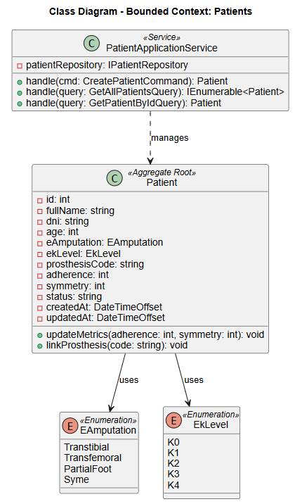

#### Prescriptions
Modela la prescripción terapéutica por fases y el catálogo de rutinas domiciliarias. La raíz de agregado `Prescription` gestiona los parámetros de la fase de rehabilitación (`phaseNumber`, `phaseName`, `durationWeeks`, `frequencyPerWeek`) y contiene una colección de entidades hijas `PrescribedExercise`, las cuales encapsulan la dosificación específica (`sets`, `reps`, `restSeconds`) referenciando a la entidad catálogo `Exercise` (`id`, `name`, `focus`).

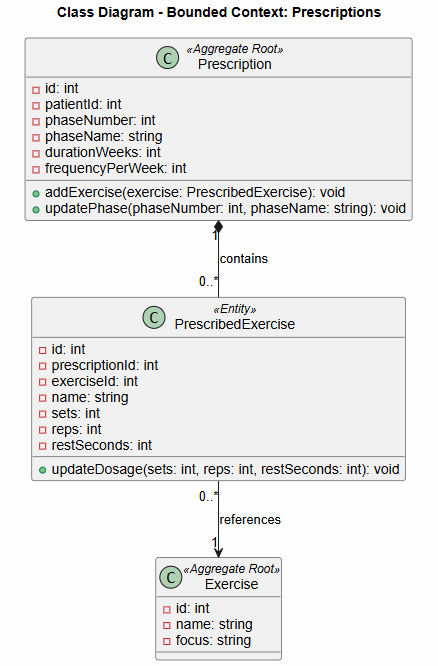

#### Monitoring
Modela el registro de sesiones de marcha, la evaluación de umbrales biomecánicos y la gestión de alertas clínicas. La raíz de agregado `GaitSession` almacena las métricas consolidadas de cada sesión (`recordedAt`, `durationMinutes`, `steps`, `cadence`, `symmetryPercent`, `alertsCount`, `impactPeakNewtons`). La raíz de agregado `ThresholdProfile` define los límites personalizados por paciente (`pelvicTilt`, `asymmetry`, `cadence`, `impactPeak`), mientras que `Alert` gestiona el ciclo de vida de los eventos críticos detectados (`deviationType`, `recordedValue`, `threshold`, `severity`, `status`, `occurredAt`, `resolvedAt`).

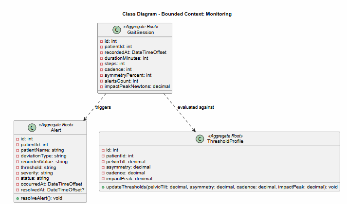

#### Analytics
Modela la generación y formalización de los informes clínicos de evolución del paciente. La raíz de agregado `ClinicalReport` consolida la información administrativa y médica de la evaluación (`reportCode`, `issueDate`, `clinicName`, `clinicUnit`, datos del paciente, `diagnosis`, `prosthesisCode`, `evaluationPeriod`, `summary`, `medicalRecommendation`), incorpora la identificación del profesional junto con el objeto de valor `TherapistRegistry` y mantiene una relación de composición con la entidad hija `ReportIndicator` (`name`, `value`, `normalRange`, `evaluation`, `status`) para desglosar cada métrica biomecánica evaluada.

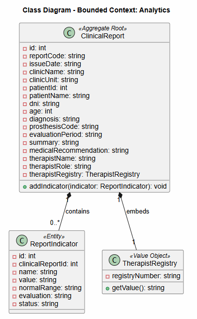

#### Workshop
Modela la gestión de la flota de prótesis, el calendario de mantenimiento y las alertas mecánicas de taller. La raíz de agregado `Prosthesis` controla las especificaciones técnicas del dispositivo (`serialNumber`, `type`, `kLevel`, `socketType`, `kneeType`, `footType`), su asignación (`patientName`, `clinicName`), telemetría de hardware (`batteryLevel`, `sensorStatus`) y desgaste (`accumulatedCycles`, `cycleLimit`, `lastService`, `status`). Por su parte, `MaintenanceSchedule` administra la programación de intervenciones técnicas (`scheduledDate`, `interventionType`, `technicianName`, `status`, `notes`) y `MechanicalAlerts` registra los avisos por fatiga o límite de ciclos por componente.

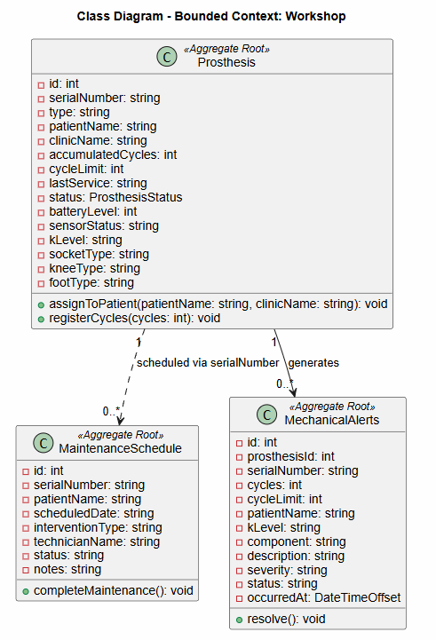

#### Communication
Modela la coordinación interinstitucional con talleres ortopédicos y la mensajería clínica directa. La raíz de agregado `ClinicalTransmission` gestiona el envío de fichas técnicas y módulos compartidos hacia los centros ortopédicos (`patientId`, `patientName`, `patientDni`, `workshopName`, `sharedModules`, `technicalNotes`, `status`, `statusLabel`, `summary`, `createdAtDate`). Adicionalmente, `ClinicalMessage` soporta el canal de comunicación bidireccional entre terapeutas, pacientes y notificaciones del sistema (`sender`, `senderName`, `senderRole`, `text`, `timestamp`, `isSystem`, `status`).

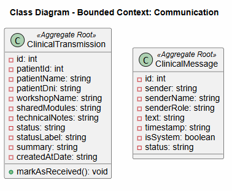

#### Módulos de Soporte (Billing)
* **Billing:** La raíz de agregado `ClinicSubscription` administra el plan institucional contratado por la clínica (`planName`, `status`, `planType`, `annualFee`, `monthlyEquivalent`, `startDate`, `renewalDate`, `usedQuota`, `totalQuota`) e integra como Owned Entity al objeto de valor `PaymentMethod` (`brand`, `cardTitle`, `expiry`, `autoRenew`). Asimismo, la entidad `ElectronicInvoice` gestiona los comprobantes de pago emitidos (`invoiceNumber`, `issueDate`, `concept`, `amount`, `currency`, `status`, `statusLabel`, `downloadUrl`).

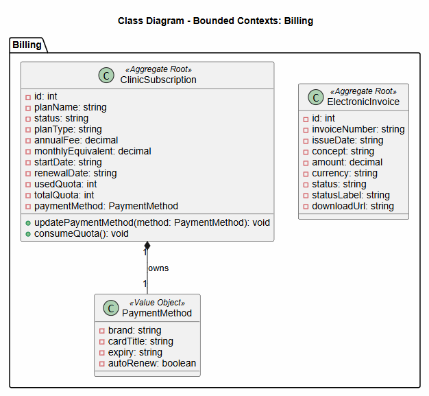

#### Identity & Access Management (IAM)
Modela la gestión de identidades, credenciales de acceso, control de roles (RBAC) y auditoría de sesiones para los tres perfiles de la plataforma (Paciente, Clínica y Taller Ortopédico). La raíz de agregado `User` encapsula las credenciales (`username`, `email`, `passwordHash`), el rol asignado mediante la enumeración `ERole`, el estado de la cuenta (`isActive`) y extiende la clase de trazabilidad temporal `UserAudit` (`createdAt`, `updatedAt`). Asimismo, los servicios de dominio e infraestructura `ITokenService` y `IHashingService` soportan la emisión/validación de tokens JWT y el cifrado seguro de contraseñas.

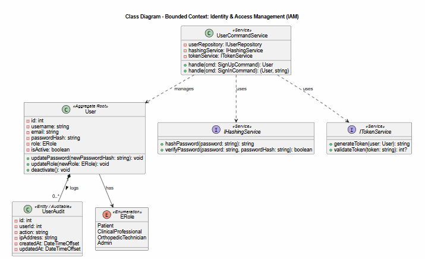

### 4.8. Database Design
El diseño de base de datos utiliza PostgreSQL como DBMS relacional y conserva la separación lógica establecida por los Bounded Contexts implementados en el backend bajo los principios de Domain-Driven Design (DDD) y Entity Framework Core. Se utiliza `lowercase_snake_case` para el mapeo de tablas y columnas, claves primarias enteras autoincrementales (`INT` / `SERIAL`) para los identificadores de entidades, `TIMESTAMPTZ` (`DateTimeOffset`) y cadenas formateadas (`VARCHAR`) para el registro de fechas e instantes temporales, y tipos numéricos (`INT` y `DECIMAL`) para los indicadores biomecánicos, conteo de ciclos y montos de facturación

## 4.8.1. Database Diagrams

**Diagrama del modelo de base de datos relacional**
Representa la estructura relacional de Prothia Platform en MySQL, mostrando las tablas implementadas en cada Bounded Context y la trazabilidad de referencias entre pacientes, planes de prescripción, sesiones de marcha, alertas biomecánicas, reportes clínicos con sus indicadores, flota de prótesis, transmisiones técnicas y facturación institucional

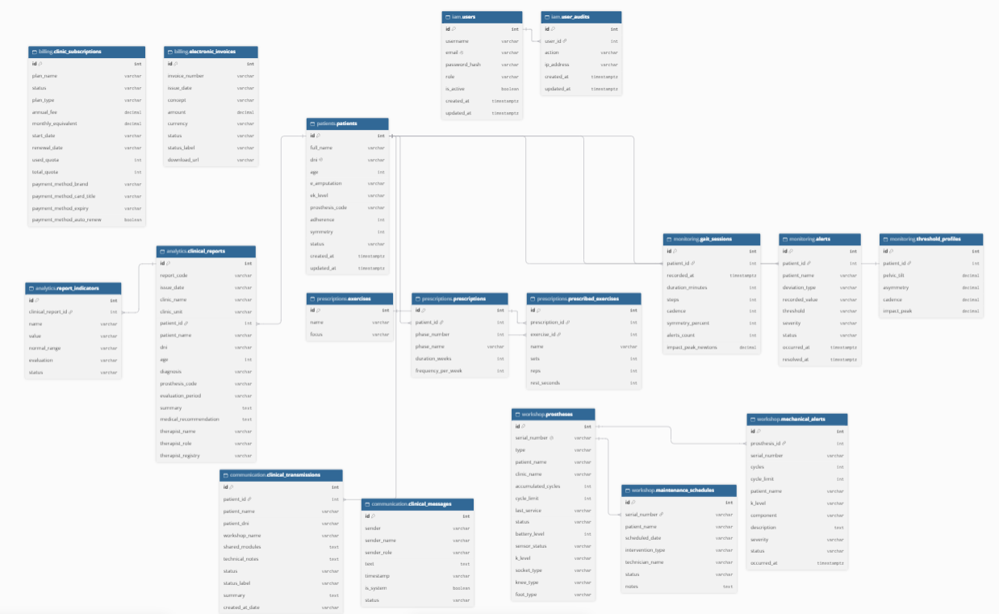

**Esquemas de Persistencia por Bounded Context**
* **Patients (`patients`):** Persiste los datos clínicos, demográficos y de evolución general de los pacientes amputados mediante la tabla `patients`, incluyendo su DNI único, edad (`age`), nivel de amputación (`e_amputation`), nivel funcional K (`ek_level`), código de prótesis vinculada (`prosthesis_code`), porcentajes consolidados de adherencia y simetría (`adherence`, `symmetry`), estado clínico (`status`) y marcas de auditoría temporal (`created_at`, `updated_at`).

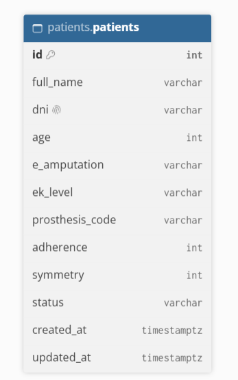

* **Prescriptions (`prescriptions`):** Persiste los planes de prescripción terapéutica por fases en la tabla `prescriptions` (`phase_number`, `phase_name`, `duration_weeks`, `frequency_per_week`), el detalle de ejercicios dosificados en `prescribed_exercises` (`sets`, `reps`, `rest_seconds`) y el catálogo base de ejercicios terapéuticos en la tabla `exercises` (`name`, `focus`).

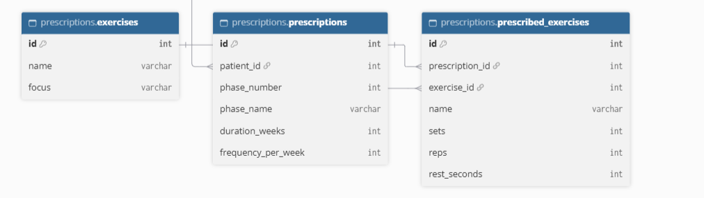

* **Monitoring (`monitoring`):** Persiste las sesiones de marcha domiciliaria en `gait_sessions` (registrando duración en minutos, pasos totales, cadencia, porcentaje de simetría, conteo de alertas y pico de impacto en Newtons), las alertas clínicas emitidas por desviaciones biomecánicas en `alerts` (`deviation_type`, `recorded_value`, `threshold`, `severity`, `status`) y los perfiles de umbrales biomecánicos calibrados por paciente en `threshold_profiles` (`pelvic_tilt`, `asymmetry`, `cadence`, `impact_peak`).

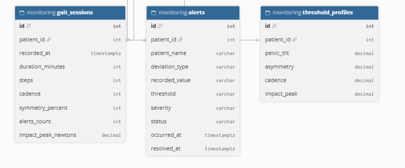

* **Analytics (`analytics`):** Persiste los informes clínicos de evolución en la tabla `clinical_reports` (incluyendo código de reporte, datos de la clínica y del paciente, diagnóstico, periodo de evaluación, resumen, recomendación médica y el registro de colegiatura del terapeuta mediante el objeto de valor `therapist_registry`), junto con la tabla hija `report_indicators`, que almacena las métricas evaluadas, su rango normal y su estado de cumplimiento.

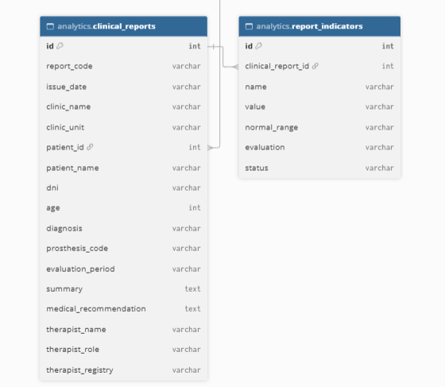

* **Workshop (`workshop`):** Persiste la flota de prótesis en la tabla `prostheses` (controlando número de serie único, tipo, paciente y clínica asignados, ciclos acumulados frente al límite de fatiga, nivel de batería, estado del sensor y especificaciones de encaje, rodilla y pie), la programación de mantenimientos preventivos y correctivos en `maintenance_schedules`, y los avisos por desgaste o fatiga de componentes en `mechanical_alerts`.

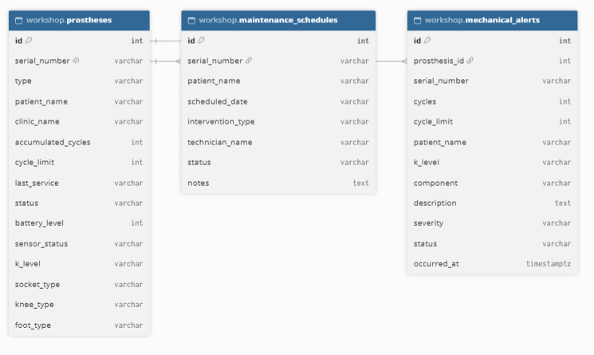

* **Communication (`communication`):** Persiste las transmisiones de fichas e información clínica hacia talleres ortopédicos en `clinical_transmissions` (registrando los módulos compartidos, notas técnicas, resumen y estado de envío), así como el historial de mensajería bidireccional de interconsulta entre profesionales y pacientes en `clinical_messages`.

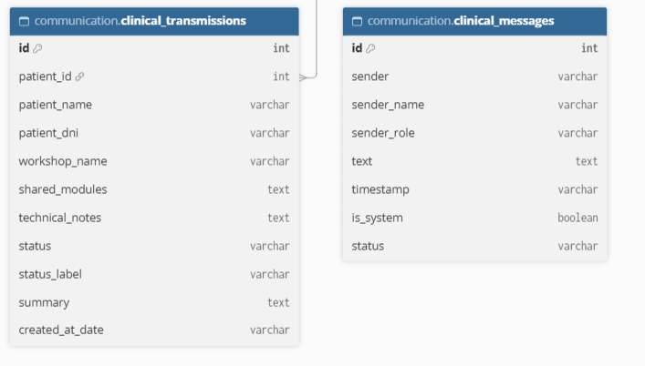

* **Billing (`billing`):** Persiste las suscripciones institucionales de las clínicas en `clinic_subscriptions` (incluyendo tarifas, fechas de vigencia, control de cupos utilizados frente al total contratado y los datos del método de pago embebidos mediante el Owned Type `PaymentMethod`), además de los comprobantes emitidos en la tabla `electronic_invoices`.

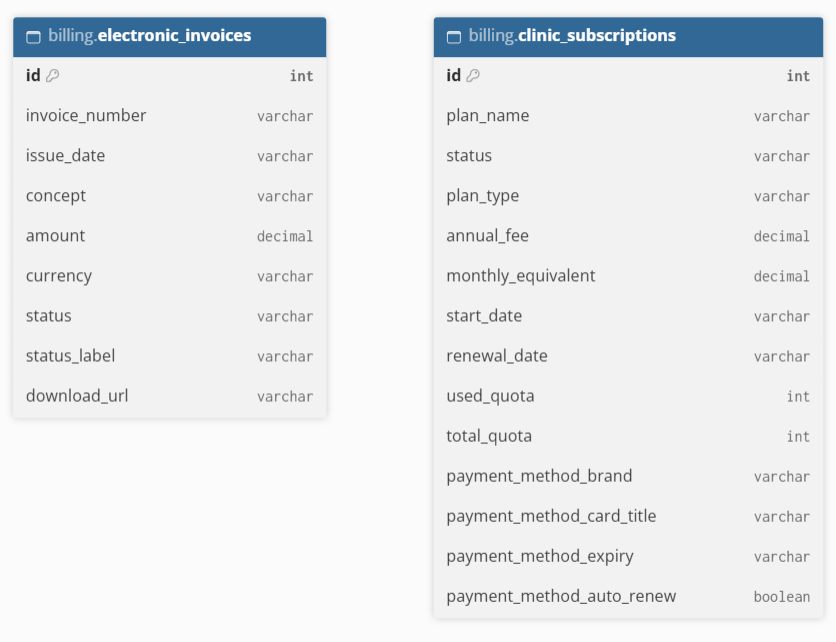

* **Identity & Access Management (`iam`):** Persiste las cuentas de usuario y sus credenciales en la tabla `users` (incluyendo `username`, `email` único, `password_hash`, `role` de acceso diferenciado, estado `is_active` y marcas temporales `created_at` y `updated_at`), además del registro de trazabilidad de accesos y seguridad en la tabla `user_audits` (`user_id`, `action`, `ip_address`, `created_at`, `updated_at`).

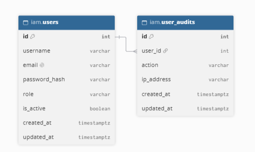
