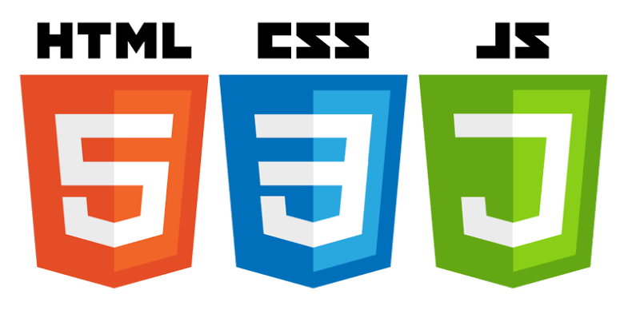
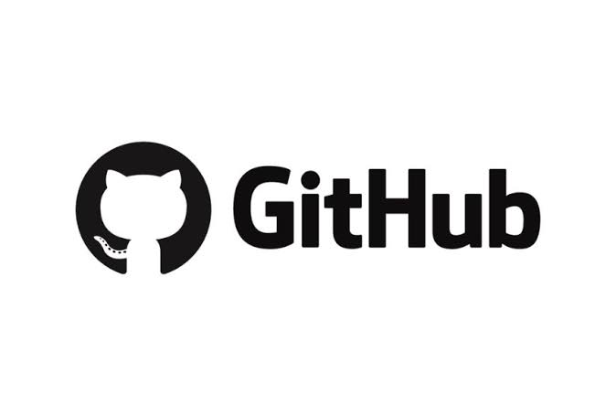
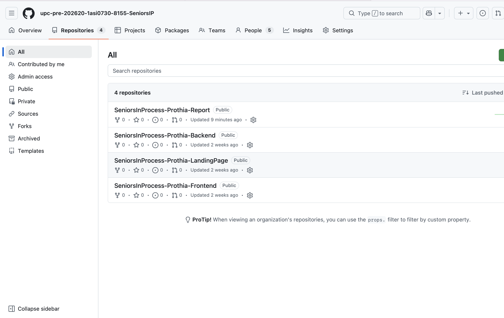
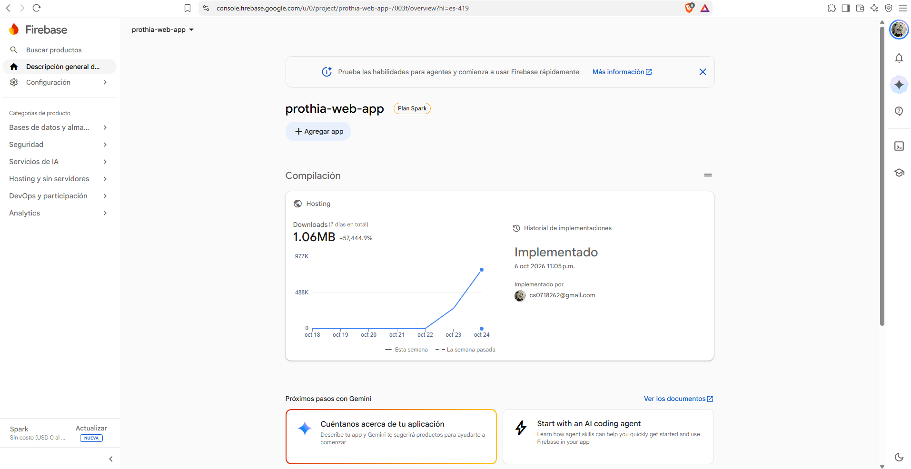
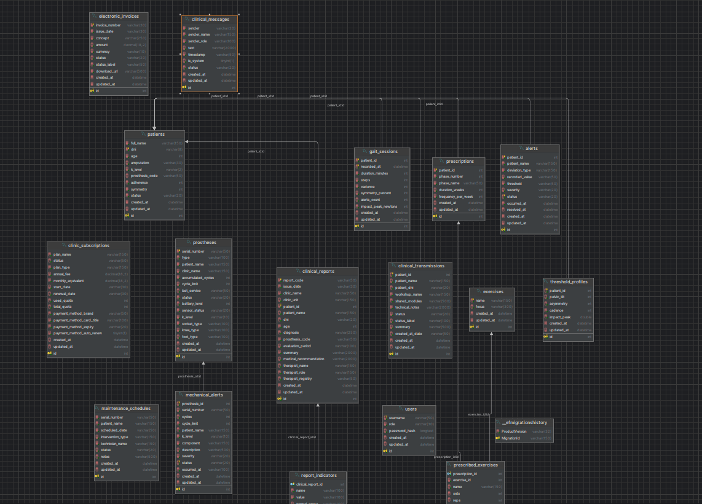
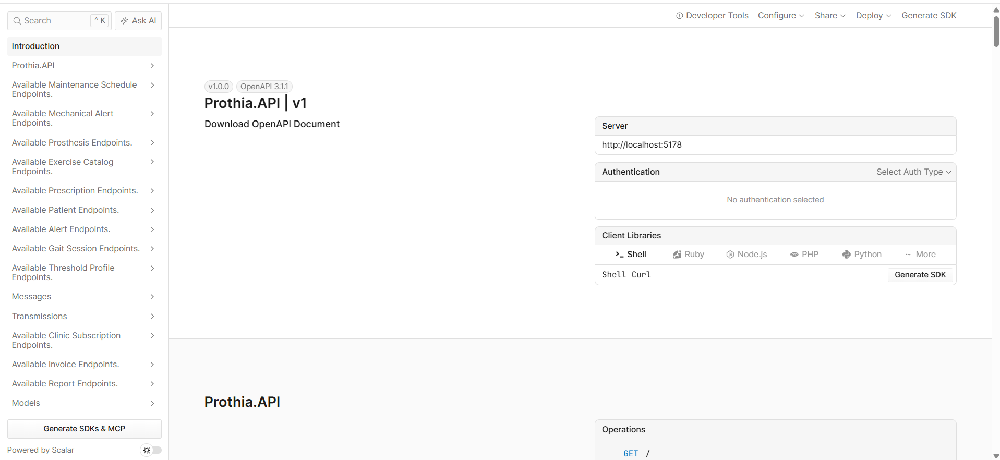

# Capítulo V: Product Implementation, Validation & Deployment

## 5.1 Software Configuration Management

La gestión en **SeniorsInProcess (Prothia)** incluye el código fuente, documentación, prototipos y configuraciones del entorno de desarrollo de la plataforma web de monitoreo y seguimiento de rehabilitación de pacientes amputados. El proyecto contempla distintos productos digitales, incluyendo una Landing Page institucional, una aplicación web para clínicas de rehabilitación y centros ortopédicos, y servicios backend orientados al procesamiento de datos biomecánicos y de uso de prótesis en tiempo real. El equipo adopta prácticas basadas en GitFlow, Conventional Commits y Semantic Versioning, asegurando un flujo de trabajo colaborativo y organizado.

### 5.1.1. Software Development Environment Configuration

| Categoría / Actividad | Nombre del Producto                                                                 | Propósito de Uso en el Proyecto                                                                                                                                                                     | Tipo / Plataforma | Ruta de Referencia / Descarga               |
|---|-------------------------------------------------------------------------------------|-----------------------------------------------------------------------------------------------------------------------------------------------------------------------------------------------------|---|---------------------------------------------|
| Project Management |       | Gestión e itinerario de tareas del proyecto mediante tableros organizados por estados (To-Do, In Progress, Done), clave para el seguimiento de entregables como el reporte y la landing page.       | SaaS | https://trello.com                          |
| Team Communication |      | Plataforma principal de comunicación remota para la realización de reuniones de equipo sincrónicas, planificación de Sprints y coordinación general.                                                | SaaS / Desktop | https://discord.com/                        |
| Requirements Management |         | Estructuración de ideas, diagramación de flujos de sistema, análisis del negocio y ejecución de la sesión de Event Storming para el ecosistema IoT.                                                 | SaaS | https://miro.com                            |
| Requirements Management |  | Modelado de la arquitectura de software del sistema DomotiCore bajo el modelo C4, representando los componentes clave (dashboard, gateway, nodos IoT y servicios de monitoreo).                     | SaaS / Desktop | https://structurizr.com                     |
| Product UX/UI Design |        | Diseño visual y prototipado interactivo de las interfaces del sistema, incluyendo el dashboard centralizado, paneles de control de dispositivos y visualización de consumo energético.              | SaaS / Desktop | https://www.figma.com                       |
| Product UX/UI Design |   | Elaboración de diagramas de flujo de trabajo, arquitectura técnica y diseño de procesos operativos del sistema.                                                                                     | SaaS | https://www.lucidchart.com                  |
| Software Development |         | Lenguajes y estándares base utilizados para el desarrollo del frontend web, las interfaces de usuario y la Landing Page del producto.                                                               | Lenguajes / Estándares | https://developer.mozilla.org/es/docs/Web   |
| Software Development |     | Entorno de desarrollo integrado (IDE) principal utilizado para la programación, edición y depuración del código fuente del frontend.                                                                | Desktop | https://www.jetbrains.com/webstorm/download |
| Software Development |        | Entorno de desarrollo integrado (IDE) principal utilizado para la programación, edición y depuración del código fuente del backend.                                                                 | Desktop | https://www.jetbrains.com/rider/download    |
| Software Testing |      | Lenguaje de especificación para definir escenarios de prueba BDD (Behavior-Driven Development) basados en historias de usuario (control remoto, automatizaciones por horario y alertas de consumo). | Estándar / DSL | https://cucumber.io/docs/gherkin/reference  |
| Software Documentation |       | Repositorio central del proyecto para el control de versiones distribuido, registro de commits, trabajo colaborativo y alojamiento de la documentación del sistema.                                 | SaaS | https://github.com                          |
| Software Deployment |     | Servicio de alojamiento y despliegue continuo para la Landing Page pública del producto, permitiendo exponer la propuesta de valor de DomotiCore.                                                   | SaaS | https://pages.github.com                    |

### 5.1.2 Source Code Management

La gestión de código fuente del proyecto **Prothia (SeniorsInProcess)** se realiza mediante la plataforma **GitHub**, permitiendo un control de versiones en entorno de trabajo colaborativo. Se han definido repositorios independientes para cada producto digital.

#### 5.1.2.1 Repositories

| Product | Repository URL | Description |
| :--- | :--- | :--- |
| **Organization** | [SeniorsInProcess-Prothia-1ASI0729](https://github.com/SeniorsInProcess-Prothia-1ASI0729) --- [https://github.com/SeniorsInProcess-Prothia-1ASI0729] --- | Organización donde se ubican todos los repositorios del proyecto. |
| **Landing Page** | [Prothia-Business-Web-Page](https://github.com/upc-pre-202620-1asi0730-8155-SeniorsIP/SeniorsInProcess-Prothia-LandingPage) --- [https://github.com/upc-pre-202620-1asi0730-8155-SeniorsIP/SeniorsInProcess-Prothia-LandingPage] --- | Repositorio de la Landing Page institucional del proyecto. |
| **Frontend Web Application** | [Prothia-Front-End](https://github.com/upc-pre-202620-1asi0730-8155-SeniorsIP/SeniorsInProcess-Prothia-Frontend) --- [https://github.com/upc-pre-202620-1asi0730-8155-SeniorsIP/SeniorsInProcess-Prothia-Frontend] --- | Aplicación web para el monitoreo y seguimiento de la rehabilitación de pacientes amputados. |
| **Backend Web Services** | [Prothia-Back-end](https://github.com/upc-pre-202620-1asi0730-8155-SeniorsIP/SeniorsInProcess-Prothia-Backend) --- [https://github.com/upc-pre-202620-1asi0730-8155-SeniorsIP/SeniorsInProcess-Prothia-Backend] --- | API REST y lógica de procesamiento de datos biomecánicos y de uso de prótesis. |
| **Documentation Repository** | [Prothia-Report](https://github.com/upc-pre-202620-1asi0730-8155-SeniorsIP/SeniorsInProcess-Prothia-Report/tree/develop) --- [https://github.com/upc-pre-202620-1asi0730-8155-SeniorsIP/SeniorsInProcess-Prothia-Report/tree/develop] --- | Documentación técnica, reportes y entregables del proyecto. |
---
<div style="text-align:center;"></div>

#### 5.1.2.2 GitFlow Workflow

El equipo adopta **GitFlow** como estrategia de branching para mantener la estabilidad.

* **Main Branch**: Contiene únicamente versiones estables y aprobadas del proyecto listas para producción.
    * `main`
* **Develop Branch**: Rama principal de integración donde se consolidan las funcionalidades desarrolladas antes de integrarse en producción.
    * `develop`
* **Feature Branches**: Cada nueva funcionalidad se desarrolla en una rama independiente para evitar conflictos en el código base.
    * **Naming Convention**: `feature/<feature-name>`
    * **Examples**: `feature/patient-monitoring-dashboard`, `feature/biomechanical-data-tracking`
* **Hotfix Branches**: Ramas de emergencia para corregir errores críticos detectados directamente en producción.
    * **Naming Convention**: `hotfix/<issue-description>`

#### 5.1.2.3 Semantic Versioning

El proyecto utiliza **Semantic Versioning 2.0.0** para controlar las versiones de los productos digitales de Prothia.

| Version | Description |
| :--- | :--- |
| **v1.0.0** | Primera versión estable y funcional del producto. |
| **v1.1.0** | Incorporación de nuevas funcionalidades menores. |
| **v1.1.1** | Corrección de errores menores. |
| **v2.0.0** | Cambios mayores que incluyen modificaciones estructurales incompatibles. |

#### 5.1.2.4 Conventional Commits

Se adopta el estándar de **Conventional Commits** para mantener un historial de cambios limpio y fácil de verificar por el equipo.

| Prefix | Purpose |
| :--- | :--- |
| **feat** | Implementación de nuevas funcionalidades. |
| **fix** | Corrección de errores o bugs. |
| **docs** | Actualizaciones en la documentación del repositorio. |
| **style** | Cambios que no afectan la lógica (espaciados, formatos, CSS). |
| **refactor** | Reestructuración del código existente sin cambiar su funcionalidad. |
| **test** | Corrección de pruebas unitarias o de integración. |

**Examples:**
* `feat: implement patient rehabilitation dashboard`
* `docs: update sprint 1 documentation`
* `fix: correct biomechanical data sync error`
* `style: improve clinic panel spacing`
### 5.1.3. Source Code Style Guide & Conventions.

El uso de un estilo de código unificado y una arquitectura bien definida es clave para asegurar la escalabilidad, la mantenibilidad y la colaboración efectiva en el desarrollo de **Prothia**. Para ello, el proyecto incorpora prácticas de programación y convenciones estructurales que promueven la calidad técnica, la claridad y la consistencia en cada módulo de la plataforma, tomando como referencia estándares reconocidos de la industria y metodologías actuales.

#### Arquitectura y organización del sistema

Prothia adopta el modelo C4 de Simon Brown, lo que permite visualizar el sistema en distintos niveles de abstracción (contexto, contenedor, componente y código). Este enfoque ofrece una representación clara y comprensible, facilitando la comunicación entre desarrolladores, diseñadores y testers. Además, la arquitectura se fundamenta en los principios de Domain-Driven Design (DDD) y Clean Architecture, lo que garantiza una separación rigurosa entre capas (presentación, aplicación, dominio e infraestructura). Gracias a ello, se reduce el acoplamiento, se incrementa la mantenibilidad y se fortalece la capacidad de realizar pruebas automatizadas de manera eficiente.

#### Frontend: Vue.js

En el frontend, se emplea Vue.js como framework principal, implementando una arquitectura centrada en componentes reutilizables, organizados en directorios específicos como components, views y store. La convención de nombres establece el uso de PascalCase para los componentes (por ejemplo, PatientCard.vue) y kebab-case para los archivos (patient-card.vue), en concordancia con las recomendaciones de la comunidad Vue. Asimismo, se aplican buenas prácticas de desarrollo, entre ellas:

* Separación de lógica y presentación mediante el patrón container/presentational components.
* Uso de props y emits para la comunicación clara entre componentes.
* Implementación de lazy loading y code splitting para optimizar el rendimiento.
* Internacionalización con vue-i18n, gestionando archivos JSON para cada idioma.

#### Alineación con guías de estilo estándar

La estructura y nomenclatura utilizadas en Prothia siguen convenciones reconocidas como la Vue Style Guide y lineamientos generales de HTML/CSS. Además, el uso del inglés en identificadores, clases y funciones garantiza coherencia en el trabajo colaborativo, simplifica la integración con librerías externas y favorece la comprensión del código por parte de equipos internacionales.

### 5.1.4. Software Deployment Configuration

Esta sección describe la arquitectura de despliegue, la infraestructura cloud y los procedimientos operativos necesarios para publicar y mantener en producción los tres componentes de software que conforman la solución tecnológica de **Prothia**: la **Web service**, la **Web Application** y los **Backend**. Cada componente ha sido aprovisionado sobre plataformas cloud optimizadas para su arquitectura técnica y modelo operativo.

| Producto / Componente | Repositorio GitHub | URL Pública de Producción | Rama | Plataforma de Despliegue | Stack Tecnológico |
| :--- | :--- | :--- | :---: | :--- | :--- |
| **Web services** | [SeniorsInProcess-Prothia-LandingPage](https://github.com/upc-pre-202620-1asi0730-8155-SeniorsIP/SeniorsInProcess-Prothia-LandingPage) | <https://upc-pre-202620-1asi0730-8155-seniorsip.github.io/SeniorsInProcess-Prothia-LandingPage/> | `main` | **GitHub Pages** | HTML5, CSS3, JavaScript, i18n |
| **Web Application** | [SeniorsInProcess-Prothia-Frontend](https://github.com/upc-pre-202620-1asi0730-8155-SeniorsIP/SeniorsInProcess-Prothia-Frontend) | <https://prothia-web-app-7003f.web.app/> | `main` | **Firebase Hosting** | Vue 3, Vite, PrimeVue, Pinia, Vue Router, Axios, vue-i18n |
| **Backend** | [SeniorsInProcess-Prothia-Backend](https://github.com/upc-pre-202620-1asi0730-8155-SeniorsIP/SeniorsInProcess-Prothia-Backend) | <https://prothia-backend.onrender.com/> | `main` | **Render** & **MySQL Cloud** | ASP.NET Core (.NET 10), C#, EF Core, Scalar/OpenAPI, RFC 9457, JWT, MySQL |


#### 5.1.4.1. Web services Deployment Configuration 

La Web services de Prothia se encuentra alojada en **GitHub Pages**.

* **Repositorio:** <https://tinyurl.com/mr2nw5yx>
* **URL publicada:** <https://tinyurl.com/mpu69fp3>
* **Rama de producción:** `main`
* **Stack:** HTML5 + CSS3 + JavaScript (Vanilla) + i18n
* **Plataforma de despliegue:** GitHub Pages

##### Pasos de despliegue

1. Confirmar que la rama `main` contiene la versión estable de la Landing Page y que `index.html` se encuentra en la raíz del repositorio.
2. En el repositorio de GitHub, navegar a **Settings → Pages**.
3. En la sección **Build and deployment**, configurar:
   * **Source:** Deploy from a branch
   * **Branch:** `main`
   * **Folder:** `/ (root)`
4. Hacer clic en **Save**. GitHub Pages generará automáticamente la URL pública bajo el dominio de la organización.
5. Esperar entre 1 y 2 minutos para que el runner de GitHub Actions complete el pipeline de publicación.
6. Verificar que la página cargue correctamente en: `https://upc-pre-202620-1asi0730-8155-seniorsip.github.io/SeniorsInProcess-Prothia-LandingPage/`.
7. Comprobar que el diseño responda adecuadamente en desktop (≥ 1025px), tablet (769–1024px) y móvil (≤ 768px).
8. Verificar que el toggle de idioma (EN | ES) conmute los contenidos dinámicamente en todos los breakpoints.

##### Actualizaciones posteriores y CI/CD

Cada `git push` a la rama `main` desencadena la ejecución automática del workflow de GitHub Pages, publicando los cambios sin requerir intervención manual:

```bash
# Flujo estándar para publicar cambios en Landing Page
git add .
git commit -m "feat: update value proposition copy and team profiles"
git push origin main
```

##### Verificación post-despliegue

| Verificación | Detalle |
| :--- | :--- |
| **Carga de assets** | Logotipos, diagramas y fotos de testimonios visibles con compresión optimizada. |
| **Navegación interna** | Enlaces del navbar redirigen a las secciones correspondientes (`#features`, `#plans`, `#audience`, `#demo`). |
| **Toggle de idioma** | Conmutación instantánea entre EN y ES mediante atributos `data-i18n`. |
| **Menú móvil** | Despliegue correcto del menú hamburguesa en pantallas móviles y ocultamiento en desktop. |
| **Diseño Responsive** | Visualización fluida sin scroll horizontal en breakpoints de 320px hasta 1920px. |

---

#### 5.1.4.2. Web Application Deployment Configuration 

La aplicación web de Prothia (`Prothia-Frontend`), diseñada bajo la arquitectura Single Page Application (SPA) con **Vue 3** y **PrimeVue**, está desplegada en **Firebase Hosting** (Google Cloud Platform).

* **Repositorio:** https://github.com/upc-pre-202620-1asi0730-8155-SeniorsIP/SeniorsInProcess-Prothia-Frontend
* **URL publicada:** https://prothia-web-app-7003f.web.app/
* **Rama de producción:** `main`
* **Stack tecnológico:** Vue.js 3 (Composition API), Vite, PrimeVue (Material Design Theme), Pinia, Vue Router, Axios, vue-i18n
* **Plataforma de despliegue:** Firebase Hosting
* **ID del Proyecto Firebase:** `prothia-web-app-7003f`

##### Prerrequisitos de entorno

* **Node.js:** Versión LTS 18.x o 20.x y gestor de paquetes **npm**.
* **Firebase CLI:** Instalado globalmente en el equipo de desarrollo (`npm install`).
* **Cuenta con permisos:** Acceso de administrador/desarrollador en Firebase Console al proyecto `prothia-web-app-7003f`.

##### Archivos clave de configuración

1. **`firebase.json`**: Define el directorio público donde se compila la SPA (`dist`), reglas de exclusión y la regla crítica de reescritura (`rewrites`) para redirigir todas las rutas al `index.html`, evitando errores 404 al recargar el navegador en rutas profundas.

2. **`.firebaserc`**: Mapea el alias por defecto del entorno de despliegue al identificador único del proyecto en Google Firebase.

3. **`.env.production`**: Inyecta la URL base del backend RESTful desplegado en Render para que el cliente Axios dirija las peticiones al servidor en producción en lugar del entorno local:


##### Procedimiento de despliegue paso a paso

1. **Sincronización del código:** Asegurar que la rama `main` contiene el código fuente integrado y probado desde `develop`.
   ```bash
   git checkout main
   git pull origin main
   ```
2. **Instalación limpia de dependencias:** Restaurar los paquetes npm según el archivo de bloqueo `package-lock.json`:
   ```bash
   npm install
   ```
3. **Verificación de variables de entorno:** Confirmar que el archivo `.env.production` apunte a la API de Render (`https://prothia-backend.onrender.com/api/v1`).
4. **Compilación y empaquetado para producción:** Ejecutar el bundler Vite para generar los artefactos minificados y optimizados en la carpeta `dist/`:
   ```bash
   npm run build
   ```
5. **Autenticación en Firebase:** Iniciar sesión en la CLI de Firebase mediante OAuth 2.0:
   ```bash
   firebase login
   ```
6. **Selección del proyecto:** Vincular el espacio de trabajo local al proyecto activo:
   ```bash
   firebase use prothia-web-app-7003f
   ```
7. **Ejecución del despliegue:** Publicar únicamente los recursos del servicio de hosting:
   ```bash
   firebase deploy --only hosting
   ```
8. **Confirmación en consola:** Comprobar que Firebase retorne el mensaje `Deploy complete!` junto con la URL pública: `https://prothia-web-app-7003f.web.app/`.

##### Actualizaciones posteriores y automatización

Para propagar nuevas funcionalidades o correcciones al entorno de producción, se ejecuta el ciclo de build y deploy:

```bash
npm run build
firebase deploy --only hosting -m "deploy: release frontend v1.x with integrated backend"
```

##### Verificación post-despliegue

| Verificación | Detalle |
| :--- | :--- |
| **Resolución de SPA Routing** | Navegación directa y recarga (F5) en rutas profundas (`/patient/my-day`, `/clinic/monitoring`, `/workshop/fleet`, `/billing`) sin provocar error 404. |
| **Conectividad con Backend REST** | Consumo exitoso de los endpoints en `https://prothia-backend.onrender.com/api/v1` sin bloqueos de Cross-Origin Resource Sharing (CORS). |
| **Autenticación y Sesiones** | Almacenamiento seguro del token JWT en el cliente y persistencia del estado de usuario autenticado mediante Pinia. |
| **Internacionalización (i18n)** | Conmutación dinámica de etiquetas y mensajes entre español e inglés gestionados por `vue-i18n`. |
| **Estilos y Componentes PrimeVue** | Correcta visualización de tablas de datos, modales de alerta, tarjetas biomecánicas y gráficos de telemetría. |



---

#### 5.1.4.3. Backend Deployment Configuration 

El backend de Prothia (`Prothia-Backend`) implementa una arquitectura RESTful desarrollada en **ASP.NET Core (.NET 10)** bajo los principios de Domain-Driven Design (DDD) y Clean Architecture, organizado en 8 Bounded Contexts. Los servicios web se encuentran desplegados en **Render** como un Web Service administrado, conectado a una base de datos relacional **MySQL** alojada en la nube y administrada mediante **MySQL Workbench**. La API expone su documentación interactiva mediante **Scalar / OpenAPI** y estandariza los errores bajo la especificación **RFC 9457 (`ProblemDetails`)**.

* **Repositorio:** https://github.com/upc-pre-202620-1asi0730-8155-SeniorsIP/SeniorsInProcess-Prothia-Backend
* **URL de Documentación Interactiva (Scalar / OpenAPI):** <https://prothia-backend.onrender.com/>
* **URL Base de la API RESTful:** https://prothia-backend.onrender.com/api/v1
* **Rama de producción:** `main`
* **Stack tecnológico:** ASP.NET Core (.NET 10 / C#), Entity Framework Core, Pomelo.EntityFrameworkCore.MySql, Scalar OpenAPI (`Scalar.AspNetCore`), RFC 9457 `ProblemDetails`, JWT Bearer Authentication, BCrypt.Net
* **Motor de Base de Datos:** MySQL Server 
* **Plataforma de despliegue:** Render (Web Service con auto-deploy y TLS gestionado)

##### Prerrequisitos de entorno

* **.NET SDK:** Versión 10.0 (o .NET 8 LTS compatible) instalado en los puestos de desarrollo.
* **Instancia Cloud de MySQL:** Servidor MySQL aprovisionado en la nube con acceso remoto habilitado, credenciales seguras y puerto 3306 expuesto.
* **MySQL Workbench:** Cliente gráfico para modelado, ejecución de scripts DDL/DML y verificación de integridad referencial.
* **Cuenta en Render:** Vinculada a la organización de GitHub `upc-pre-202620-1asi0730-8155-SeniorsIP`.

##### Variables de entorno en Render

Para resguardar credenciales sensibles y separar configuraciones de entorno, Render inyecta las siguientes variables en el entorno de ejecución:

| Variable de Entorno | Valor / Descripción | Propósito |
| :--- | :--- | :--- |
| `ASPNETCORE_ENVIRONMENT` | `Production` | Activa el perfil de producción en ASP.NET Core, deshabilitando el middleware de desarrollo. |
| `ConnectionStrings__DefaultConnection` | `Server=<host>;Port=3306;Database=prothia_db;Uid=<user>;Pwd=<password>;SslMode=Preferred;` | Cadena de conexión hacia la instancia remota de MySQL para Entity Framework Core. |
| `Jwt__SecretKey` | `<clave-secreta-criptográfica-de-alta-entropía>` | Clave simétrica utilizada por el módulo IAM para la firma y validación de tokens JWT. |
| `Jwt__Issuer` | `https://prothia-backend.onrender.com` | Emisor oficial registrado en las aserciones de autenticación. |
| `Jwt__Audience` | `https://prothia-web-app-7003f.web.app` | Audiencia destinataria autorizada para consumir los tokens generados. |
| `Cors__AllowedOrigins` | `https://prothia-web-app-7003f.web.app,https://upc-pre-202620-1asi0730-8155-seniorsip.github.io` | Dominios web permitidos en las cabeceras `Access-Control-Allow-Origin`. |

##### Procedimiento de despliegue paso a paso

1. **Aprovisionamiento de la Base de Datos MySQL:**
   * Crear la base de datos `prothia_db` en el proveedor cloud de base de datos MySQL.
   * Configurar el usuario de aplicación con permisos `SELECT`, `INSERT`, `UPDATE`, `DELETE`, `CREATE`, `ALTER`, `INDEX` y `REFERENCES`.
   * Verificar la conectividad remota mediante MySQL Workbench probando la cadena de conexión y revisando el estado del servidor.

2. **Creación del Web Service en Render:**
   * Iniciar sesión en el portal de Render (<https://dashboard.render.com/>).
   * Hacer clic en **New + → Web Service**.
   * Conectar el repositorio de GitHub `SeniorsInProcess-Prothia-Backend` y seleccionar la rama `main`.
   * Establecer los siguientes parámetros de compilación y ejecución:
     * **Name:** `prothia-backend`
     * **Region:** Oregon (US West) / Ohio (US East)
     * **Branch:** `main`
     * **Runtime:** .NET
     * **Build Command:** `dotnet publish -c Release -o out`
     * **Start Command:** `dotnet out/Prothia.API.dll`

3. **Inyección de Variables Secretas en Render:**
   * En la pestaña **Environment** del Web Service en Render, agregar las variables `ASPNETCORE_ENVIRONMENT`, `ConnectionStrings__DefaultConnection`, `Jwt__SecretKey`, `Jwt__Issuer`, `Jwt__Audience` y `Cors__AllowedOrigins`.

4. **Aplicación de Migraciones de Base de Datos:**
   * Ejecutar la migración inicial de Entity Framework Core para generar el esquema de tablas en MySQL:
     ```bash
     dotnet ef database update --connection "Server=<host>;Port=3306;Database=prothia_db;Uid=<user>;Pwd=<password>;"
     ```
   * Opcionalmente, el backend cuenta con ejecución programática de `context.Database.Migrate()` en el pipeline de inicialización de `Program.cs`, asegurando la sincronización de tablas con convención `snake_case` pluralizada en cada arranque.

5. **Lanzamiento del Despliegue:**
   * Presionar **Create Web Service**. Render iniciará el proceso de compilación descargando los paquetes NuGet, construyendo la solución en modo Release y exponiendo el servicio bajo la URL HTTPS `https://prothia-backend.onrender.com/`.

##### Actualizaciones posteriores y Auto-Deploy

Render mantiene una integración continua (Auto-Deploy) activa sobre la rama `main`. Cualquier Pull Request fusionado en `main` desencadena automáticamente una nueva compilación y despliegue sin caída de servicio (zero-downtime deployment).

```bash
git checkout main
git merge develop
git push origin main

```

##### Verificación post-despliegue

| Verificación | Detalle |
| :--- | :--- |
| **Disponibilidad de Scalar / OpenAPI** | Carga interactiva de la documentación en `https://prothia-backend.onrender.com/` visualizando los 8 Bounded Contexts y 21 Technical Stories. |
| **Salud del Servicio y Endpoints** | Verificación de respuestas HTTP 200 OK en endpoints GET no autenticados y disponibilidad de `/api/v1`. |
| **Autenticación IAM y JWT** | Ejecución de prueba en `/api/v1/authentication/sign-up` y `/sign-in`, confirmando hash BCrypt en BD y emisión de token Bearer. |
| **Cabeceras de CORS** | Verificación de la cabecera `Access-Control-Allow-Origin: https://prothia-web-app-7003f.web.app` en las respuestas HTTP OPTIONS y GET/POST. |
| **Estandarización RFC 9457** | Envío de una petición con datos inválidos (p. ej. DNI duplicado) y confirmación de recepción de formato `ProblemDetails` (`application/problem+json`). |
| **Persistencia e Integridad en MySQL** | Inspección desde MySQL Workbench de las tablas creadas (`patients`, `gait_sessions`, `alerts`, `prescriptions`, `prostheses`, etc.) y registro efectivo de datos transaccionales. |



