# Capítulo V: Product Implementation, Validation & Deployment

## 5.1 Software Configuration Management

La gestión en **SeniorsInProcess (Prothia)** incluye el código fuente, documentación, prototipos y configuraciones del entorno de desarrollo de la plataforma web de monitoreo y seguimiento de rehabilitación de pacientes amputados. El proyecto contempla distintos productos digitales, incluyendo una Landing Page institucional, una aplicación web para clínicas de rehabilitación y centros ortopédicos, y servicios backend orientados al procesamiento de datos biomecánicos y de uso de prótesis en tiempo real. El equipo adopta prácticas basadas en GitFlow, Conventional Commits y Semantic Versioning, asegurando un flujo de trabajo colaborativo y organizado.

### 5.1.1. Software Development Environment Configuration

| Categoría / Actividad | Nombre del Producto | Propósito de Uso en el Proyecto | Tipo / Plataforma | Ruta de Referencia / Descarga |
|---|---|---|---|---|
| Project Management |  | Gestión e itinerario de tareas del proyecto mediante tableros organizados por estados (To-Do, In Progress, Done), clave para el seguimiento de entregables como el reporte y la landing page. | SaaS | https://trello.com |
| Team Communication |  | Plataforma principal de comunicación remota para la realización de reuniones de equipo sincrónicas, planificación de Sprints y coordinación general. | SaaS / Desktop | https://discord.com/ |
| Requirements Management |  | Estructuración de ideas, diagramación de flujos de sistema, análisis del negocio y ejecución de la sesión de Event Storming para el ecosistema IoT. | SaaS | https://miro.com |
| Requirements Management | 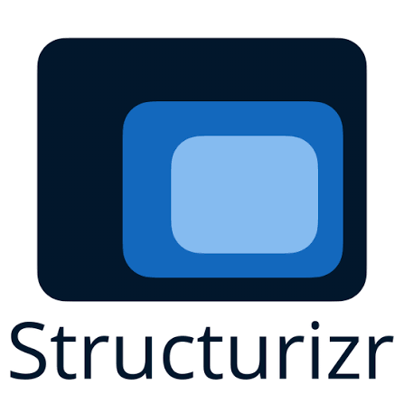 | Modelado de la arquitectura de software del sistema DomotiCore bajo el modelo C4, representando los componentes clave (dashboard, gateway, nodos IoT y servicios de monitoreo). | SaaS / Desktop | https://structurizr.com |
| Product UX/UI Design |  | Diseño visual y prototipado interactivo de las interfaces del sistema, incluyendo el dashboard centralizado, paneles de control de dispositivos y visualización de consumo energético. | SaaS / Desktop | https://www.figma.com |
| Product UX/UI Design |  | Elaboración de diagramas de flujo de trabajo, arquitectura técnica y diseño de procesos operativos del sistema. | SaaS | https://www.lucidchart.com |
| Software Development | 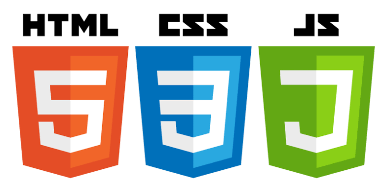 | Lenguajes y estándares base utilizados para el desarrollo del frontend web, las interfaces de usuario y la Landing Page del producto. | Lenguajes / Estándares | https://developer.mozilla.org/es/docs/Web |
| Software Development |  | Entorno de desarrollo integrado (IDE) principal utilizado para la programación, edición y depuración del código fuente del frontend. | Desktop | https://www.jetbrains.com/webstorm/download |
| Software Testing |  | Lenguaje de especificación para definir escenarios de prueba BDD (Behavior-Driven Development) basados en historias de usuario (control remoto, automatizaciones por horario y alertas de consumo). | Estándar / DSL | https://cucumber.io/docs/gherkin/reference |
| Software Documentation | 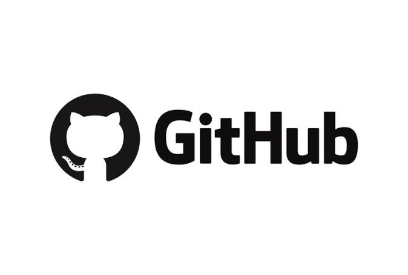 | Repositorio central del proyecto para el control de versiones distribuido, registro de commits, trabajo colaborativo y alojamiento de la documentación del sistema. | SaaS | https://github.com |
| Software Deployment |  | Servicio de alojamiento y despliegue continuo para la Landing Page pública del producto, permitiendo exponer la propuesta de valor de DomotiCore. | SaaS | https://pages.github.com |

### 5.1.2 Source Code Management

La gestión de código fuente del proyecto **Prothia (SeniorsInProcess)** se realiza mediante la plataforma **GitHub**, permitiendo un control de versiones en entorno de trabajo colaborativo. Se han definido repositorios independientes para cada producto digital.

#### 5.1.2.1 Repositories

| Product | Repository URL | Description |
| :--- | :--- | :--- |
| **Organization** | [SeniorsInProcess-Prothia-1ASI0729](https://github.com/SeniorsInProcess-Prothia-1ASI0729) --- [https://github.com/SeniorsInProcess-Prothia-1ASI0729] --- | Organización donde se ubican todos los repositorios del proyecto. |
| **Landing Page** | [Prothia-Business-Web-Page](https://github.com/upc-pre-202620-1asi0730-8155-SeniorsIP/SeniorsInProcess-Prothia-LandingPage) --- [https://github.com/upc-pre-202620-1asi0730-8155-SeniorsIP/SeniorsInProcess-Prothia-LandingPage] --- | Repositorio de la Landing Page institucional del proyecto. |
| **Frontend Web Application** | [Prothia-Front-End](https://github.com/upc-pre-202620-1asi0730-8155-SeniorsIP/SeniorsInProcess-Prothia-Frontend) --- [https://github.com/upc-pre-202620-1asi0730-8155-SeniorsIP/SeniorsInProcess-Prothia-Frontend] --- | Aplicación web para el monitoreo y seguimiento de la rehabilitación de pacientes amputados. |
| **Backend Web Services** | [Prothia-Back-end](https://github.com/upc-pre-202620-1asi0730-8155-SeniorsIP/SeniorsInProcess-Prothia-Backend) --- [https://github.com/upc-pre-202620-1asi0730-8155-SeniorsIP/SeniorsInProcess-Prothia-Backend] --- | API REST y lógica de procesamiento de datos biomecánicos y de uso de prótesis. |
| **Documentation Repository** | [Prothia-Report](https://github.com/upc-pre-202620-1asi0730-8155-SeniorsIP/SeniorsInProcess-Prothia-Report/tree/develop) --- [https://github.com/upc-pre-202620-1asi0730-8155-SeniorsIP/SeniorsInProcess-Prothia-Report/tree/develop] --- | Documentación técnica, reportes y entregables del proyecto. |
---

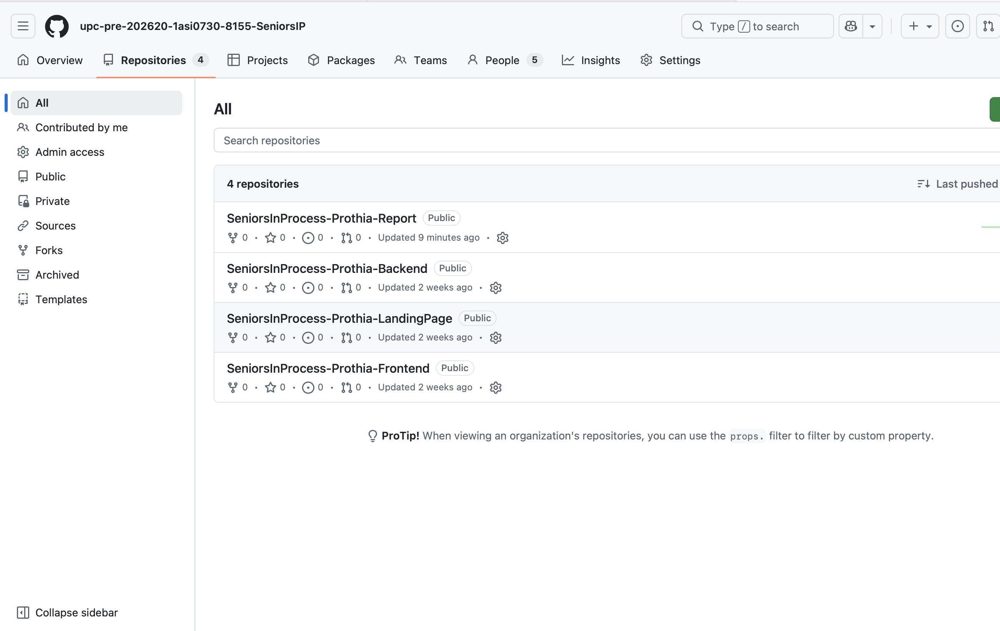

#### 5.1.2.2 GitFlow Workflow

El equipo adopta **GitFlow** como estrategia de branching para mantener la estabilidad.

* **Main Branch**: Contiene únicamente versiones estables y aprobadas del proyecto listas para producción.
    * `main`
* **Develop Branch**: Rama principal de integración donde se consolidan las funcionalidades desarrolladas antes de integrarse en producción.
    * `develop`
* **Feature Branches**: Cada nueva funcionalidad se desarrolla en una rama independiente para evitar conflictos en el código base.
    * **Naming Convention**: `feature/<feature-name>`
    * **Examples**: `feature/patient-monitoring-dashboard`, `feature/biomechanical-data-tracking`
* **Hotfix Branches**: Ramas de emergencia para corregir errores críticos detectados directamente en producción.
    * **Naming Convention**: `hotfix/<issue-description>`

#### 5.1.2.3 Semantic Versioning

El proyecto utiliza **Semantic Versioning 2.0.0** para controlar las versiones de los productos digitales de Prothia.

| Version | Description |
| :--- | :--- |
| **v1.0.0** | Primera versión estable y funcional del producto. |
| **v1.1.0** | Incorporación de nuevas funcionalidades menores. |
| **v1.1.1** | Corrección de errores menores. |
| **v2.0.0** | Cambios mayores que incluyen modificaciones estructurales incompatibles. |

#### 5.1.2.4 Conventional Commits

Se adopta el estándar de **Conventional Commits** para mantener un historial de cambios limpio y fácil de verificar por el equipo.

| Prefix | Purpose |
| :--- | :--- |
| **feat** | Implementación de nuevas funcionalidades. |
| **fix** | Corrección de errores o bugs. |
| **docs** | Actualizaciones en la documentación del repositorio. |
| **style** | Cambios que no afectan la lógica (espaciados, formatos, CSS). |
| **refactor** | Reestructuración del código existente sin cambiar su funcionalidad. |
| **test** | Corrección de pruebas unitarias o de integración. |

**Examples:**
* `feat: implement patient rehabilitation dashboard`
* `docs: update sprint 1 documentation`
* `fix: correct biomechanical data sync error`
* `style: improve clinic panel spacing`

## 5.2. Landing Page, Services & Applications Implementation

### 5.2.1. Sprint 1

Durante este primer sprint, el equipo se enfocó en la implementación de la Landing Page de Prothia, estableciendo el principal canal de comunicación pública y captación para la plataforma biomecánica.  

### 5.2.1.1. Sprint Planning 1 

En esta sección se detalla la reunión de planificación del primer sprint, donde se definieron los objetivos y la capacidad del equipo. 

| **Sprint #** | Sprint 1 |
| :--- | :--- |
| **Sprint Planning Background** | Reunión inicial para definir las prioridades del producto, enfocándonos en establecer la presencia web pública y habilitar la captación de usuarios interesados mediante la Landing Page. |
| **Date** | 2026-09-03 |
| **Time** | 20:00 PM |
| **Location** | Microsoft Teams Group Call |
| **Prepared By** | Patricio Farias, Ana Camila |
| **Attendees (to planning meeting)** | Patricio Farias, Ana Camila / Checa Burga, Oscar Diego / Dextre Flores, Leonardo Felix / Salcedo Correa, Carlos Mathhew / Barrenechea Bustamante, Rafael Andre |
| **Sprint n - 1 Review Summary** | Durante la fase preliminar, el equipo definió la arquitectura de información, elaboró los wireframes y mock-ups, y configuró los repositorios en GitHub junto con el tablero de Trello. Se revisaron y aprobaron los diseños iniciales que servirán como base para la maquetación web. |
| **Sprint n - 1 Retrospective Summary** | **Start:** Realizar sincronizaciones de avance cortas para identificar bloqueos técnicos a tiempo. **Continue:** Mantener la revisión cruzada de diseños y la buena distribución de las tareas. **Stop:** Retrasar la creación de ramas (branches) en el repositorio hasta el momento de escribir el código. |
| **Sprint Goal & User Stories** | |
| **Sprint 1 Goal** | Our focus is on implementing the core information architecture and functionalities of the Prothia landing page. We believe it delivers a clear value proposition to amputee patients, rehabilitation clinics, and orthopedic centers. This will be confirmed when visitors are able to successfully navigate the platform's features, review access plans, and submit a clinical demonstration request. |
| **Sprint 1 Velocity** | 6 |
| **Sum of Story Points** | 6 |

### 5.2.1.2. Aspect Leaders and Collaborators 

A continuación, se detalla la matriz de liderazgo y colaboración (LACX) para los aspectos clave abordados en este sprint.  

| Team Member (Last Name, First Name) | GitHub Username | Landing Page (HTML/CSS/JS) Leader (L) / Collaborator (C) | UX/UI & Prototyping Leader (L) / Collaborator (C) | Project Documentation Leader (L) / Collaborator (C) |
| :--- | :--- | :---: | :---: | :---: |
| Barrenechea Bustamante, Rafael Andre | yafussssss | C | C | C |
| Checa Burga, Oscar Diego | OscarCheca | C | C | L |
| Dextre Dextre Flores, Leonardo | Leo-dex45 | C | C | C |
| Patricio Farias, Ana Camila | anacamilapatricio-sketch | C | L | L |
| Salcedo Correa, Carlos Mathhew | Matthewnhfe | L | L | C |

### 5.2.1.3. Sprint Backlog 1 
Para organizar el flujo de trabajo, las tareas se gestionaron mediante **Trello**. A continuación se desglosan las historias de usuario priorizadas de la épica EP-09 y sus respectivas tareas. 

**Figura**

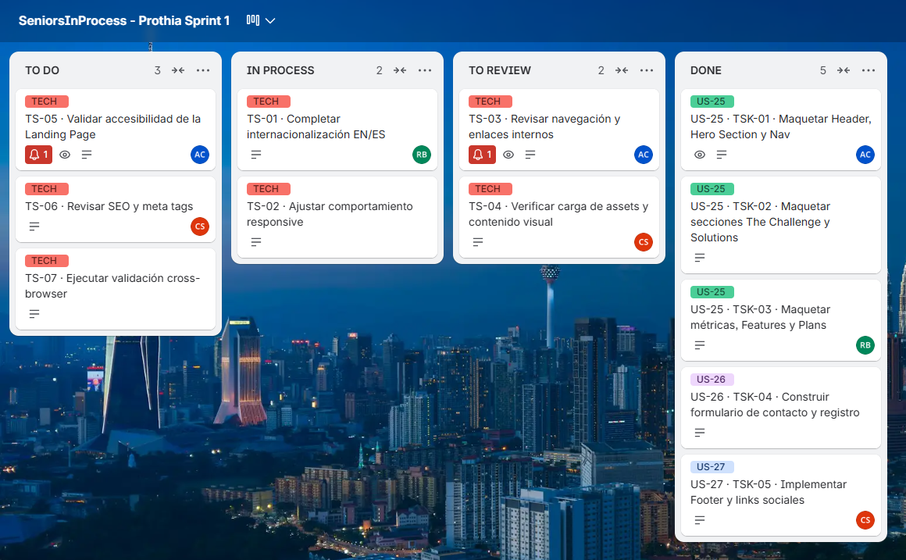

**Enlace del tablero de Trello:** 

https://trello.com/invite/b/6aabb55b023122d8fe598ee0/ATTI98b4a9da9fc821f35855872e0885a87cFED1E6E2/seniorsinprocess-prothia-sprint-1

### 5.2.1.4. Development Evidence for Sprint Review 

| Repository | Branch | Commit Id | Commit Message | Commit Message Body | Commited on (Date) |
| :--- | :--- | :--- | :--- | :--- | :--- |
| SeniorsInProcess/Prothia-Landing-Page | develop | `e5acca4` | Feat(landing): complete landing page structure and content in index.html | Estructura y contenido completos de la Landing page en index.html | 17/09/2026 |
| SeniorsInProcess/Prothia-Landing-Page | develop | `b2c7cce` | Feat(landing): complete landing page styles and responsive layout in styles.css | Completa los estilos de la Landing page y el diseño responsivo en styles.css. | 17/09/2026 |
| SeniorsInProcess/Prothia-Landing-Page | develop | `f2b24fc` | feat(landing): complete main javascript interactions and logic in main.js | Completa las interacciones y la lógica principales de JavaScript en main.js. | 17/09/2026 |
| SeniorsInProcess/Prothia-Landing-Page | develop | `a4d9681` | feat(landing): complete hero sequence animation logic in hero-sequence.js | Implementar la lógica de animación de la secuencia del hero en hero-sequence.js. | 17/09/2026 |
| SeniorsInProcess/Prothia-Landing-Page | develop | `a4d9681` | feat(landing): complete internationalization logic and language switcher in translation.js | Implementar la lógica de internacionalización y el selector de idioma en translation.js. | 17/09/2026 |

#### 5.2.1.5. Execution Evidence for Sprint Review

Capturas de pantalla de la Landing Page implementada en vistas Desktop y Mobile, acompañadas del video demostrativo de navegación e interacción del sitio.

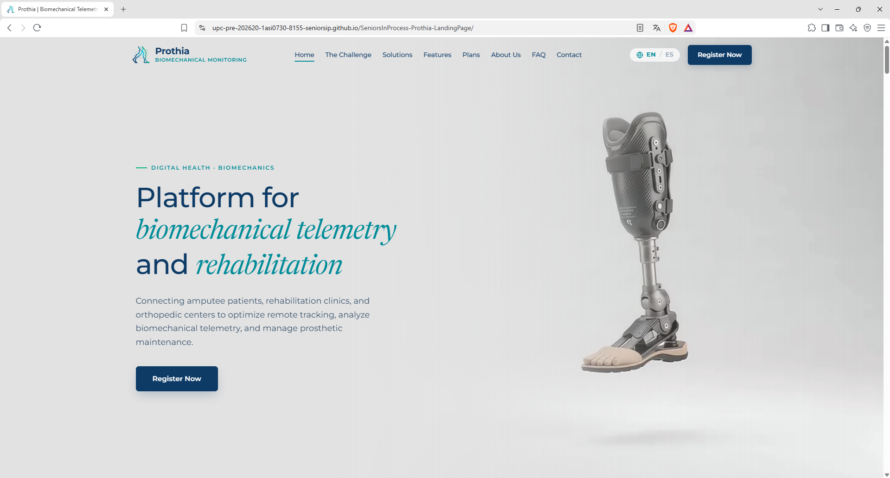

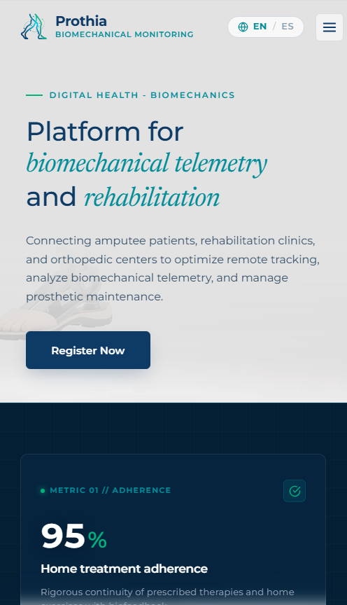

link de la landing: https://upc-pre-202620-1asi0730-8155-seniorsip.github.io/SeniorsInProcess-Prothia-LandingPage/

link del video: https://upcedupe-my.sharepoint.com/:v:/g/personal/u202421065_upc_edu_pe/IQDNRf7YFyx2S7sfhe8y7z-aAemJubaEn3IlURxzwNnz_MM?e=NuhSGo

### 5.2.1.6. Services Documentation Evidence for Sprint Review
Durante este Sprint 1, el esfuerzo del equipo se concentró de manera exclusiva en el desarrollo del Landing Page estático (HTML, CSS y JavaScript) y en establecer la identidad visual del producto. Dado que el alcance funcional de esta iteración no contempló aún el desarrollo del backend (RESTful API), no se cuenta con endpoints documentados mediante OpenAPI/Swagger para esta entrega. La documentación de servicios se abordará en los siguientes sprints, conforme se inicie la construcción de la API orientada a dominio de Prothia.

### 5.2.1.7. Software Deployment Evidence for Sprint Review
Para asegurar el acceso público a la propuesta de Prothia, el Landing Page fue desplegado utilizando GitHub Pages. Se consolidó el código estático en la rama develop del repositorio SeniorsInProcess/Prothia-Landing-Page. Desde la sección Settings de GitHub, se configuró "Build and deployment" apuntando a la rama correspondiente. El despliegue generó exitosamente la URL pública, donde se verificó la correcta carga de estilos, scripts de internacionalización y assets visuales en todos los breakpoints.

**Figura**
*Evidencia de deployment 1*

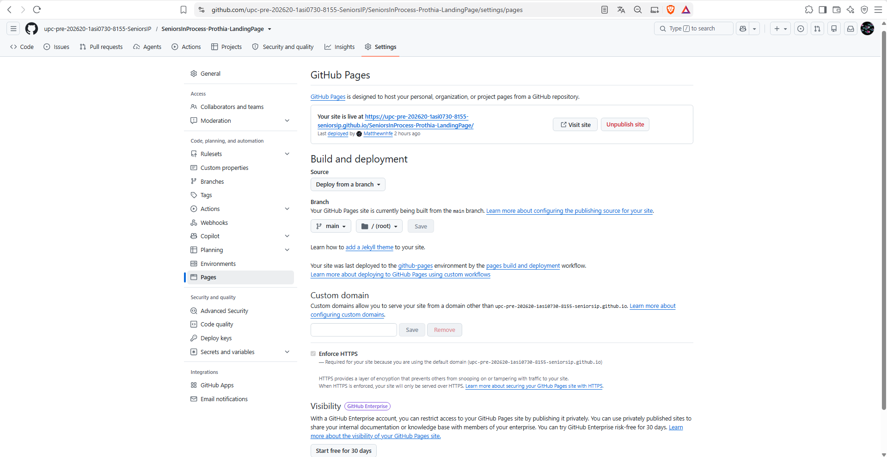

*Nota. Elaboración propia.*

**Figura**
*Evidencia de deployment 2*

### 5.2.1.8. Team Collaboration Insights during Sprint 

El trabajo en equipo durante el Sprint 1 fluyó de manera estructurada bajo el flujo de GitFlow. Cada integrante clonó el repositorio y trabajó sobre ramas feature/ específicas (ej. feature/contact-form, feature/hero-section). Al finalizar las tareas asignadas en Trello, se abrieron Pull Requests hacia la rama develop, los cuales fueron revisados activamente por Ana Camila como Team Leader antes de ser integrados. Esto garantizó que el código HTML/CSS mantuviera las convenciones establecidas en nuestras Style Guidelines y evitó conflictos significativos al unificar las vistas del Landing Page. 

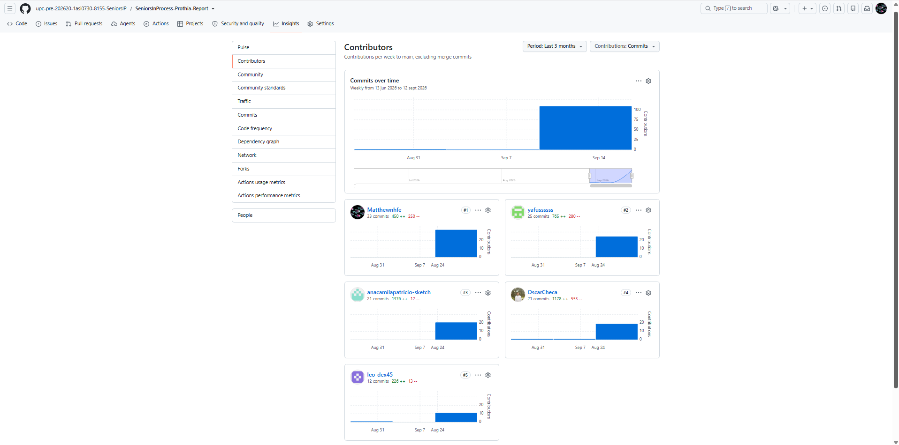

*Nota*. Elaboracion propia

### 5.2.2. Sprint 2

Durante el Sprint 2, el equipo SeniorsInProcess enfocó su trabajo en aplicar las mejoras a la versión pública de la Landing Page y en desarrollar y desplegar la primera versión funcional de la aplicación web de Prothia, implementando todos los Bounded Contexts definidos en la arquitectura Domain-Driven Design para los tres segmentos objetivo.

#### 5.2.2.1. Sprint Planning 2

El Sprint Planning 2 se enfocó en el despliegue de mejoras del sitio web estático (Landing Page) de Prothia y en el desarrollo y despliegue de la primera versión funcional de la aplicación web de Prothia. El objetivo principal de esta iteración es consolidar la plataforma digital conectando a pacientes amputados, profesionales de clínicas de rehabilitación y técnicos de centros ortopédicos.

| Sprint # | Sprint 2 |
| :--- | :--- |
| **SPRINT PLANNING BACKGROUND** | |
| Date | 2026-10-01 |
| Time | 8:00 PM |
| Location | Reunión virtual mediante Discord y Microsoft Teams |
| Prepared By | Patricio Farias, Ana Camila |
| Attendees (to planning meeting) | Ana Camila Patricio Farias, Oscar Diego Checa Burga, Leonardo Felix Dextre Flores, Carlos Matthew Salcedo Correa, Rafael Andre Barrenechea Bustamante |
| **SPRINT 2 REVIEW & RETROSPECTIVE SUMMARY** | |
| Sprint 2 Review Summary | Se validó la versión mejorada de la Landing Page con conexión directa hacia la aplicación web y el funcionamiento de los módulos del frontend en Vue 3 y PrimeVue para pacientes, clínicas y centros ortopédicos. |
| Sprint 2 Retrospective Summary | Durante este sprint, todos los integrantes compartieron sus ideas respecto a la aplicación web, los Bounded Contexts, la arquitectura DDD en el frontend y las funcionalidades por rol. Tuvimos tareas bien organizadas y realizadas mediante ramas `feature/` y Pull Requests hacia `develop`, lo cual se verifica en los avances del informe y de la aplicación web desplegada. |
| **SPRINT GOAL & USER STORIES** | |
|Sprint 2 Goal|Nuestro enfoque está en implementar las mejoras en la Landing Page y el desarrollo y despliegue de la aplicación web de Prothia, asegurando su coherencia visual, funcionalidad multilingüe (ES/EN) y acceso diferenciado para nuestros tres segmentos objetivo (pacientes amputados, clínicas de rehabilitación y centros ortopédicos). Creemos que esto ofrece una experiencia de navegación clara, accesible e integrada a los usuarios potenciales de nuestra solución. Esto se confirmará cuando los usuarios puedan alternar el idioma desde la interfaz, navegar intuitivamente por cada módulo sin errores visuales y consultar o registrar información simulada mediante JSON Server y servicios mock en producción.|

#### 5.2.2.2. Aspect Leaders and Collaborators

A continuación, se detalla la matriz de liderazgo y colaboración (LACX) para los aspectos clave abordados durante el Sprint 2, reflejando la distribución real de responsabilidades sobre la aplicación web, su despliegue y la documentación del proyecto.

| Team Member (Last Name, First Name) | GitHub Username | Aplicación Web Leader (L) / Collaborator (C) | Despliegue de la Aplicación Web Leader (L) / Collaborator (C) | Project Documentation Leader (L) / Collaborator (C) |
| :--- | :--- | :---: | :---: | :---: |
| **Patricio Farias, Ana Camila** | anacamilapatricio-sketch | L | C | L |
| **Checa Burga, Oscar Diego** | `OscarCheca` | L | C | L |
| **Dextre Flores, Leonardo Felix** | `leo-dex45` | C | L | C |
| **Salcedo Correa, Carlos Matthew** | `Matthewnhfe` | L | L | C |
| **Barrenechea Bustamante, Rafael Andre** | `yafussssss` | C | C | C |

#### 5.2.2.3. Sprint Backlog 2

El objetivo principal del Sprint 2 es poner en operación la primera versión de la aplicación web y optimizar la experiencia interactiva del Landing Page. Para el seguimiento ágil de las historias de usuario y tareas de desarrollo, se utilizó la herramienta **Trello**. A continuación, se presenta la evidencia del tablero del sprint y la tabla de control de estado correspondiente.

**Figura**  
*Tablero de control de tareas en Trello para el Sprint 2*

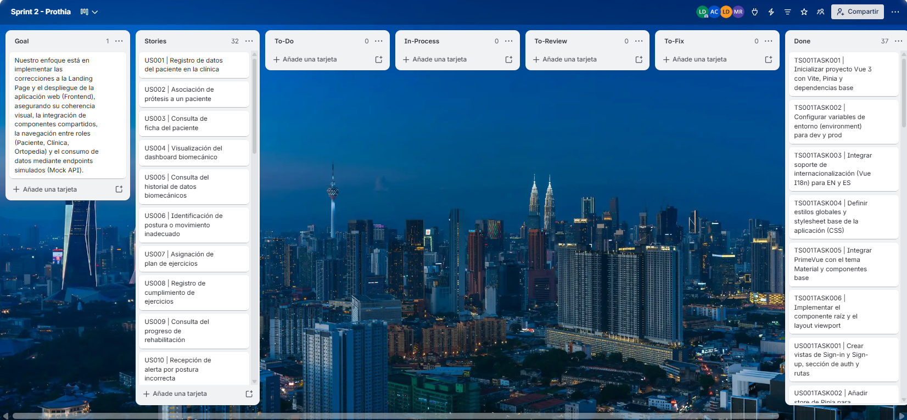

*Nota. Captura del tablero en Trello.*

**Enlace del tablero de Trello:**  
https://trello.com/invite/b/6a3482081843e32dea421094/ATTI18eefa82ccf88b07429958c3ca4d886e7D9A78CB/sprint-2-prothia

| **Story Id** | **User Story Title** | **Task Id** | **Task Title** | **Task Description** | **Story point** | **Assigned** | **Status** |
| :--- | :--- | :--- | :--- | :--- | :--- | :--- | :--- |
| US-01 | Registro de datos del paciente en la clínica | US001TASK001 | Formulario y store de alta de pacientes | Implementar entidad `Patient`, patient store y formulario de registro clínico con validación de DNI y nivel K. | 3 | Oscar | Done |
| US-02 | Asociación de prótesis a un paciente | US002TASK001 | Modal de vinculación de prótesis | Desarrollar diálogo en el módulo workshop para asociar una prótesis disponible del inventario a un paciente. | 3 | Leonardo | Done |
| US-03 | Consulta de ficha del paciente | US003TASK001 | Vista de directorio y expediente 360 | Implementar lista de pacientes, filtros de selección y vista de expediente clínico integral con prótesis vinculada. | 2 | Oscar | Done |
| US-04 | Visualización del dashboard biomecánico | US004TASK001 | Dashboard de telemetría clínica | Construir la vista de monitoreo biomecánico con métricas de cadencia, simetría bilateral, ángulo sagital e impacto. | 4 | Oscar | Done |
| US-05 | Consulta del historial de datos biomecánicos | US005TASK001 | Vista de historial de marcha en portal paciente | Implementar vista gait history monitoring en patient-portal con gráficos de evolución semanal y sesiones. | 3 | Carlos | Done |
| US-06 | Identificación de postura o movimiento inadecuado | US006TASK001 | Vista de telemetría en vivo para paciente | Desarrollar pantalla de biofeedback en vivo (live telemetry) con indicadores visuales de alineación postural. | 4 | Carlos | Done |
| US-07 | Asignación de plan de ejercicios | US007TASK001 | Editor de prescripción terapéutica | Crear entidades `Prescription` y `Exercise`, servicio API, store Pinia y vista de asignación de rutinas clínicas. | 4 | Camila | Done |
| US-08 | Registro de cumplimiento de ejercicios | US008TASK001 | Vista de ejercicios diarios del paciente | Implementar en patient-portal la lista interactiva de ejercicios prescritos para marcar series completadas. | 3 | Carlos | Done |
| US-09 | Consulta del progreso de rehabilitación | US009TASK001 | Dashboard "Mi Día" y adherencia | Desarrollar el panel de resumen diario del paciente y el indicador porcentual de adherencia semanal. | 3 | Carlos | Done |
| US-10 | Recepción de alerta por postura incorrecta | US010TASK001 | Centro de alertas clínicas | Implementar entidad `Alert`, store y bandeja de eventos críticos por desviación postural en monitoring. | 3 | Oscar | Done |
| US-13 | Registro de historial técnico de la prótesis | US013TASK001 | Bitácora e inventario de flota protésica | Implementar entidad `Prosthesis`, tablas de flota y registro de intervenciones mecánicas en workshop. | 3 | Leonardo | Done |
| US-14 | Programación de mantenimiento preventivo | US014TASK001 | Agenda de mantenimiento preventivo | Desarrollar entidad `MaintenanceSchedule`, store Pinia y calendario de revisiones técnicas agendadas. | 3 | Leonardo | Done |
| US-15 | Recepción de alerta de mantenimiento requerido | US015TASK001 | Centro de alertas de fatiga mecánica | Implementar entidad `MechanicalAlert` y vista de avisos por exceso de ciclos o pico de fuerza en taller. | 2 | Leonardo | Done |
| US-16 | Envío de mensajes entre paciente y clínica | US016TASK001 | Módulo de mensajería clínica | Crear entidad `ClinicalMessage` en communication y vista de chat directo en patient-portal. | 3 | Camila/Carlos | Done |
| US-17 | Compartir información entre clínica y ortopedia | US017TASK001 | Vista de coordinación con taller ortopédico | Implementar entidad `Transmission`, store y formulario para transmitir fichas biomecánicas al taller. | 4 | Camila | Done |
| US-18 | Consulta de notificaciones generales | US018TASK001 | Menú de opciones y avisos de cuenta | Desarrollar el Bounded Context option con store Pinia, API client y componente de presentación. | 3 | Rafael | Done |
| US-19 | Contratación de suscripción anual | US019TASK001 | Vista de suscripción y facturación clínica | Implementar entidades `ClinicSubscription` e `ElectronicInvoice`, servicio API, store y vista en billing. | 4 | Leonardo | Done |
| US-20 | Adquisición de licencia de software | US020TASK001 | Gestión de licencia anual para taller | Integrar vista de control de licencia corporativa de software y cupos de prótesis activas en telemetría. | 2 | Leonardo | Done |
| US-21 | Consulta del estado de suscripción o licencia | US021TASK001 | Historial de comprobantes y vigencia | Mostrar barra de capacidad de cupos activos, vigencia del plan y tabla de facturas electrónicas emitidas. | 2 | Leonardo | Done |
| US-38 | Generación de reporte de progreso del paciente | US038TASK001 | Generador de reportes clínicos | Implementar entidad `ClinicalReport`, analytics store y vista de informe con firma y colegiatura. | 4 | Carlos | Done |
| US-39 | Exportación de datos históricos del paciente | US039TASK001 | Acciones de exportación CSV y PDF clínico | Añadir controles de selección de paciente, periodo de evaluación y botones de exportación. | 2 | Carlos | Done |

* Total de horas invertidas: 50 horas de trabajo colaborativo.

#### 5.2.2.4. Development Evidence for Sprint Review

Durante el Sprint 2, el equipo desarrolló el frontend de la aplicación web de Prothia, incorporando la configuración base de Vue 3, PrimeVue, Pinia, Vue Router e internacionalización (EN/ES), así como los Bounded Contexts de `shared`, `monitoring`, `patients`, `communication`, `prescription`, `billing`, `workshop`, `analytics`, `patient-portal`, `iam` y `option`. A continuación, se presenta el registro completo de los 75 commits reales del repositorio (Parte 1: Configuración inicial, shared y monitoring).

| Repository | Author / Branch | Commit Id | Commit Message | Descripción del cambio |
| :--- | :--- | :--- | :--- | :--- |
| Prothia-Frontend | anacamilapatricio-sketch | de2aa3c | chore: initial commit | Inicializa el repositorio base del proyecto frontend en Vue 3 y Vite. |
| Prothia-Frontend | anacamilapatricio-sketch | 6e21554 | chore: clean up code, remove unused imports, remove unused files | Limpia la plantilla inicial eliminando archivos e importaciones no utilizadas. |
| Prothia-Frontend | anacamilapatricio-sketch | a0a6754 | build: add dependencies for project features | Agrega dependencias de PrimeVue, Pinia, Vue Router, Axios y Vue I18n. |
| Prothia-Frontend | anacamilapatricio-sketch | b680551 | feat(i18n): add internationalization support for en and es locales | Configura el plugin de internacionalización para soporte en inglés y español. |
| Prothia-Frontend | anacamilapatricio-sketch | 2765848 | feat(in-app-navigation): add In-app navigation router | Incorpora la configuración base del enrutador de navegación interna. |
| Prothia-Frontend | anacamilapatricio-sketch | b991c56 | feat(state-management): add pinia for state management | Integra Pinia para la gestión centralizada de estado en la aplicación. |
| Prothia-Frontend | anacamilapatricio-sketch | 4c627e0 | feat(environment): add Environment variables for development and production | Añade archivos de variables de entorno para desarrollo y producción. |
| Prothia-Frontend | anacamilapatricio-sketch | 79385f9 | feat(ui): integrate PrimeVue with Material theme | Configura la librería de componentes PrimeVue con el tema visual Material. |
| Prothia-Frontend | anacamilapatricio-sketch | 998c483 | Merge pull request #1 from .../feature/project-configuration | Integra la rama de configuración base del proyecto mediante el PR #1. |
| Prothia-Frontend | OscarCheca | 2d73c91 | feat(shared): add BaseApi and BaseEndpoint infrastructure | Implementa las clases base de infraestructura HTTP para consumo de APIs. |
| Prothia-Frontend | OscarCheca | 2f19f47 | feat(shared): add role store | Crea el store compartido para gestionar el rol activo del usuario. |
| Prothia-Frontend | OscarCheca | 6a76f6e | feat(shared): add presentation views and components for shared | Agrega vistas de presentación y componentes transversales del módulo shared. |
| Prothia-Frontend | OscarCheca | 8f7b63b | refactor(router): fix router names | Estandariza los nombres de las rutas en el archivo de configuración del router. |
| Prothia-Frontend | OscarCheca | e782a9d | Merge branch 'feature/shared' into develop | Integra la rama feature/shared en la rama develop. |
| Prothia-Frontend | OscarCheca | 8326e33 | feat(monitoring): add domain | Crea las entidades de alertas y monitoreo. |
| Prothia-Frontend | anacamilapatricio-sketch | fe3110e | feat(communication): add clinical message and transmission domain entities | Crea las entidades de dominio para mensajes clínicos y transmisiones al taller. |
| Prothia-Frontend | anacamilapatricio-sketch | cb63011 | feat(communication): implement api client and data assemblers | Implementa el cliente API y los ensambladores del módulo communication. |
| Prothia-Frontend | anacamilapatricio-sketch | f036d5c | feat(communication): add communication state management store | Agrega el store de Pinia para gestionar transmisiones y mensajes clínicos. |
| Prothia-Frontend | anacamilapatricio-sketch | 86cd7ba | feat(communication): create workshop coordination view and routes | Desarrolla la vista de coordinación con centros ortopédicos y sus rutas. |
| Prothia-Frontend | anacamilapatricio-sketch | d68ae9d | feat(communication): integrate module routing, translations and mock endpoints | Integra las rutas del módulo, claves de traducción y endpoints simulados. |
| Prothia-Frontend | anacamilapatricio-sketch | 2be0fcf | Merge branch 'feature/communication' into develop | Integra la rama feature/communication en la rama develop. |
| Prothia-Frontend | anacamilapatricio-sketch | 48d668f | feat(prescription): add prescription and exercise domain entities | Define las entidades de dominio de prescripción terapéutica y ejercicios. |
| Prothia-Frontend | anacamilapatricio-sketch | 3cccc4a | feat(prescription): implement api service and exercise assemblers | Implementa el servicio API y ensambladores de planes de ejercicios. |
| Prothia-Frontend | anacamilapatricio-sketch | 4f89b83 | feat(prescription): add prescription pinia store | Crea el store de Pinia para administrar la prescripción de ejercicios. |
| Prothia-Frontend | anacamilapatricio-sketch | 9a23e41 | feat(prescription): implement prescription editor view and routes | Construye la vista del editor de prescripciones clínicas y sus rutas. |
| Prothia-Frontend | anacamilapatricio-sketch | 372627a | Merge branch 'feature/prescription' into develop | Integra la rama feature/prescription en la rama develop. |
| Prothia-Frontend | leo-dex45 | 1e22528 | feat(billing): add clinic subscription and electronic invoice domain entities | Define las entidades de suscripción de clínica y comprobantes electrónicos. |
| Prothia-Frontend | leo-dex45 | a7521d3 | feat(billing): implement api service and data assemblers | Implementa el servicio API y ensambladores de datos del módulo billing. |
| Prothia-Frontend | leo-dex45 | 1a35cd6 | feat(billing): add billing pinia store | Agrega el store de Pinia para el estado de suscripciones y facturación. |
| Prothia-Frontend | leo-dex45 | 1344515 | feat(billing): create clinic subscription view and routes | Desarrolla la vista de administración de suscripción anual y sus rutas. |
| Prothia-Frontend | Matthewnhfe | d7c4dca | feat(analytics): add clinical report domain entity | Define la entidad de dominio para los informes clínicos de evolución. |
| Prothia-Frontend | Matthewnhfe | f66113a | feat(analytics): implement api client and clinical report assembler | Implementa el cliente API y el ensamblador de reportes clínicos. |
| Prothia-Frontend | Matthewnhfe | 7340e25 | feat(analytics): add analytics state management store | Crea el store de Pinia para la gestión de métricas y reportes analíticos. |
| Prothia-Frontend | Matthewnhfe | d6176e7 | feat(analytics): create clinical reports view and routing | Desarrolla la vista generadora de reportes clínicos y su enrutamiento. |
| Prothia-Frontend | Matthewnhfe | 1466900 | feat(patient-portal): create patient layout and portal routing definition | Construye la estructura visual y definición de rutas del portal del paciente. |
| Prothia-Frontend | Matthewnhfe | dba99d2 | feat(patient-portal): add dashboard and daily routine views | Añade el dashboard principal "Mi Día" y la vista de rutina diaria del paciente. |
| Prothia-Frontend | Matthewnhfe | 90fa5d1 | feat(patient-portal): add live telemetry and gait history monitoring views | Implementa las vistas de telemetría en vivo e historial biomecánico de marcha. |
| Prothia-Frontend | Matthewnhfe | 4e759bb | feat(patient-portal): add patient exercises and messaging views | Agrega las vistas de ejercicios asignados y mensajería con el fisioterapeuta. |
| Prothia-Frontend | Matthewnhfe | 06447aa | Merge branch 'feature/patient-portal' into develop | Integra la rama feature/patient-portal en la rama develop. |
| Prothia-Frontend | Matthewnhfe | b1e17e2 | chore(config): configure html entrypoint and vite client type definitions | Configura el archivo raíz index.html y las definiciones de tipos de Vite. |
| Prothia-Frontend | Matthewnhfe | f195df2 | style: define global styles and base application stylesheet | Define las variables CSS globales y la hoja de estilos base de Prothia. |
| Prothia-Frontend | Matthewnhfe | e7cbea8 | feat(app): implement root application component and layout viewport | Implementa el componente raíz App.vue y el contenedor de vistas. |
| Prothia-Frontend | Matthewnhfe | f7504b6 | feat(main): bootstrap vue application with plugins and global providers | Inicializa la instancia principal de Vue integrando plugins y proveedores. |
| Prothia-Frontend | Matthewnhfe | 99b7680 | chore(config): configure development environment variables | Ajusta la configuración de variables de entorno para el servidor local. |
| Prothia-Frontend | Matthewnhfe | 1614be1 | Merge branch 'feature/app-setup' into develop | Integra la rama feature/app-setup en develop |

#### 5.2.2.5.Execution Evidence for Sprint Review

En esta sección se presentan las evidencias de ejecución de la aplicación web de Prothia correspondientes al Sprint 2, siguiendo la estructura de presentación de referencia de Noxway. Las vistas muestran las interfaces desarrolladas en Vue 3 y PrimeVue y los resultados de las interacciones desde los perfiles de Paciente Amputado, Profesional de Clínica de Rehabilitación y Técnico de Centro Ortopédico.

**Enlaces de Ejecución Pública en Producción**
*   **Aplicación Web Desplegada (Prothia Frontend):** https://prothia-web-app-7003f.web.app/
*   **Landing Page Desplegada (v2.0):** https://upc-pre-202620-1asi0730-8155-seniorsip.github.io/SeniorsInProcess-Prothia-LandingPage/

*Figura 1. Inicio de Sesión y Selección de Rol (Módulo IAM).*

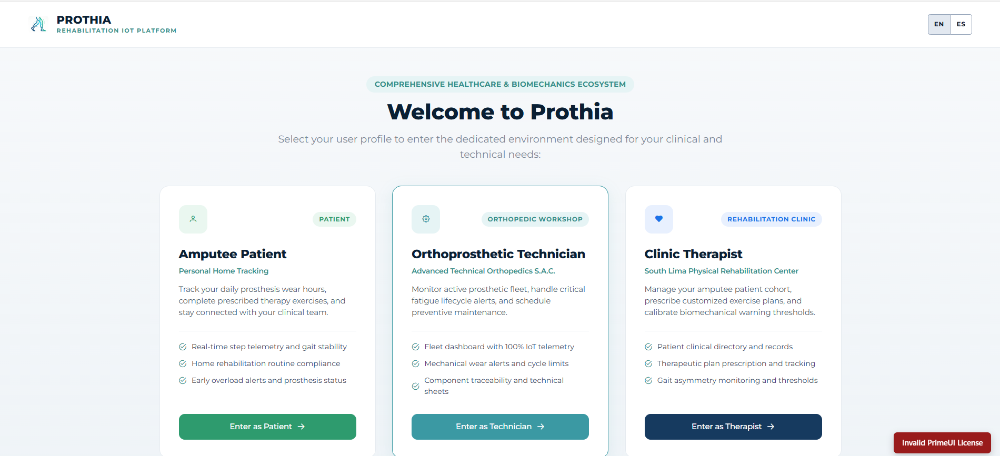

*Figura 2. Dashboard Principal del Paciente ("Mi Día" - Patient Portal).*

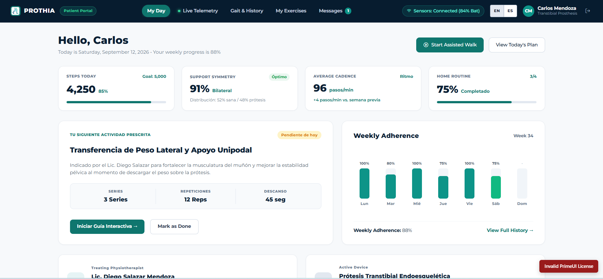

*Figura 3. Telemetría Biomecánica en Vivo e Historial de Marcha.*

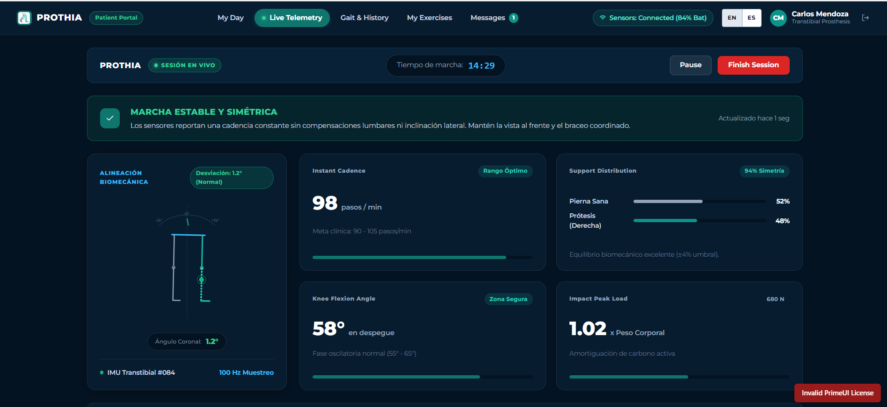

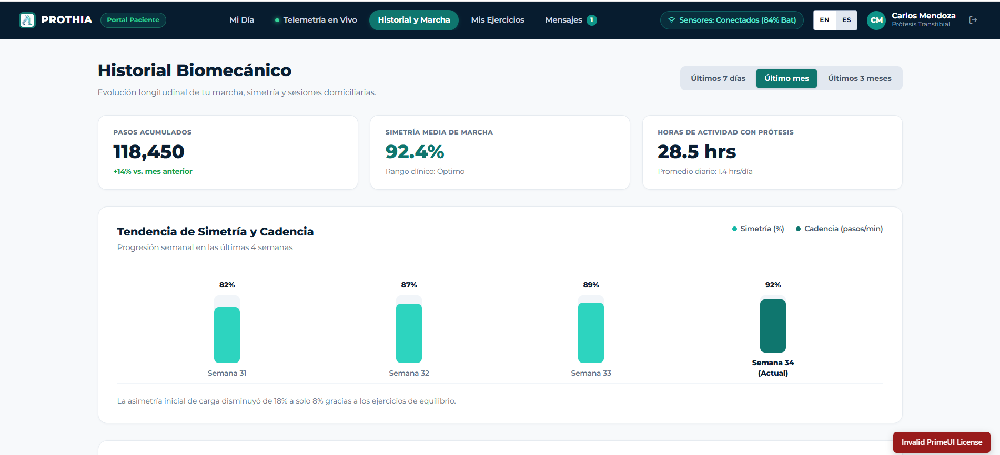

*Figura 4. Mis Ejercicios y Mensajería Clínica del Paciente.*

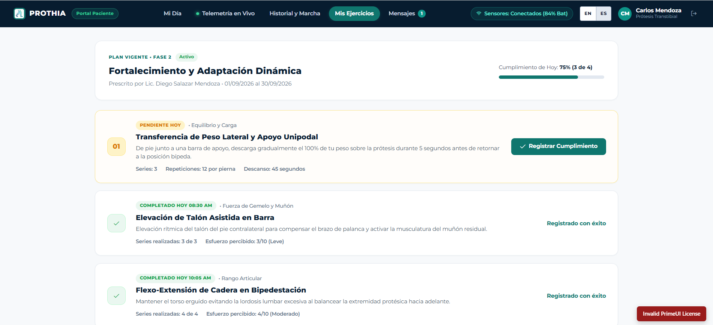

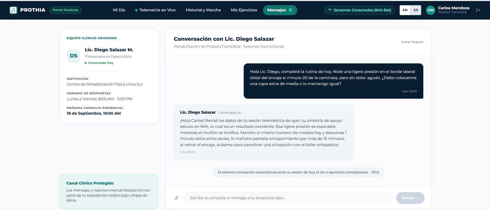

*Figura 5. Dashboard Clínico y Alta de Pacientes (Módulo Patients).*

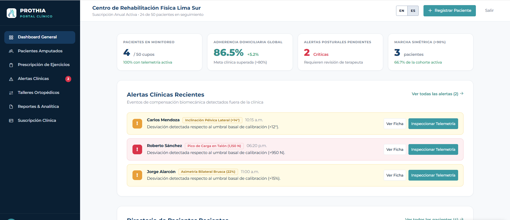

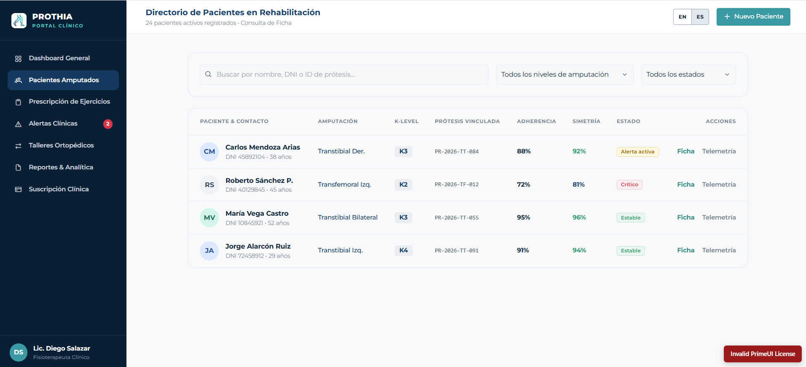

*Figura 6. Prescripción Terapéutica y Centro de Alertas (Prescription & Monitoring).*

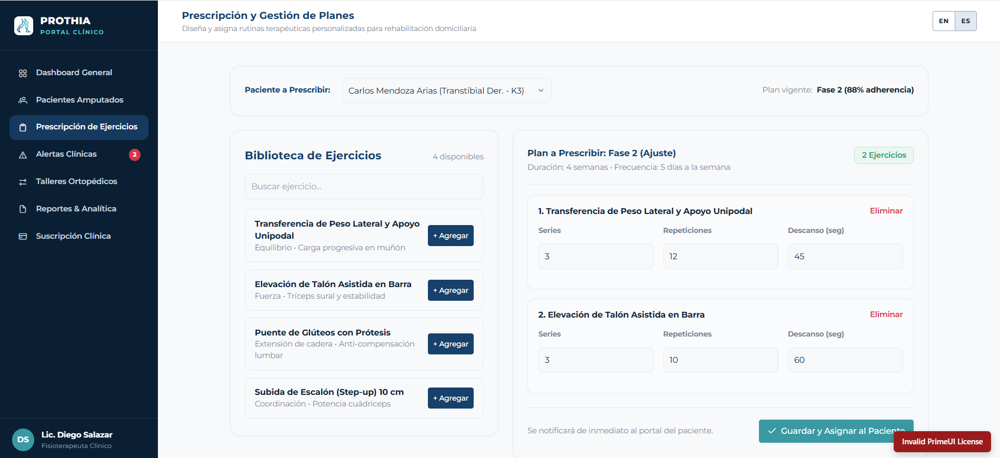

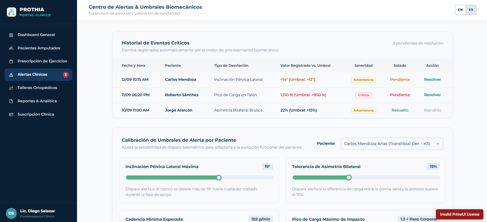

*Figura 7. Coordinación con Ortopedia, Reportes y Suscripción (Communication, Analytics & Billing).*

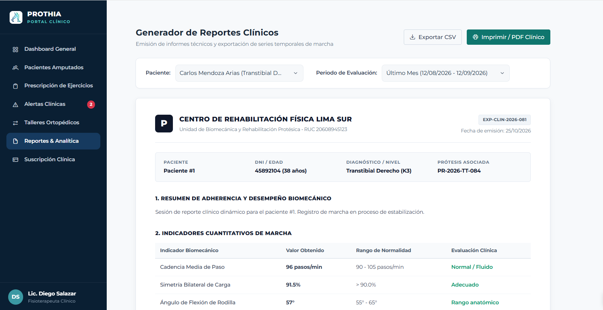

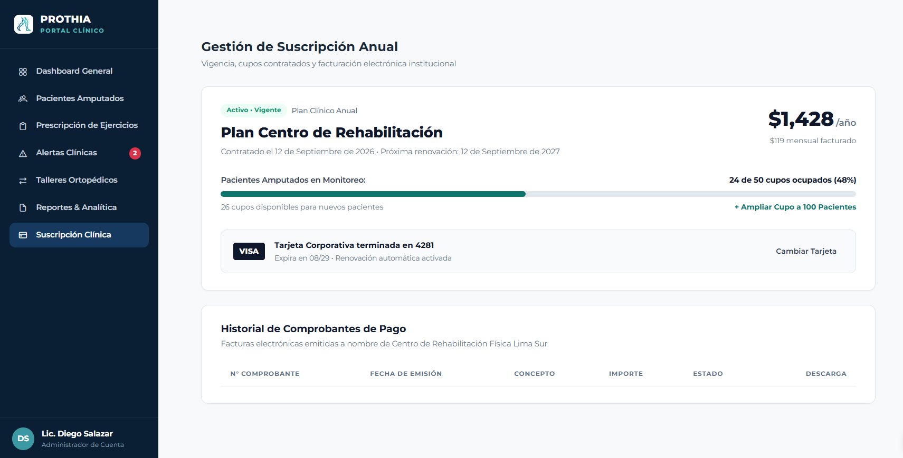

*Figura 8. Portal del Taller Ortopédico: Flota, Mantenimiento y Alertas (Módulo Workshop).*

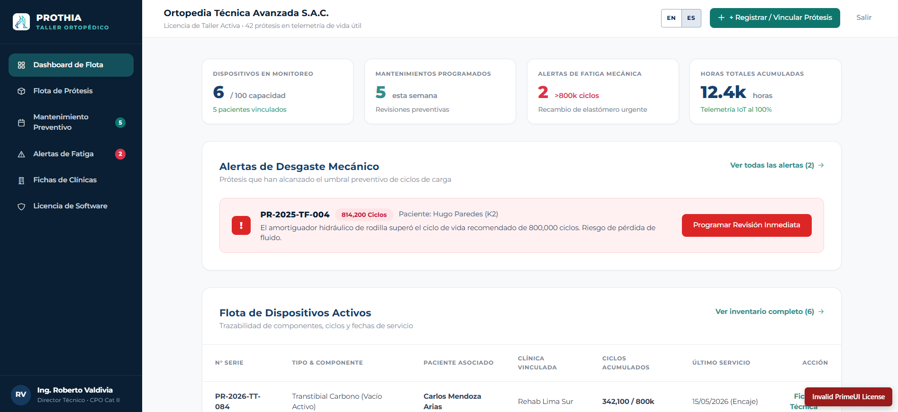

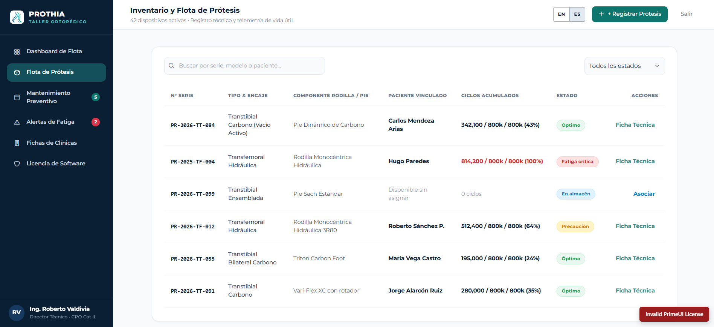

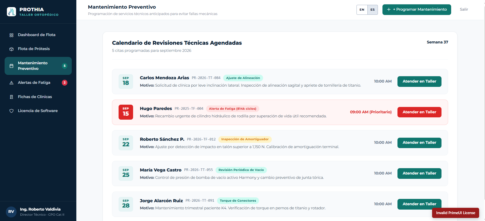

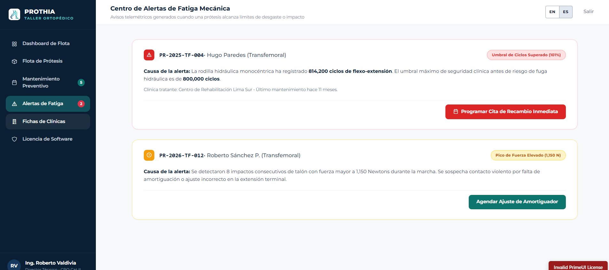

#### 5.2.2.6. Services Documentation Evidence for Sprint Review

Durante el Sprint 2 se implementaron los servicios de consumo HTTP en el frontend de Prothia (SeniorsInProcess-Prothia-Frontend) apoyados en la infraestructura compartida BaseApi y BaseEndpoint (basada en Axios) y en clases Assembler para transformar los recursos JSON hacia las entidades de dominio de cada Bounded Context.

En el entorno de desarrollo local se utiliza JSON Server con datos simulados definidos en el archivo server/db.json. Para el entorno de producción desplegado, la configuración en environment.production conecta los servicios con endpoints mock en la nube (Beeceptor / Mock API). Los ejemplos presentados en la tabla muestran los campos principales de los recursos consumidos por cada módulo del frontend.

**Configuración de URLs Base de Servicios en el Frontend**
*   **URL base local (JSON Server):** http://localhost:3000
*   **Repositorio con servicios y datos simulados:** https://github.com/upc-pre-202620-1asi0730-8155-SeniorsIP/SeniorsInProcess-Prothia-Frontend

| Acción / Módulo | Método HTTP | Sintaxis de llamada local | Parámetros / cuerpo | Ejemplo parcial de respuesta | Explicación |
| :--- | :--- | :--- | :--- | :--- | :--- |
| Consultar pacientes (patients) | GET | http://localhost:3000/patients | Ninguno | `[{"id":1,"fullName": "Carlos Mendoza Arias", "kLevel":"K3"}]` | Devuelve el directorio de pacientes amputados registrados en la clínica. |
| Registrar paciente (patients) | POST | http://localhost:3000/patients | Body JSON (Patient) | `{"id": 5, "dni": "45892104", "amputationLevel": "Transtibial"}` | Almacena un nuevo paciente en el catálogo clínico y actualiza el store. |
| Consultar sesiones (monitoring) | GET | http://localhost:3000/gaitSessions | Ninguno | `[{"id":1,"patientId":1, "cadence":96, "symmetry":92.4}]` | Obtiene las sesiones telemétricas de marcha y sus métricas biomecánicas. |
| Consultar alertas (monitoring) | GET | http://localhost:3000/alerts | Ninguno | `[{"id": 1, "patientName": "Carlos Mendoza", "severity":"Warning"}]` | Devuelve el historial de alertas clínicas por desviación postural o impacto. |
| Consultar umbrales (monitoring) | GET / PUT | http://localhost:3000/thresholds | Body JSON en PUT | `[{"id":1,"patientId":1, "maxPelvicTilt":12,"maxAsymmetry":15}]` | Consulta o actualiza los parámetros de sensibilidad de alerta por paciente. |
| Consultar planes (prescription) | GET / POST | http://localhost:3000/prescriptions | Body JSON en POST | `[{"id":1,"patientId":1, "phase": "Fase 2", "adherence":88}]` | Obtiene o publica planes de prescripción terapéutica y ejercicios asignados. |
| Consultar transmisiones (communication) | GET / POST | http://localhost:3000/transmissions | Body JSON en POST | `[{"id":1,"patientName":"Carlos Mendoza", "workshop":"Ortopedia Avanzada"}]` | Lista o registra el envío de fichas biomecánicas entre clínica y ortopedia. |
| Consultar mensajes (communication) | GET / POST | http://localhost:3000/clinicalMessages | Body JSON en POST | `[{"id":1,"sender": "Lic. Diego Salazar", "text": "Mantén el apoyo..."}]` | Gestiona los mensajes de interconsulta entre el paciente y su fisioterapeuta. |

#### 5.2.2.7. Software Deployment Evidence for Sprint Review

Durante el Sprint 2 se realizó el despliegue de la primera versión funcional del frontend de Prothia mediante Firebase Hosting, habilitando su acceso público desde cualquier navegador web. El proyecto utilizado en la consola de Firebase se identifica como prothia-web-app-7003f. Asimismo, se actualizó el despliegue de la Landing Page en GitHub Pages conectando sus botones de acción directamente hacia la aplicación web desplegada.

**Datos de Alojamiento y Publicación (Sprint 2)**
*   **Plataforma de alojamiento de la Web Application:** Firebase Hosting (prothia-web-app-7003f).
*   **Repositorio del Frontend:** https://github.com/upc-pre-202620-1asi0730-8155-SeniorsIP/SeniorsInProcess-Prothia-Frontend
*   **Aplicación Web Desplegada:** https://prothia-web-app-7003f.web.app/

*Figura 1. Evidencia de publicación en Firebase Hosting.*

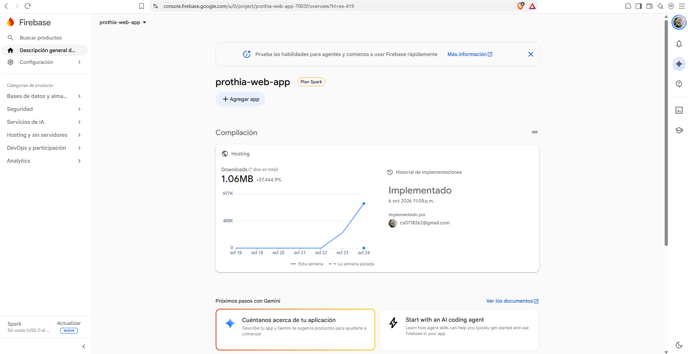

#### 5.2.2.8. Team Collaboration Insights during Sprint

Durante el Sprint 2, el equipo organizó el desarrollo del frontend de Prothia mediante ramas de funcionalidades (feature/<bounded-context>) y su integración progresiva en la rama develop y main. La siguiente tabla resume los aportes reales verificados en el historial de commits del repositorio SeniorsInProcess-Prothia-Frontend:

| Integrante | Usuario de GitHub | Aportes registrados en SeniorsInProcess-Prothia-Frontend |
| :--- | :--- | :--- |
| Patricio Farias, Ana Camila | anacamilapatricio-sketch | Inicialización del repositorio, configuración de dependencias, i18n, router, Pinia, variables de entorno y PrimeVue Material (PR #1); desarrollo completo e integración de los módulos Communication y Prescription . |
| Checa Burga, Oscar Diego | OscarCheca | Desarrollo de la infraestructura Shared (BaseApi, BaseEndpoint, role store, vistas compartidas), diccionarios en.json y es.json, e implementación completa de los módulos Monitoring y Patients . |
| Dextre Flores, Leonardo Felix | leo-dex45 | Desarrollo completo de los módulos Billing (entidades, API service, Pinia store y vista de suscripción clínica) y Workshop (flota de prótesis, agenda de mantenimiento preventivo, alertas mecánicas y vistas de taller) . |
| Salcedo Correa, Carlos Matthew | Matthewnhfe | Desarrollo de los módulos Analytics (reportes clínicos) y Patient-Portal (layout, dashboard diario, telemetría en vivo, historial de marcha, ejercicios y mensajes), además de la configuración raíz App-Setup . |
| Barrenechea Bustamante, Rafael Andre | yafussssss | Desarrollo completo del módulo IAM (entidad de usuario, comandos auth, cliente API, interceptores, auth guard, Pinia store y vistas sign-in/sign-up), del módulo Option y actualización del README.md. |

**Figura**  
*Métricas de colaboración y commits en GitHub Insights para el Sprint 2*

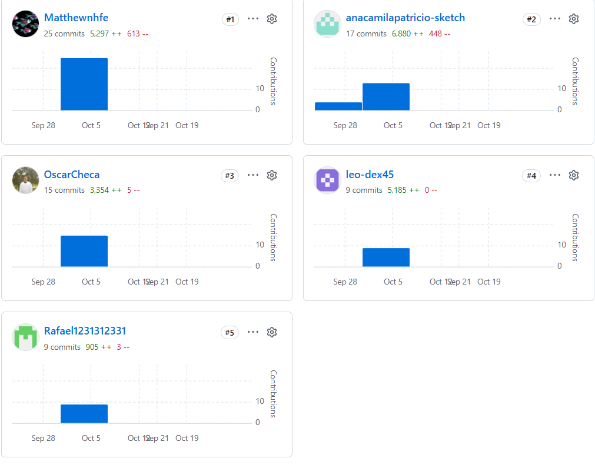

*Nota. Registro de contribuciones y frecuencia de commits de los integrantes del equipo durante el Sprint 2 obtenido desde GitHub Insights.*
