## 5.2. Landing Page, Services & Applications Implementation

### 5.2.1. Sprint 1

Durante este primer sprint, el equipo se enfocó en la implementación de la Landing Page de Prothia, estableciendo el principal canal de comunicación pública y captación para la plataforma biomecánica.  

### 5.2.1.1. Sprint Planning 1 

En esta sección se detalla la reunión de planificación del primer sprint, donde se definieron los objetivos y la capacidad del equipo. 

| **Sprint #** | Sprint 1 |
| :--- | :--- |
| **Sprint Planning Background** | Reunión inicial para definir las prioridades del producto, enfocándonos en establecer la presencia web pública y habilitar la captación de usuarios interesados mediante la Landing Page. |
| **Date** | 2026-09-03 |
| **Time** | 20:00 PM |
| **Location** | Microsoft Teams Group Call |
| **Prepared By** | Patricio Farias, Ana Camila |
| **Attendees (to planning meeting)** | Patricio Farias, Ana Camila / Checa Burga, Oscar Diego / Dextre Flores, Leonardo Felix / Salcedo Correa, Carlos Mathhew / Barrenechea Bustamante, Rafael Andre |
| **Sprint n - 1 Review Summary** | Durante la fase preliminar, el equipo definió la arquitectura de información, elaboró los wireframes y mock-ups, y configuró los repositorios en GitHub junto con el tablero de Trello. Se revisaron y aprobaron los diseños iniciales que servirán como base para la maquetación web. |
| **Sprint n - 1 Retrospective Summary** | **Start:** Realizar sincronizaciones de avance cortas para identificar bloqueos técnicos a tiempo. **Continue:** Mantener la revisión cruzada de diseños y la buena distribución de las tareas. **Stop:** Retrasar la creación de ramas (branches) en el repositorio hasta el momento de escribir el código. |
| **Sprint Goal & User Stories** | |
| **Sprint 1 Goal** | Our focus is on implementing the core information architecture and functionalities of the Prothia landing page. We believe it delivers a clear value proposition to amputee patients, rehabilitation clinics, and orthopedic centers. This will be confirmed when visitors are able to successfully navigate the platform's features, review access plans, and submit a clinical demonstration request. |
| **Sprint 1 Velocity** | 6 |
| **Sum of Story Points** | 6 |

### 5.2.1.2. Aspect Leaders and Collaborators 

A continuación, se detalla la matriz de liderazgo y colaboración (LACX) para los aspectos clave abordados en este sprint.  

| Team Member (Last Name, First Name) | GitHub Username | Landing Page (HTML/CSS/JS) Leader (L) / Collaborator (C) | UX/UI & Prototyping Leader (L) / Collaborator (C) | Project Documentation Leader (L) / Collaborator (C) |
| :--- | :--- | :---: | :---: | :---: |
| Barrenechea Bustamante, Rafael Andre | yafussssss | C | C | C |
| Checa Burga, Oscar Diego | OscarCheca | C | C | L |
| Dextre Dextre Flores, Leonardo | Leo-dex45 | C | C | C |
| Patricio Farias, Ana Camila | anacamilapatricio-sketch | C | L | L |
| Salcedo Correa, Carlos Mathhew | Matthewnhfe | L | L | C |

### 5.2.1.3. Sprint Backlog 1 
Para organizar el flujo de trabajo, las tareas se gestionaron mediante **Trello**. A continuación se desglosan las historias de usuario priorizadas de la épica EP-09 y sus respectivas tareas. 

**Figura**

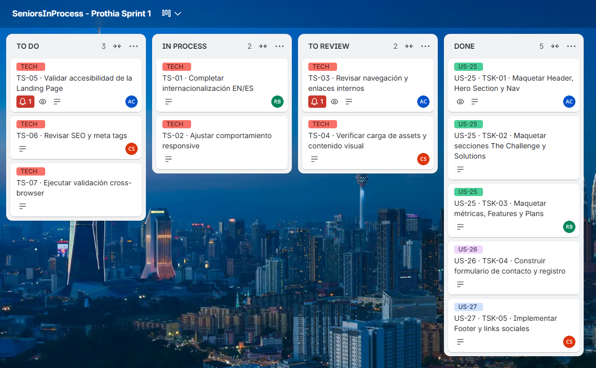

**Enlace del tablero de Trello:** 

https://trello.com/invite/b/6aabb55b023122d8fe598ee0/ATTI98b4a9da9fc821f35855872e0885a87cFED1E6E2/seniorsinprocess-prothia-sprint-1

### 5.2.1.4. Development Evidence for Sprint Review 

| Repository | Branch | Commit Id | Commit Message | Commit Message Body | Commited on (Date) |
| :--- | :--- | :--- | :--- | :--- | :--- |
| SeniorsInProcess/Prothia-Landing-Page | develop | `e5acca4` | Feat(landing): complete landing page structure and content in index.html | Estructura y contenido completos de la Landing page en index.html | 17/09/2026 |
| SeniorsInProcess/Prothia-Landing-Page | develop | `b2c7cce` | Feat(landing): complete landing page styles and responsive layout in styles.css | Completa los estilos de la Landing page y el diseño responsivo en styles.css. | 17/09/2026 |
| SeniorsInProcess/Prothia-Landing-Page | develop | `f2b24fc` | feat(landing): complete main javascript interactions and logic in main.js | Completa las interacciones y la lógica principales de JavaScript en main.js. | 17/09/2026 |
| SeniorsInProcess/Prothia-Landing-Page | develop | `a4d9681` | feat(landing): complete hero sequence animation logic in hero-sequence.js | Implementar la lógica de animación de la secuencia del hero en hero-sequence.js. | 17/09/2026 |
| SeniorsInProcess/Prothia-Landing-Page | develop | `a4d9681` | feat(landing): complete internationalization logic and language switcher in translation.js | Implementar la lógica de internacionalización y el selector de idioma en translation.js. | 17/09/2026 |

#### 5.2.1.5. Execution Evidence for Sprint Review

Capturas de pantalla de la Landing Page implementada en vistas Desktop y Mobile, acompañadas del video demostrativo de navegación e interacción del sitio.

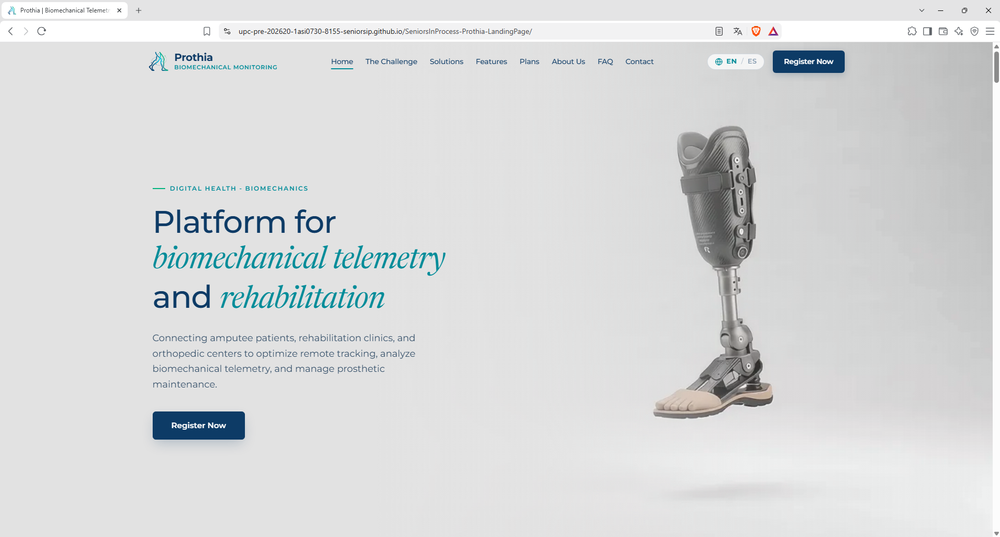

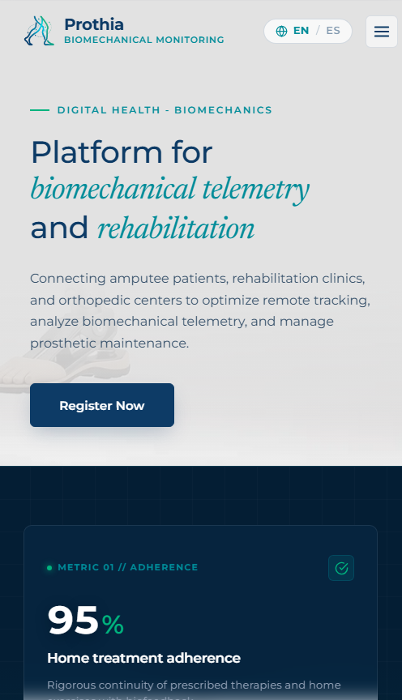

link de la landing: https://upc-pre-202620-1asi0730-8155-seniorsip.github.io/SeniorsInProcess-Prothia-LandingPage/

link del video: https://upcedupe-my.sharepoint.com/:v:/g/personal/u202421065_upc_edu_pe/IQDNRf7YFyx2S7sfhe8y7z-aAemJubaEn3IlURxzwNnz_MM?e=NuhSGo

### 5.2.1.6. Services Documentation Evidence for Sprint Review
Durante este Sprint 1, el esfuerzo del equipo se concentró de manera exclusiva en el desarrollo del Landing Page estático (HTML, CSS y JavaScript) y en establecer la identidad visual del producto. Dado que el alcance funcional de esta iteración no contempló aún el desarrollo del backend (RESTful API), no se cuenta con endpoints documentados mediante OpenAPI/Swagger para esta entrega. La documentación de servicios se abordará en los siguientes sprints, conforme se inicie la construcción de la API orientada a dominio de Prothia.

### 5.2.1.7. Software Deployment Evidence for Sprint Review
Para asegurar el acceso público a la propuesta de Prothia, el Landing Page fue desplegado utilizando GitHub Pages. Se consolidó el código estático en la rama develop del repositorio SeniorsInProcess/Prothia-Landing-Page. Desde la sección Settings de GitHub, se configuró "Build and deployment" apuntando a la rama correspondiente. El despliegue generó exitosamente la URL pública, donde se verificó la correcta carga de estilos, scripts de internacionalización y assets visuales en todos los breakpoints.

**Figura**
*Evidencia de deployment 1*

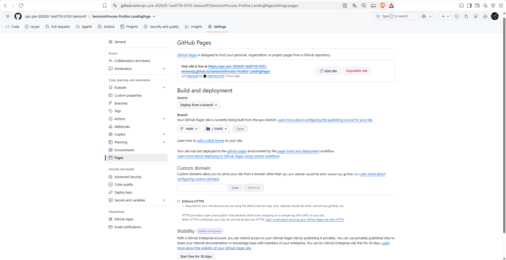

*Nota. Elaboración propia.*

**Figura**
*Evidencia de deployment 2*

### 5.2.1.8. Team Collaboration Insights during Sprint 

El trabajo en equipo durante el Sprint 1 fluyó de manera estructurada bajo el flujo de GitFlow. Cada integrante clonó el repositorio y trabajó sobre ramas feature/ específicas (ej. feature/contact-form, feature/hero-section). Al finalizar las tareas asignadas en Trello, se abrieron Pull Requests hacia la rama develop, los cuales fueron revisados activamente por Ana Camila como Team Leader antes de ser integrados. Esto garantizó que el código HTML/CSS mantuviera las convenciones establecidas en nuestras Style Guidelines y evitó conflictos significativos al unificar las vistas del Landing Page. 

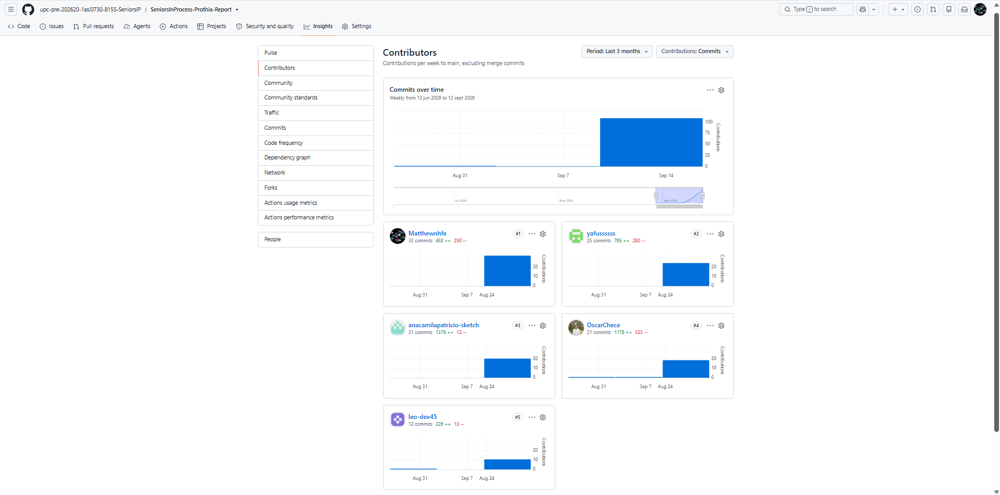

*Nota*. Elaboracion propia

### 5.2.2. Sprint 2

Durante el Sprint 2, el equipo SeniorsInProcess enfocó su trabajo en aplicar las mejoras a la versión pública de la Landing Page y en desarrollar y desplegar la primera versión funcional de la aplicación web de Prothia, implementando todos los Bounded Contexts definidos en la arquitectura Domain-Driven Design para los tres segmentos objetivo.

#### 5.2.2.1. Sprint Planning 2

El Sprint Planning 2 se enfocó en el despliegue de mejoras del sitio web estático (Landing Page) de Prothia y en el desarrollo y despliegue de la primera versión funcional de la aplicación web de Prothia. El objetivo principal de esta iteración es consolidar la plataforma digital conectando a pacientes amputados, profesionales de clínicas de rehabilitación y técnicos de centros ortopédicos.

| Sprint # | Sprint 2 |
| :--- | :--- |
| **SPRINT PLANNING BACKGROUND** | |
| Date | 2026-10-01 |
| Time | 8:00 PM |
| Location | Reunión virtual mediante Discord y Microsoft Teams |
| Prepared By | Patricio Farias, Ana Camila |
| Attendees (to planning meeting) | Ana Camila Patricio Farias, Oscar Diego Checa Burga, Leonardo Felix Dextre Flores, Carlos Matthew Salcedo Correa, Rafael Andre Barrenechea Bustamante |
| **SPRINT 2 REVIEW & RETROSPECTIVE SUMMARY** | |
| Sprint 2 Review Summary | Se validó la versión mejorada de la Landing Page con conexión directa hacia la aplicación web y el funcionamiento de los módulos del frontend en Vue 3 y PrimeVue para pacientes, clínicas y centros ortopédicos. |
| Sprint 2 Retrospective Summary | Durante este sprint, todos los integrantes compartieron sus ideas respecto a la aplicación web, los Bounded Contexts, la arquitectura DDD en el frontend y las funcionalidades por rol. Tuvimos tareas bien organizadas y realizadas mediante ramas `feature/` y Pull Requests hacia `develop`, lo cual se verifica en los avances del informe y de la aplicación web desplegada. |
| **SPRINT GOAL & USER STORIES** | |
|Sprint 2 Goal|Nuestro enfoque está en implementar las mejoras en la Landing Page y el desarrollo y despliegue de la aplicación web de Prothia, asegurando su coherencia visual, funcionalidad multilingüe (ES/EN) y acceso diferenciado para nuestros tres segmentos objetivo (pacientes amputados, clínicas de rehabilitación y centros ortopédicos). Creemos que esto ofrece una experiencia de navegación clara, accesible e integrada a los usuarios potenciales de nuestra solución. Esto se confirmará cuando los usuarios puedan alternar el idioma desde la interfaz, navegar intuitivamente por cada módulo sin errores visuales y consultar o registrar información simulada mediante JSON Server y servicios mock en producción.|

#### 5.2.2.2. Aspect Leaders and Collaborators

A continuación, se detalla la matriz de liderazgo y colaboración (LACX) para los aspectos clave abordados durante el Sprint 2, reflejando la distribución real de responsabilidades sobre la aplicación web, su despliegue y la documentación del proyecto.

| Team Member (Last Name, First Name) | GitHub Username | Aplicación Web Leader (L) / Collaborator (C) | Despliegue de la Aplicación Web Leader (L) / Collaborator (C) | Project Documentation Leader (L) / Collaborator (C) |
| :--- | :--- | :---: | :---: | :---: |
| **Patricio Farias, Ana Camila** | anacamilapatricio-sketch | L | C | L |
| **Checa Burga, Oscar Diego** | `OscarCheca` | L | C | L |
| **Dextre Flores, Leonardo Felix** | `leo-dex45` | C | L | C |
| **Salcedo Correa, Carlos Matthew** | `Matthewnhfe` | L | L | C |
| **Barrenechea Bustamante, Rafael Andre** | `yafussssss` | C | C | C |

#### 5.2.2.3. Sprint Backlog 2

El objetivo principal del Sprint 2 es poner en operación la primera versión de la aplicación web y optimizar la experiencia interactiva del Landing Page. Para el seguimiento ágil de las historias de usuario y tareas de desarrollo, se utilizó la herramienta **Trello**. A continuación, se presenta la evidencia del tablero del sprint y la tabla de control de estado correspondiente.

**Figura**  
*Tablero de control de tareas en Trello para el Sprint 2*

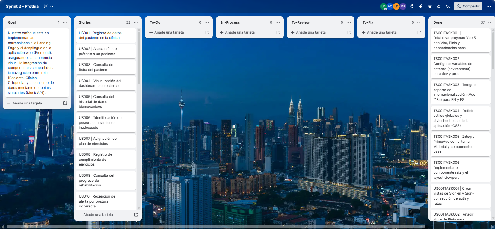

*Nota. Captura del tablero en Trello.*

**Enlace del tablero de Trello:**  
https://trello.com/invite/b/6a3482081843e32dea421094/ATTI18eefa82ccf88b07429958c3ca4d886e7D9A78CB/sprint-2-prothia

| **Story Id** | **User Story Title** | **Task Id** | **Task Title** | **Task Description** | **Story point** | **Assigned** | **Status** |
| :--- | :--- | :--- | :--- | :--- | :--- | :--- | :--- |
| US-01 | Registro de datos del paciente en la clínica | US001TASK001 | Formulario y store de alta de pacientes | Implementar entidad `Patient`, patient store y formulario de registro clínico con validación de DNI y nivel K. | 3 | Oscar | Done |
| US-02 | Asociación de prótesis a un paciente | US002TASK001 | Modal de vinculación de prótesis | Desarrollar diálogo en el módulo workshop para asociar una prótesis disponible del inventario a un paciente. | 3 | Leonardo | Done |
| US-03 | Consulta de ficha del paciente | US003TASK001 | Vista de directorio y expediente 360 | Implementar lista de pacientes, filtros de selección y vista de expediente clínico integral con prótesis vinculada. | 2 | Oscar | Done |
| US-04 | Visualización del dashboard biomecánico | US004TASK001 | Dashboard de telemetría clínica | Construir la vista de monitoreo biomecánico con métricas de cadencia, simetría bilateral, ángulo sagital e impacto. | 4 | Oscar | Done |
| US-05 | Consulta del historial de datos biomecánicos | US005TASK001 | Vista de historial de marcha en portal paciente | Implementar vista gait history monitoring en patient-portal con gráficos de evolución semanal y sesiones. | 3 | Carlos | Done |
| US-06 | Identificación de postura o movimiento inadecuado | US006TASK001 | Vista de telemetría en vivo para paciente | Desarrollar pantalla de biofeedback en vivo (live telemetry) con indicadores visuales de alineación postural. | 4 | Carlos | Done |
| US-07 | Asignación de plan de ejercicios | US007TASK001 | Editor de prescripción terapéutica | Crear entidades `Prescription` y `Exercise`, servicio API, store Pinia y vista de asignación de rutinas clínicas. | 4 | Camila | Done |
| US-08 | Registro de cumplimiento de ejercicios | US008TASK001 | Vista de ejercicios diarios del paciente | Implementar en patient-portal la lista interactiva de ejercicios prescritos para marcar series completadas. | 3 | Carlos | Done |
| US-09 | Consulta del progreso de rehabilitación | US009TASK001 | Dashboard "Mi Día" y adherencia | Desarrollar el panel de resumen diario del paciente y el indicador porcentual de adherencia semanal. | 3 | Carlos | Done |
| US-10 | Recepción de alerta por postura incorrecta | US010TASK001 | Centro de alertas clínicas | Implementar entidad `Alert`, store y bandeja de eventos críticos por desviación postural en monitoring. | 3 | Oscar | Done |
| US-13 | Registro de historial técnico de la prótesis | US013TASK001 | Bitácora e inventario de flota protésica | Implementar entidad `Prosthesis`, tablas de flota y registro de intervenciones mecánicas en workshop. | 3 | Leonardo | Done |
| US-14 | Programación de mantenimiento preventivo | US014TASK001 | Agenda de mantenimiento preventivo | Desarrollar entidad `MaintenanceSchedule`, store Pinia y calendario de revisiones técnicas agendadas. | 3 | Leonardo | Done |
| US-15 | Recepción de alerta de mantenimiento requerido | US015TASK001 | Centro de alertas de fatiga mecánica | Implementar entidad `MechanicalAlert` y vista de avisos por exceso de ciclos o pico de fuerza en taller. | 2 | Leonardo | Done |
| US-16 | Envío de mensajes entre paciente y clínica | US016TASK001 | Módulo de mensajería clínica | Crear entidad `ClinicalMessage` en communication y vista de chat directo en patient-portal. | 3 | Camila/Carlos | Done |
| US-17 | Compartir información entre clínica y ortopedia | US017TASK001 | Vista de coordinación con taller ortopédico | Implementar entidad `Transmission`, store y formulario para transmitir fichas biomecánicas al taller. | 4 | Camila | Done |
| US-18 | Consulta de notificaciones generales | US018TASK001 | Menú de opciones y avisos de cuenta | Desarrollar el Bounded Context option con store Pinia, API client y componente de presentación. | 3 | Rafael | Done |
| US-19 | Contratación de suscripción anual | US019TASK001 | Vista de suscripción y facturación clínica | Implementar entidades `ClinicSubscription` e `ElectronicInvoice`, servicio API, store y vista en billing. | 4 | Leonardo | Done |
| US-20 | Adquisición de licencia de software | US020TASK001 | Gestión de licencia anual para taller | Integrar vista de control de licencia corporativa de software y cupos de prótesis activas en telemetría. | 2 | Leonardo | Done |
| US-21 | Consulta del estado de suscripción o licencia | US021TASK001 | Historial de comprobantes y vigencia | Mostrar barra de capacidad de cupos activos, vigencia del plan y tabla de facturas electrónicas emitidas. | 2 | Leonardo | Done |
| US-38 | Generación de reporte de progreso del paciente | US038TASK001 | Generador de reportes clínicos | Implementar entidad `ClinicalReport`, analytics store y vista de informe con firma y colegiatura. | 4 | Carlos | Done |
| US-39 | Exportación de datos históricos del paciente | US039TASK001 | Acciones de exportación CSV y PDF clínico | Añadir controles de selección de paciente, periodo de evaluación y botones de exportación. | 2 | Carlos | Done |

* Total de horas invertidas: 50 horas de trabajo colaborativo.

#### 5.2.2.4. Development Evidence for Sprint Review

Durante el Sprint 2, el equipo desarrolló el frontend de la aplicación web de Prothia, incorporando la configuración base de Vue 3, PrimeVue, Pinia, Vue Router e internacionalización (EN/ES), así como los Bounded Contexts de `shared`, `monitoring`, `patients`, `communication`, `prescription`, `billing`, `workshop`, `analytics`, `patient-portal`, `iam` y `option`. A continuación, se presenta el registro completo de los 75 commits reales del repositorio (Parte 1: Configuración inicial, shared y monitoring).

| Repository | Author / Branch | Commit Id | Commit Message | Descripción del cambio |
| :--- | :--- | :--- | :--- | :--- |
| Prothia-Frontend | anacamilapatricio-sketch | de2aa3c | chore: initial commit | Inicializa el repositorio base del proyecto frontend en Vue 3 y Vite. |
| Prothia-Frontend | anacamilapatricio-sketch | 6e21554 | chore: clean up code, remove unused imports, remove unused files | Limpia la plantilla inicial eliminando archivos e importaciones no utilizadas. |
| Prothia-Frontend | anacamilapatricio-sketch | a0a6754 | build: add dependencies for project features | Agrega dependencias de PrimeVue, Pinia, Vue Router, Axios y Vue I18n. |
| Prothia-Frontend | anacamilapatricio-sketch | b680551 | feat(i18n): add internationalization support for en and es locales | Configura el plugin de internacionalización para soporte en inglés y español. |
| Prothia-Frontend | anacamilapatricio-sketch | 2765848 | feat(in-app-navigation): add In-app navigation router | Incorpora la configuración base del enrutador de navegación interna. |
| Prothia-Frontend | anacamilapatricio-sketch | b991c56 | feat(state-management): add pinia for state management | Integra Pinia para la gestión centralizada de estado en la aplicación. |
| Prothia-Frontend | anacamilapatricio-sketch | 4c627e0 | feat(environment): add Environment variables for development and production | Añade archivos de variables de entorno para desarrollo y producción. |
| Prothia-Frontend | anacamilapatricio-sketch | 79385f9 | feat(ui): integrate PrimeVue with Material theme | Configura la librería de componentes PrimeVue con el tema visual Material. |
| Prothia-Frontend | anacamilapatricio-sketch | 998c483 | Merge pull request #1 from .../feature/project-configuration | Integra la rama de configuración base del proyecto mediante el PR #1. |
| Prothia-Frontend | OscarCheca | 2d73c91 | feat(shared): add BaseApi and BaseEndpoint infrastructure | Implementa las clases base de infraestructura HTTP para consumo de APIs. |
| Prothia-Frontend | OscarCheca | 2f19f47 | feat(shared): add role store | Crea el store compartido para gestionar el rol activo del usuario. |
| Prothia-Frontend | OscarCheca | 6a76f6e | feat(shared): add presentation views and components for shared | Agrega vistas de presentación y componentes transversales del módulo shared. |
| Prothia-Frontend | OscarCheca | 8f7b63b | refactor(router): fix router names | Estandariza los nombres de las rutas en el archivo de configuración del router. |
| Prothia-Frontend | OscarCheca | e782a9d | Merge branch 'feature/shared' into develop | Integra la rama feature/shared en la rama develop. |
| Prothia-Frontend | OscarCheca | 8326e33 | feat(monitoring): add domain | Crea las entidades de alertas y monitoreo. |
| Prothia-Frontend | anacamilapatricio-sketch | fe3110e | feat(communication): add clinical message and transmission domain entities | Crea las entidades de dominio para mensajes clínicos y transmisiones al taller. |
| Prothia-Frontend | anacamilapatricio-sketch | cb63011 | feat(communication): implement api client and data assemblers | Implementa el cliente API y los ensambladores del módulo communication. |
| Prothia-Frontend | anacamilapatricio-sketch | f036d5c | feat(communication): add communication state management store | Agrega el store de Pinia para gestionar transmisiones y mensajes clínicos. |
| Prothia-Frontend | anacamilapatricio-sketch | 86cd7ba | feat(communication): create workshop coordination view and routes | Desarrolla la vista de coordinación con centros ortopédicos y sus rutas. |
| Prothia-Frontend | anacamilapatricio-sketch | d68ae9d | feat(communication): integrate module routing, translations and mock endpoints | Integra las rutas del módulo, claves de traducción y endpoints simulados. |
| Prothia-Frontend | anacamilapatricio-sketch | 2be0fcf | Merge branch 'feature/communication' into develop | Integra la rama feature/communication en la rama develop. |
| Prothia-Frontend | anacamilapatricio-sketch | 48d668f | feat(prescription): add prescription and exercise domain entities | Define las entidades de dominio de prescripción terapéutica y ejercicios. |
| Prothia-Frontend | anacamilapatricio-sketch | 3cccc4a | feat(prescription): implement api service and exercise assemblers | Implementa el servicio API y ensambladores de planes de ejercicios. |
| Prothia-Frontend | anacamilapatricio-sketch | 4f89b83 | feat(prescription): add prescription pinia store | Crea el store de Pinia para administrar la prescripción de ejercicios. |
| Prothia-Frontend | anacamilapatricio-sketch | 9a23e41 | feat(prescription): implement prescription editor view and routes | Construye la vista del editor de prescripciones clínicas y sus rutas. |
| Prothia-Frontend | anacamilapatricio-sketch | 372627a | Merge branch 'feature/prescription' into develop | Integra la rama feature/prescription en la rama develop. |
| Prothia-Frontend | leo-dex45 | 1e22528 | feat(billing): add clinic subscription and electronic invoice domain entities | Define las entidades de suscripción de clínica y comprobantes electrónicos. |
| Prothia-Frontend | leo-dex45 | a7521d3 | feat(billing): implement api service and data assemblers | Implementa el servicio API y ensambladores de datos del módulo billing. |
| Prothia-Frontend | leo-dex45 | 1a35cd6 | feat(billing): add billing pinia store | Agrega el store de Pinia para el estado de suscripciones y facturación. |
| Prothia-Frontend | leo-dex45 | 1344515 | feat(billing): create clinic subscription view and routes | Desarrolla la vista de administración de suscripción anual y sus rutas. |
| Prothia-Frontend | Matthewnhfe | d7c4dca | feat(analytics): add clinical report domain entity | Define la entidad de dominio para los informes clínicos de evolución. |
| Prothia-Frontend | Matthewnhfe | f66113a | feat(analytics): implement api client and clinical report assembler | Implementa el cliente API y el ensamblador de reportes clínicos. |
| Prothia-Frontend | Matthewnhfe | 7340e25 | feat(analytics): add analytics state management store | Crea el store de Pinia para la gestión de métricas y reportes analíticos. |
| Prothia-Frontend | Matthewnhfe | d6176e7 | feat(analytics): create clinical reports view and routing | Desarrolla la vista generadora de reportes clínicos y su enrutamiento. |
| Prothia-Frontend | Matthewnhfe | 1466900 | feat(patient-portal): create patient layout and portal routing definition | Construye la estructura visual y definición de rutas del portal del paciente. |
| Prothia-Frontend | Matthewnhfe | dba99d2 | feat(patient-portal): add dashboard and daily routine views | Añade el dashboard principal "Mi Día" y la vista de rutina diaria del paciente. |
| Prothia-Frontend | Matthewnhfe | 90fa5d1 | feat(patient-portal): add live telemetry and gait history monitoring views | Implementa las vistas de telemetría en vivo e historial biomecánico de marcha. |
| Prothia-Frontend | Matthewnhfe | 4e759bb | feat(patient-portal): add patient exercises and messaging views | Agrega las vistas de ejercicios asignados y mensajería con el fisioterapeuta. |
| Prothia-Frontend | Matthewnhfe | 06447aa | Merge branch 'feature/patient-portal' into develop | Integra la rama feature/patient-portal en la rama develop. |
| Prothia-Frontend | Matthewnhfe | b1e17e2 | chore(config): configure html entrypoint and vite client type definitions | Configura el archivo raíz index.html y las definiciones de tipos de Vite. |
| Prothia-Frontend | Matthewnhfe | f195df2 | style: define global styles and base application stylesheet | Define las variables CSS globales y la hoja de estilos base de Prothia. |
| Prothia-Frontend | Matthewnhfe | e7cbea8 | feat(app): implement root application component and layout viewport | Implementa el componente raíz App.vue y el contenedor de vistas. |
| Prothia-Frontend | Matthewnhfe | f7504b6 | feat(main): bootstrap vue application with plugins and global providers | Inicializa la instancia principal de Vue integrando plugins y proveedores. |
| Prothia-Frontend | Matthewnhfe | 99b7680 | chore(config): configure development environment variables | Ajusta la configuración de variables de entorno para el servidor local. |
| Prothia-Frontend | Matthewnhfe | 1614be1 | Merge branch 'feature/app-setup' into develop | Integra la rama feature/app-setup en develop |

#### 5.2.2.5.Execution Evidence for Sprint Review

En esta sección se presentan las evidencias de ejecución de la aplicación web de Prothia correspondientes al Sprint 2, siguiendo la estructura de presentación de referencia de Noxway. Las vistas muestran las interfaces desarrolladas en Vue 3 y PrimeVue y los resultados de las interacciones desde los perfiles de Paciente Amputado, Profesional de Clínica de Rehabilitación y Técnico de Centro Ortopédico.

**Enlaces de Ejecución Pública en Producción**
*   **Aplicación Web Desplegada (Prothia Frontend):** https://prothia-web-app-7003f.web.app/
*   **Landing Page Desplegada (v2.0):** https://upc-pre-202620-1asi0730-8155-seniorsip.github.io/SeniorsInProcess-Prothia-LandingPage/

*Figura 1. Inicio de Sesión y Selección de Rol (Módulo IAM).*

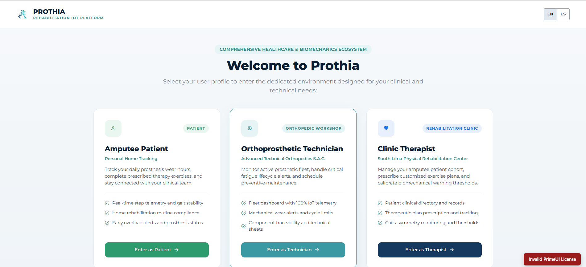

*Figura 2. Dashboard Principal del Paciente ("Mi Día" - Patient Portal).*

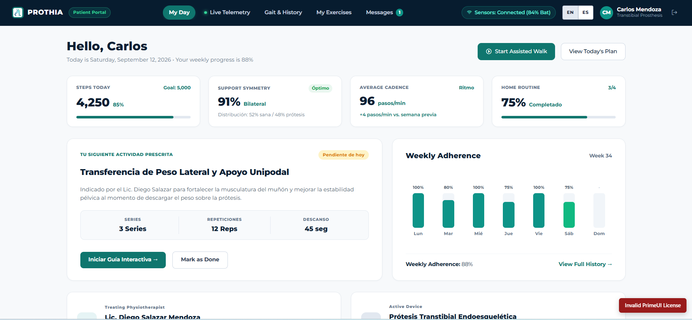

*Figura 3. Telemetría Biomecánica en Vivo e Historial de Marcha.*

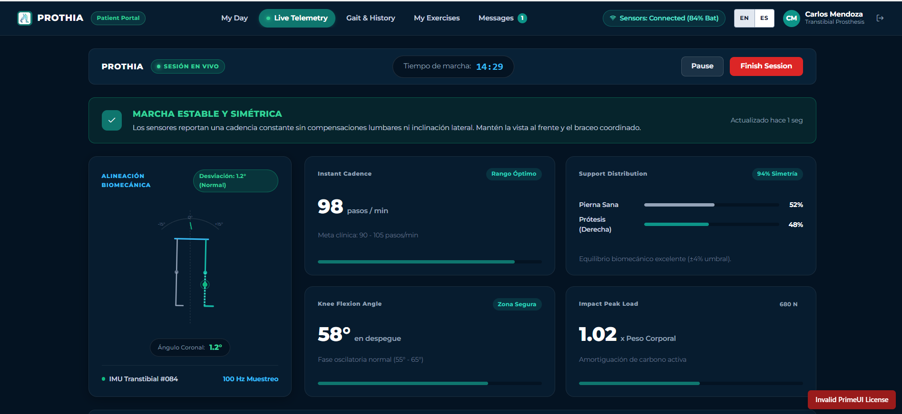

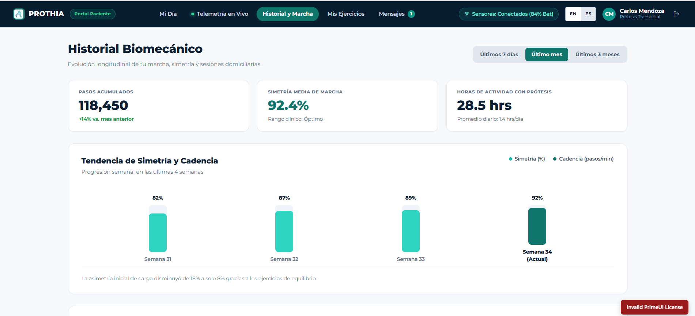

*Figura 4. Mis Ejercicios y Mensajería Clínica del Paciente.*

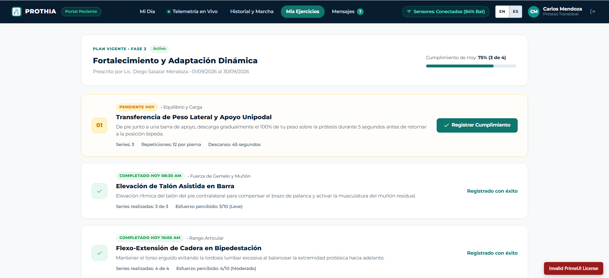

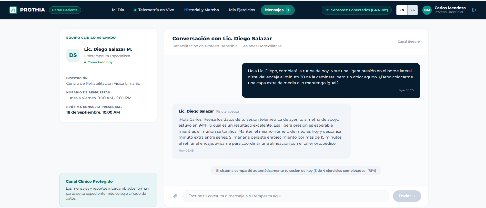

*Figura 5. Dashboard Clínico y Alta de Pacientes (Módulo Patients).*

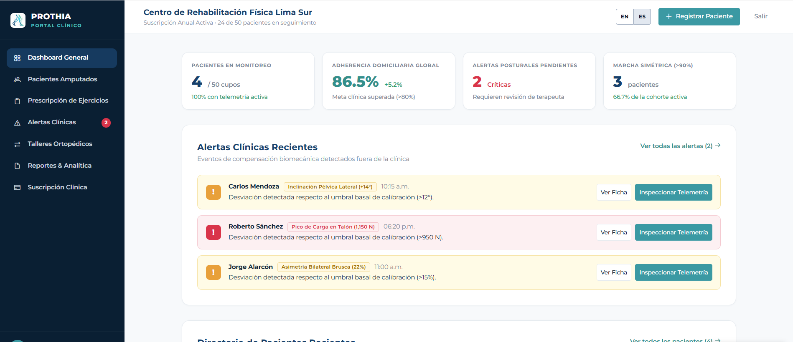

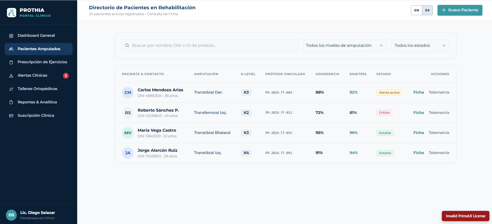

*Figura 6. Prescripción Terapéutica y Centro de Alertas (Prescription & Monitoring).*

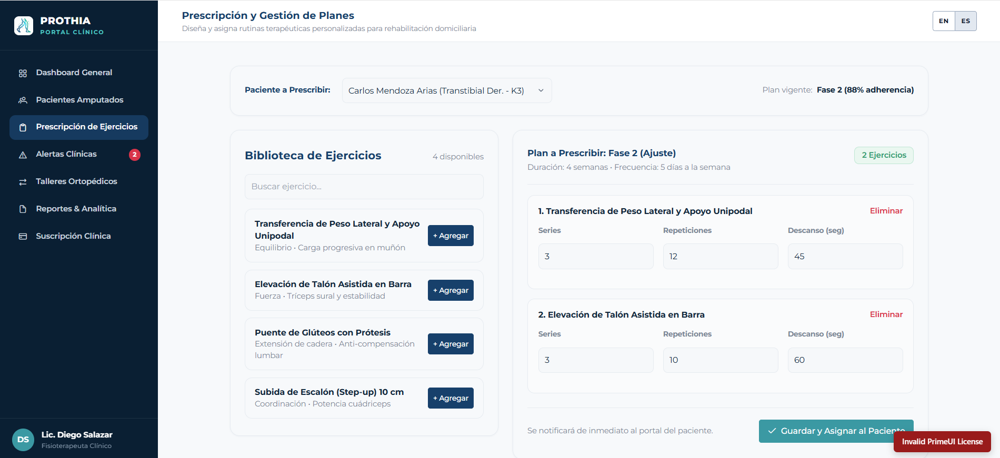

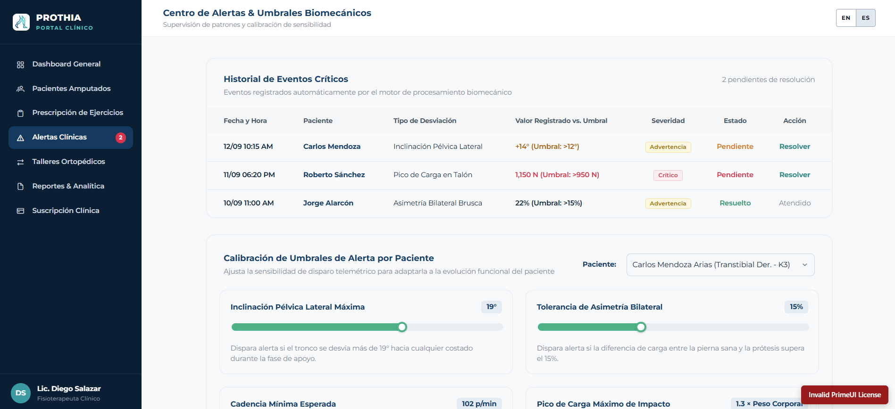

*Figura 7. Coordinación con Ortopedia, Reportes y Suscripción (Communication, Analytics & Billing).*

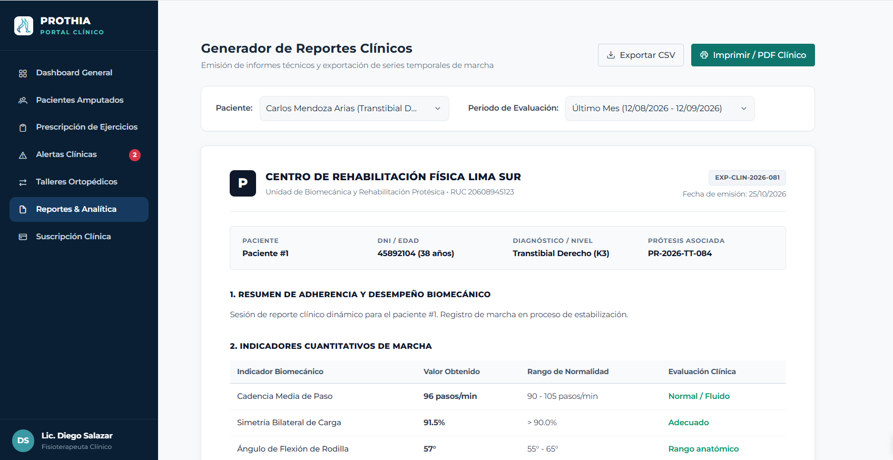

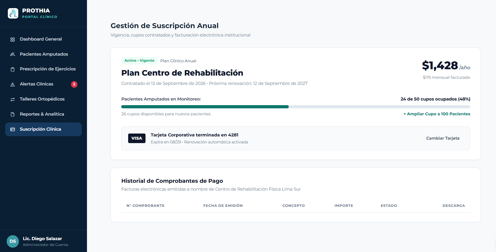

*Figura 8. Portal del Taller Ortopédico: Flota, Mantenimiento y Alertas (Módulo Workshop).*

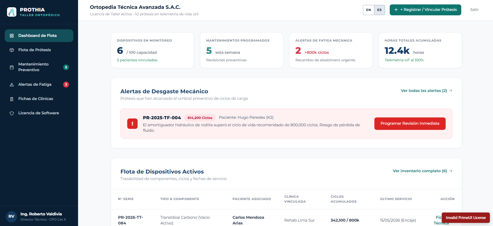

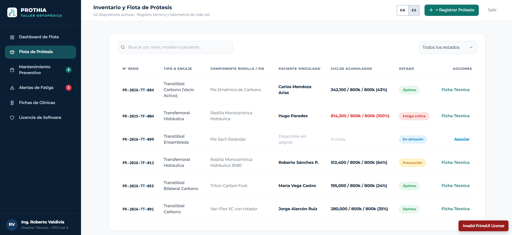

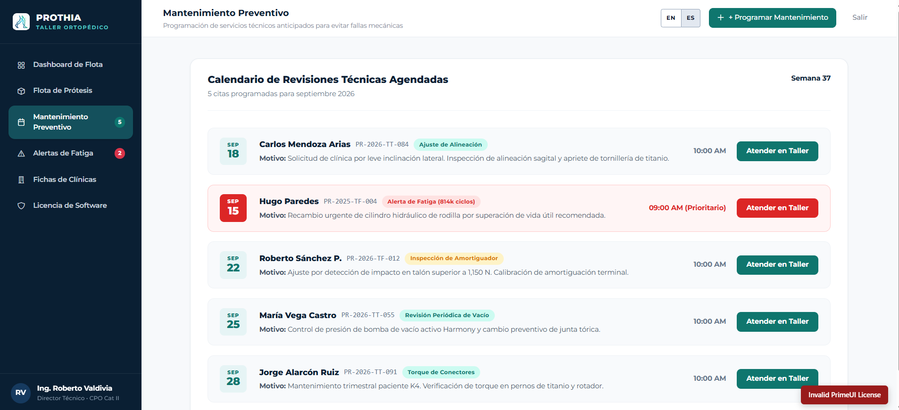

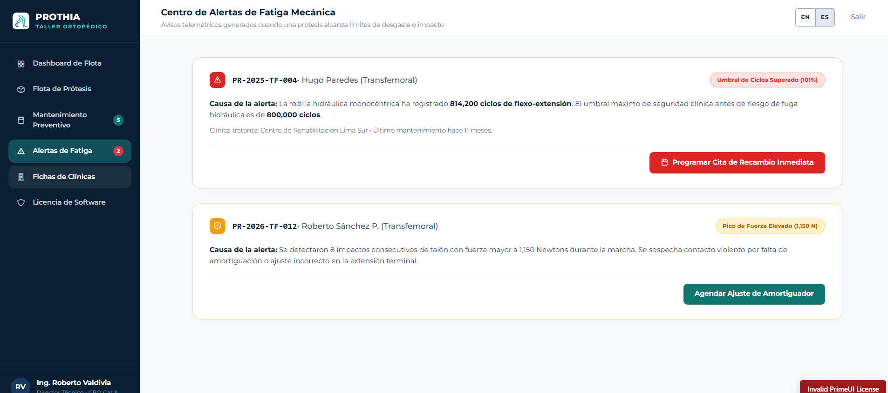

#### 5.2.2.6. Services Documentation Evidence for Sprint Review

Durante el Sprint 2 se implementaron los servicios de consumo HTTP en el frontend de Prothia (SeniorsInProcess-Prothia-Frontend) apoyados en la infraestructura compartida BaseApi y BaseEndpoint (basada en Axios) y en clases Assembler para transformar los recursos JSON hacia las entidades de dominio de cada Bounded Context.

En el entorno de desarrollo local se utiliza JSON Server con datos simulados definidos en el archivo server/db.json. Para el entorno de producción desplegado, la configuración en environment.production conecta los servicios con endpoints mock en la nube (Beeceptor / Mock API). Los ejemplos presentados en la tabla muestran los campos principales de los recursos consumidos por cada módulo del frontend.

**Configuración de URLs Base de Servicios en el Frontend**
*   **URL base local (JSON Server):** http://localhost:3000
*   **Repositorio con servicios y datos simulados:** https://github.com/upc-pre-202620-1asi0730-8155-SeniorsIP/SeniorsInProcess-Prothia-Frontend

| Acción / Módulo | Método HTTP | Sintaxis de llamada local | Parámetros / cuerpo | Ejemplo parcial de respuesta | Explicación |
| :--- | :--- | :--- | :--- | :--- | :--- |
| Consultar pacientes (patients) | GET | http://localhost:3000/patients | Ninguno | `[{"id":1,"fullName": "Carlos Mendoza Arias", "kLevel":"K3"}]` | Devuelve el directorio de pacientes amputados registrados en la clínica. |
| Registrar paciente (patients) | POST | http://localhost:3000/patients | Body JSON (Patient) | `{"id": 5, "dni": "45892104", "amputationLevel": "Transtibial"}` | Almacena un nuevo paciente en el catálogo clínico y actualiza el store. |
| Consultar sesiones (monitoring) | GET | http://localhost:3000/gaitSessions | Ninguno | `[{"id":1,"patientId":1, "cadence":96, "symmetry":92.4}]` | Obtiene las sesiones telemétricas de marcha y sus métricas biomecánicas. |
| Consultar alertas (monitoring) | GET | http://localhost:3000/alerts | Ninguno | `[{"id": 1, "patientName": "Carlos Mendoza", "severity":"Warning"}]` | Devuelve el historial de alertas clínicas por desviación postural o impacto. |
| Consultar umbrales (monitoring) | GET / PUT | http://localhost:3000/thresholds | Body JSON en PUT | `[{"id":1,"patientId":1, "maxPelvicTilt":12,"maxAsymmetry":15}]` | Consulta o actualiza los parámetros de sensibilidad de alerta por paciente. |
| Consultar planes (prescription) | GET / POST | http://localhost:3000/prescriptions | Body JSON en POST | `[{"id":1,"patientId":1, "phase": "Fase 2", "adherence":88}]` | Obtiene o publica planes de prescripción terapéutica y ejercicios asignados. |
| Consultar transmisiones (communication) | GET / POST | http://localhost:3000/transmissions | Body JSON en POST | `[{"id":1,"patientName":"Carlos Mendoza", "workshop":"Ortopedia Avanzada"}]` | Lista o registra el envío de fichas biomecánicas entre clínica y ortopedia. |
| Consultar mensajes (communication) | GET / POST | http://localhost:3000/clinicalMessages | Body JSON en POST | `[{"id":1,"sender": "Lic. Diego Salazar", "text": "Mantén el apoyo..."}]` | Gestiona los mensajes de interconsulta entre el paciente y su fisioterapeuta. |

#### 5.2.2.7. Software Deployment Evidence for Sprint Review

Durante el Sprint 2 se realizó el despliegue de la primera versión funcional del frontend de Prothia mediante Firebase Hosting, habilitando su acceso público desde cualquier navegador web. El proyecto utilizado en la consola de Firebase se identifica como prothia-web-app-7003f. Asimismo, se actualizó el despliegue de la Landing Page en GitHub Pages conectando sus botones de acción directamente hacia la aplicación web desplegada.

**Datos de Alojamiento y Publicación (Sprint 2)**
*   **Plataforma de alojamiento de la Web Application:** Firebase Hosting (prothia-web-app-7003f).
*   **Repositorio del Frontend:** https://github.com/upc-pre-202620-1asi0730-8155-SeniorsIP/SeniorsInProcess-Prothia-Frontend
*   **Aplicación Web Desplegada:** https://prothia-web-app-7003f.web.app/

*Figura 1. Evidencia de publicación en Firebase Hosting.*

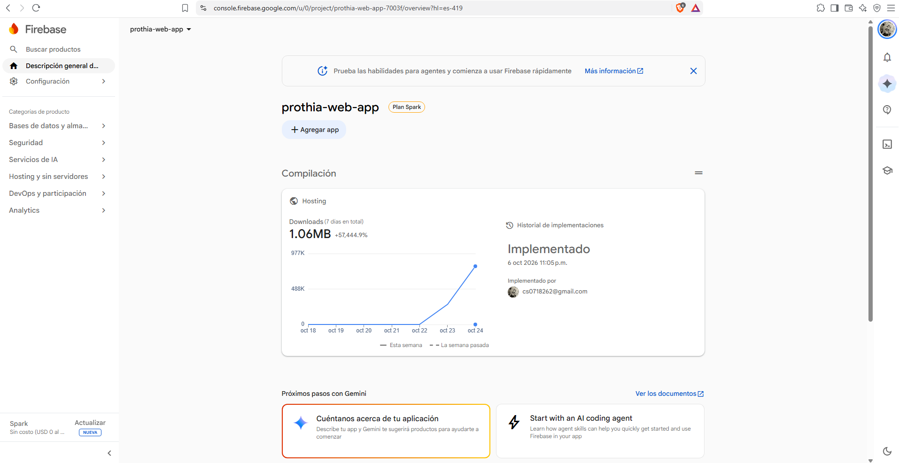

#### 5.2.2.8. Team Collaboration Insights during Sprint

Durante el Sprint 2, el equipo organizó el desarrollo del frontend de Prothia mediante ramas de funcionalidades (feature/<bounded-context>) y su integración progresiva en la rama develop y main. La siguiente tabla resume los aportes reales verificados en el historial de commits del repositorio SeniorsInProcess-Prothia-Frontend:

| Integrante | Usuario de GitHub | Aportes registrados en SeniorsInProcess-Prothia-Frontend |
| :--- | :--- | :--- |
| Patricio Farias, Ana Camila | anacamilapatricio-sketch | Inicialización del repositorio, configuración de dependencias, i18n, router, Pinia, variables de entorno y PrimeVue Material (PR #1); desarrollo completo e integración de los módulos Communication y Prescription . |
| Checa Burga, Oscar Diego | OscarCheca | Desarrollo de la infraestructura Shared (BaseApi, BaseEndpoint, role store, vistas compartidas), diccionarios en.json y es.json, e implementación completa de los módulos Monitoring y Patients . |
| Dextre Flores, Leonardo Felix | leo-dex45 | Desarrollo completo de los módulos Billing (entidades, API service, Pinia store y vista de suscripción clínica) y Workshop (flota de prótesis, agenda de mantenimiento preventivo, alertas mecánicas y vistas de taller) . |
| Salcedo Correa, Carlos Matthew | Matthewnhfe | Desarrollo de los módulos Analytics (reportes clínicos) y Patient-Portal (layout, dashboard diario, telemetría en vivo, historial de marcha, ejercicios y mensajes), además de la configuración raíz App-Setup . |
| Barrenechea Bustamante, Rafael Andre | yafussssss | Desarrollo completo del módulo IAM (entidad de usuario, comandos auth, cliente API, interceptores, auth guard, Pinia store y vistas sign-in/sign-up), del módulo Option y actualización del README.md. |

**Figura**  
*Métricas de colaboración y commits en GitHub Insights para el Sprint 2*

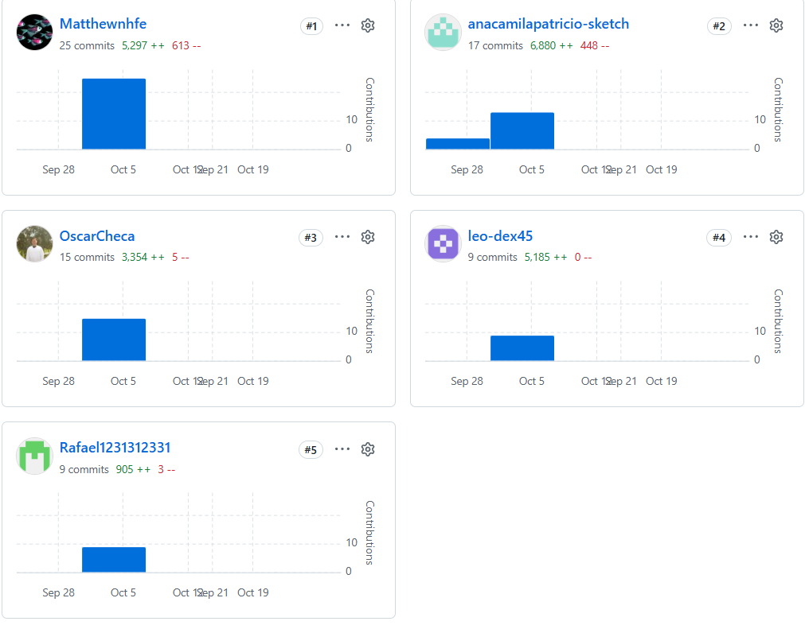

*Nota. Registro de contribuciones y frecuencia de commits de los integrantes del equipo durante el Sprint 2 obtenido desde GitHub Insights.*

### 5.2.3. Sprint 3

Durante el Sprint 3, el equipo centró su esfuerzo en el diseño, implementación y documentación del servicio backend (**Prothia Platform REST API**) utilizando **C#**, **ASP.NET Core (.NET 10)** y **Entity Framework Core** bajo una arquitectura guiada por el dominio (**DDD**) y **Clean Architecture**. Asimismo, se configuró la persistencia relacional en **MySQL** (administrada mediante **MySQL Workbench**), se estandarizó el manejo de errores mediante **RFC 9457 (`ProblemDetails`)**, se documentaron los contratos mediante **Scalar / OpenAPI** con soporte de internacionalización (`i18n`) y autenticación **HTTP Bearer Token (JWT)**, y se establecieron las bases de integración con la aplicación web frontend.

#### 5.2.3.1. Sprint Planning 3

En esta sesión se establecieron las prioridades técnicas para construir los 8 *Bounded Contexts* principales del servidor (`Patients`, `Prescriptions`, `Monitoring`, `Workshop`, `Communication`, `Analytics`, `Billing` e `IAM`) apoyados en el núcleo transversal `Shared`, abarcando las **21 Technical Stories** especificadas para la API RESTful (`TS-PAT-001` a `TS-IAM-002`).

| Campo | Detalle | 
| ----- | ----- | 
| **Sprint #** | Sprint 3 | 
| **Sprint Planning Background** | Reunión de planificación orientada a la implementación del backend RESTful en ASP.NET Core (.NET 10), configuración de persistencia relacional en MySQL Workbench, estandarización de respuestas RFC 9457 (`ProblemDetails`), exposición de documentación interactiva con Scalar/OpenAPI e integración con el frontend en Vue 3. | 
| **Date** | 2026-10-20 | 
| **Time** | 08:00 PM | 
| **Location** | Reunión virtual mediante Discord y Microsoft Teams | 
| **Prepared By** | Salcedo Correa, Carlos Mathhew / Checa Burga, Oscar Diego | 
| **Attendees (to planning meeting)** | Patricio Farias, Ana Camila / Checa Burga, Oscar Diego / Dextre Flores, Leonardo Felix / Salcedo Correa, Carlos Mathhew / Barrenechea Bustamante, Rafael Andre | 
| **Sprint 2 Review Summary** | Se validó y desplegó la primera versión de la Web Application en Vue 3 y PrimeVue sobre Firebase Hosting, integrando enrutamiento por roles, soporte multilingüe (ES/EN) y mejoras en la Landing Page. | 
| **Sprint 2 Retrospective Summary** | **Start:** Estandarizar el patrón *Result*, el formato de error RFC 9457 (`ProblemDetails`), convenciones *snake_case* en base de datos y *kebab-case* en rutas (`/api/v1/...`) desde el módulo `Shared` antes de codificar cada contexto. **Continue:** Mantener la integración progresiva mediante ramas `feature/` bajo GitFlow y control de versiones semántico en el `CHANGELOG`. **Stop:** Duplicar lógica de validación entre capas de dominio e interfaz. | 
| **Sprint 3 Goal** | **Nuestro enfoque es** implementar y desplegar la primera versión de la interfaz de programación de aplicaciones RESTful en ASP.NET Core, con persistencia de datos en MySQL e integración con la aplicación web. **Creemos que esto permitirá** garantizar la trazabilidad clínica, la persistencia de datos de telemetría biomecánica y la gestión confiable de prótesis para pacientes amputados, profesionales de rehabilitación y técnicos ortoprotesistas. **Esto se comprobará cuando** los puntos de acceso documentados en Scalar/OpenAPI procesen y almacenen correctamente las transacciones de los contextos delimitados en MySQL, devolviendo códigos de estado HTTP estandarizados. | 
| **Sprint 3 Velocity** | 63 Story Points | 
| **Sum of Story Points** | 63 Story Points (21 Technical Stories: `TS-PAT-001` a `TS-IAM-002`) | 

#### 5.2.3.2. Aspect Leaders and Collaborators

Para distribuir responsabilidades con claridad, se elaboró la matriz **LACX**. **Oscar Checa** lideró la persistencia en base de datos (**MySQL Workbench**) y la documentación/pruebas en **Scalar / OpenAPI**, mientras que **Carlos Salcedo** lideró el desarrollo del **Backend API**, la **integración Frontend-Backend** y el **despliegue Cloud**.

| Team Member (Last Name, First Name) | GitHub Username | Backend API Development (L/C) | Database & Persistence - MySQL (L/C) | Frontend-Backend Integration (L/C) | Documentation & Testing - Scalar/OpenAPI (L/C) | Cloud Deployment (L/C) | 
| ----- | ----- | ----- | ----- | ----- | ----- | ----- | 
| Barrenechea Bustamante, Rafael Andre | `Rafael1231312331` | C | C | C | C | C | 
| Checa Burga, Oscar Diego | `OscarCheca` | C | **L** | C | **L** | C | 
| Dextre Flores, Leonardo Felix | `leo-dex45` | C | C | C | C | C | 
| Patricio Farias, Ana Camila | `anc-f4` | C | C | C | C | C | 
| Salcedo Correa, Carlos Mathhew | `Matthewnhfe` | **L** | C | **L** | C | **L** | 

#### 5.2.3.3. Sprint Backlog 3

El objetivo del Sprint Backlog 3 fue descomponer las **21 Technical Stories** (`TS-PAT-001` a `TS-IAM-002`) y los requisitos transversales del núcleo `Shared` en tareas técnicas concretas (*Work-Items*) estimadas en horas.

* **Tablero de Trello Sprint 3:** https://trello.com/invite/b/6af24524b9b52bebb1362092/ATTI56729a1c7f447b96c1b198fbaad9384d9A36EF96/sprint-3-prothia

* **Captura del Tablero de Trello Sprint 3:**
  
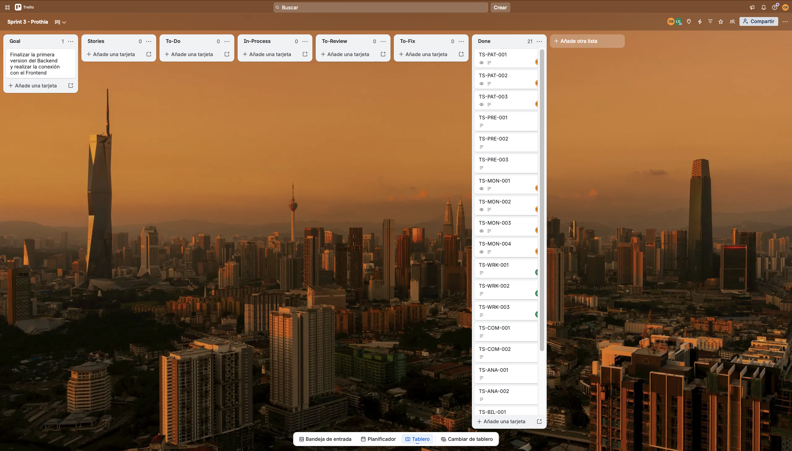

| Story Id | Story Title | Task Id | Task Title | Task Description | Estimation (Hours) | Assigned To | Status | 
| ----- | ----- | ----- | ----- | ----- | ----- | ----- | ----- | 
| **TS-PAT-001** | Register a New Patient | `TS-PAT-001-T01` | Infraestructura Base y Shared Kernel | Inicializar solución `prothia.sln` (.NET 10), configurar `BaseRepository`, `UnitOfWork`, interceptores de auditoría, convenciones `snake_case`/`kebab-case`, *Result pattern* y errores RFC 9457 `ProblemDetails`. | 5 h | Ana Camila / Oscar | Done | 
| **TS-PAT-001** | Register a New Patient | `TS-PAT-001-T02` | Comando de Alta de Paciente y Validación DNI | Implementar agregado `Patient`, objetos de valor (`Dni`, `KLevel`, `AmputationLevel`, `ProsthesisCode`), validación de unicidad de DNI y endpoint `POST /api/v1/patients` con cabecera `Location`. | 4 h | Oscar | Done | 
| **TS-PAT-002** | Query All Registered Patients | `TS-PAT-002-T01` | Consulta de Directorio Clínico de Pacientes | Implementar `PatientQueryService` con lectura sin seguimiento (*non-tracking read*), ensamblador `PatientResource` y endpoint `GET /api/v1/patients`. | 2 h | Oscar | Done | 
| **TS-PAT-003** | Query Patient by Identifier | `TS-PAT-003-T01` | Consulta de Paciente por ID y Fachada ACL | Implementar consulta individual `GET /api/v1/patients/{id}`, manejo de `404 Not Found` y exposición de `IPatientsContextFacade` para otros contextos. | 3 h | Oscar | Done | 
| **TS-PRE-001** | Query Rehabilitation Exercise Catalog | `TS-PRE-001-T01` | Catálogo de Ejercicios Terapéuticos | Implementar agregado `Exercise`, repositorio EF Core, servicio de consulta y endpoint `GET /api/v1/exercises` retornando `ExerciseResource` (`id`, `name`, `focus`). | 3 h | Ana Camila | Done | 
| **TS-PRE-002** | Create Exercise Prescription for Patient | `TS-PRE-002-T01` | Emisión de Prescripción Terapéutica con ACL | Implementar agregado `Prescription`, entidad `PrescribedExercise`, validación de paciente vía ACL (`ExternalPatientService`) y endpoint `POST /api/v1/prescriptions`. | 4 h | Ana Camila | Done | 
| **TS-PRE-003** | Get Prescription by Patient ID | `TS-PRE-003-T01` | Consulta de Prescripción Activa por Paciente | Implementar consulta de rutina activa por paciente en repositorio EF Core y exponer endpoint `GET /api/v1/prescriptions/patient/{patientId}`. | 2 h | Ana Camila | Done | 
| **TS-MON-001** | Record Telemetry Gait Session | `TS-MON-001-T01` | Ingesta de Sesiones de Marcha IoT | Implementar agregados `GaitSession` y `GaitSessionAudit`, comando `RecordGaitSessionCommand` y endpoint `POST /api/v1/gait-sessions` para persistir pasos, cadencia, simetría y picos de impacto. | 4 h | Oscar | Done | 
| **TS-MON-002** | Query Clinical Postural Alerts | `TS-MON-002-T01` | Consulta Cronológica de Alertas Posturales | Implementar agregado `Alert`, repositorio EF Core y endpoint `GET /api/v1/alerts` ordenado por fecha de ocurrencia retornando `AlertResource`. | 3 h | Oscar | Done | 
| **TS-MON-003** | Resolve Postural Alert | `TS-MON-003-T01` | Resolución de Alertas Clínicas | Implementar comando `ResolveAlertCommand`, actualización de estado a `Resolved` con marca temporal `resolvedAt` y endpoint `PUT /api/v1/alerts/{id}/resolve`. | 2 h | Oscar | Done | 
| **TS-MON-004** | Calibrate Patient Threshold Profile | `TS-MON-004-T01` | Calibración de Perfiles de Umbrales Biomecánicos | Implementar agregado `ThresholdProfile` (`pelvicTilt`, `asymmetry`, `cadence`, `impactPeak`) y endpoints `POST` y `PUT /api/v1/threshold-profiles`. | 3 h | Oscar | Done | 
| **TS-WRK-001** | Register / Associate a Prosthesis | `TS-WRK-001-T01` | Registro y Asociación de Prótesis en Flota | Implementar agregado `Prosthesis` y `ProsthesisAudit` (`serialNumber`, `kLevel`, `socketType`), repositorio EF Core y endpoint `POST /api/v1/prostheses`. | 4 h | Leonardo | Done | 
| **TS-WRK-002** | Schedule Preventive Maintenance | `TS-WRK-002-T01` | Programación de Mantenimiento Preventivo | Implementar agregado `MaintenanceSchedule`, validación de fechas e identificadores fuertemente tipados, y endpoint `POST /api/v1/maintenance-schedules`. | 3 h | Leonardo | Done | 
| **TS-WRK-003** | Mechanical Alert Dispatch & Resolution | `TS-WRK-003-T01` | Despacho y Resolución de Alertas Mecánicas | Implementar agregado `MechanicalAlert` (`MechanicalAlertSeverity`, `MechanicalAlertStatus`), creación de alertas por sobrecarga y resolución vía `PUT /api/v1/mechanical-alerts/{id}/resolve`. | 3 h | Leonardo | Done | 
| **TS-COM-001** | Transmit Clinical File to Workshop | `TS-COM-001-T01` | Transmisión de Ficha Clínica a Taller Externo | Implementar modelo de transmisión clínica, configuración EF Core, servicio ACL y endpoint `POST /api/v1/clinical-transmissions` retornando `ClinicalTransmissionResource` (`status: 'Transmitted'`). | 4 h | Ana Camila / Rafael | Done | 
| **TS-COM-002** | Exchange Clinical Coordination Messages | `TS-COM-002-T01` | Mensajería de Coordinación Clínica y Notificaciones | Implementar agregados `Message` y `UserNotification`, servicios CQRS con patrón *Result* y endpoints `GET` y `POST /api/v1/clinical-messages`. | 4 h | Rafael / Ana Camila | Done | 
| **TS-ANA-001** | Generate and Issue Clinical Report | `TS-ANA-001-T01` | Generación y Emisión de Reporte Clínico | Implementar agregado `ClinicalReport`, entidad `ReportIndicator`, validación de RUC (`TaxId`), colegiatura (`TherapistRegistry`) y paciente vía ACL, y endpoint `POST /api/v1/reports`. | 5 h | Carlos | Done | 
| **TS-ANA-002** | Query Reports by ID or Patient | `TS-ANA-002-T01` | Consulta de Reportes Clínicos y Serialización CSV | Implementar `ClinicalReportRepository` con *eager loading* de indicadores, serialización CSV (`KinematicIndicator`) y endpoints `GET /api/v1/reports` y `GET /api/v1/reports/{id}`. | 3 h | Carlos | Done | 
| **TS-BIL-001** | Manage Clinic Subscription | `TS-BIL-001-T01` | Gestión de Suscripciones y Cupos de Clínica | Implementar agregado `ClinicSubscription`, objetos de valor (`PatientQuota`, `SubscriptionPeriod`, `PaymentMethodSummary`) y endpoints `GET` y `PUT /api/v1/clinic-subscriptions/{id}`. | 4 h | Leonardo | Done | 
| **TS-BIL-002** | Query Electronic Invoices | `TS-BIL-002-T01` | Emisión y Consulta de Facturas Electrónicas | Implementar agregado `ElectronicInvoice` (`Money`, `InvoiceNumber`, `InvoiceStatus`), repositorio ordenado y endpoint `GET /api/v1/invoices`. | 3 h | Leonardo | Done | 
| **TS-IAM-001** | User Sign-Up | `TS-IAM-001-T01` | Registro de Cuentas de Usuario con BCrypt | Implementar agregado `User`, servicio de hashing `BCrypt`, detección de duplicidad (`409 Conflict`) y endpoint `POST /api/v1/authentication/sign-up`. | 3 h | Carlos | Done | 
| **TS-IAM-002** | User Sign-In & Token Issuance | `TS-IAM-002-T01` | Autenticación JWT, Middleware y Conexión MySQL | Implementar emisor de tokens JWT, middleware de autorización Bearer, endpoint `POST /api/v1/authentication/sign-in`, cadena de conexión MySQL y documentación Scalar/OpenAPI (`v0.1.7`). | 4 h | Carlos / Oscar | Done | 

#### 5.2.3.4. Development Evidence for Sprint Review

Durante el Sprint 3 se implementó la arquitectura completa del servidor en el repositorio `SeniorsInProcess-Prothia-Backend` siguiendo el flujo de ramas `feature/<context>` integradas hacia `develop`. La siguiente tabla consolida los **28 commits más relevantes** que evidencian la construcción progresiva de las 21 Technical Stories y la participación de los cinco integrantes del equipo:

| Repository | Branch | Commit Id | Commit Message | Commit Message Body / Descripción | Commited on (Date) | 
| ----- | ----- | ----- | ----- | ----- | ----- | 
| `SeniorsInProcess-Prothia-Backend` | `feature/project-configuration` | `3fd6bcc` | `chore: initial commit` | Inicializa el repositorio base y estructura de solución `.sln` en .NET 10. | 20/10/2026 | 
| `SeniorsInProcess-Prothia-Backend` | `feature/project-configuration` | `2281704` | `build: add depedencies for solution features` | Agrega paquetes NuGet para Entity Framework Core, MySQL, mediador y OpenAPI. | 20/10/2026 | 
| `SeniorsInProcess-Prothia-Backend` | `feature/shared` | `3ad7b85` | `feat(conventions): add support for snake case and pluralized table naming conventions` | Configura convenciones de nomenclatura relacional `snake_case` para las tablas de base de datos. | 21/10/2026 | 
| `SeniorsInProcess-Prothia-Backend` | `feature/shared` | `c07ccb1` | `feat(persitence): implement base repository and unit of work` | Implementa el patrón `BaseRepository` y `UnitOfWork` sobre Entity Framework Core. | 21/10/2026 | 
| `SeniorsInProcess-Prothia-Backend` | `feature/shared` | `402a97a` | `feat(result): add abstraction for Result pattern implementation` | Incorpora la abstracción del patrón `Result` para el manejo estandarizado de errores y `ProblemDetails`. | 21/10/2026 | 
| `SeniorsInProcess-Prothia-Backend` | `feature/patients` | `4a9542e` | `feat(patient): add Patient aggregate` | Modela la raíz de agregado `Patient` junto con sus objetos de valor clínicos (`TS-PAT-001`). | 28/10/2026 | 
| `SeniorsInProcess-Prothia-Backend` | `feature/analytics` | `84d72df` | `feat(analytics): add ClinicalReport aggregate root` | Modela el agregado `ClinicalReport` e indicadores cinemáticos con soporte CSV (`TS-ANA-001`). | 28/10/2026 | 
| `SeniorsInProcess-Prothia-Backend` | `feature/billing` | `7dc0c2d` | `feat(billing): add ClinicSubscription aggregate root with plan, quota and payment method validation` | Implementa el agregado `ClinicSubscription` con validaciones de cupos y periodo (`TS-BIL-001`). | 28/10/2026 | 
| `SeniorsInProcess-Prothia-Backend` | `feature/billing` | `57d8041` | `feat(billing): add ElectronicInvoice aggregate root with amount, currency and invoice number validation` | Implementa la raíz de agregado `ElectronicInvoice` con auditoría y validación de formato (`TS-BIL-002`). | 29/10/2026 | 
| `SeniorsInProcess-Prothia-Backend` | `feature/patients` | `e8b1b90` | `feat(patient): implement Patient repository` | Implementa la persistencia del repositorio de pacientes y contratos de servicio CQRS (`TS-PAT-002`, `TS-PAT-003`). | 30/10/2026 | 
| `SeniorsInProcess-Prothia-Backend` | `feature/analytics` | `2e793aa` | `feat(analytics): implement ExternalPatientService ACL adapter over IPatientsContextFacade` | Implementa el adaptador *Anti-Corruption Layer (ACL)* para validar pacientes desde `Analytics`. | 31/10/2026 | 
| `SeniorsInProcess-Prothia-Backend` | `feature/analytics` | `8b6607b` | `feat(analytics): implement ClinicalReportCommandService with patient validation and duplicate detection` | Desarrolla el servicio de comandos de reportes clínicos con detección de duplicados (`TS-ANA-001`). | 31/10/2026 | 
| `SeniorsInProcess-Prothia-Backend` | `feature/analytics` | `997af24` | `feat(analytics): implement ClinicalReportRepository with EF Core eager indicator loading` | Configura mapeos EF Core (`ApplyAnalyticsConfiguration`) y carga ansiosa de indicadores (`TS-ANA-002`). | 01/11/2026 | 
| `SeniorsInProcess-Prothia-Backend` | `feature/analytics` | `05bca90` | `feat(analytics): add ReportsController REST endpoints (/api/v1/reports)` | Expone los endpoints RESTful de reportes clínicos con metadatos OpenAPI localizados (`TS-ANA-001`, `TS-ANA-002`). | 01/11/2026 | 
| `SeniorsInProcess-Prothia-Backend` | `feature/billing` | `33c4b6b` | `feat(billing): add ApplyBillingConfiguration with EF Core mappings for ClinicSubscription and ElectronicInvoice` | Configura el mapeo relacional en EF Core e implementa los repositorios de facturación (`TS-BIL-001`, `TS-BIL-002`). | 01/11/2026 | 
| `SeniorsInProcess-Prothia-Backend` | `feature/patients` | `ab76d58` | `feat(patient): implement PatientsController for managing patients` | Implementa el controlador REST `PatientsController` y sus ensambladores de recursos (`TS-PAT-001` a `TS-PAT-003`). | 02/11/2026 | 
| `SeniorsInProcess-Prothia-Backend` | `feature/billing` | `395da37` | `feat(billing): implement ClinicSubscriptionCommandService with create and update handlers using Result pattern` | Implementa los servicios de aplicación de suscripciones y facturas electrónicas (`TS-BIL-001`, `TS-BIL-002`). | 02/11/2026 | 
| `SeniorsInProcess-Prothia-Backend` | `feature/communication` | `b33cf82` | `feat(communication): add Message and UserNotification aggregates with audits` | Crea los agregados de mensajería y notificaciones junto con sus repositorios (`TS-COM-002`). | 03/11/2026 | 
| `SeniorsInProcess-Prothia-Backend` | `feature/communication` | `5ce8464` | `feat(communication): implement CommunicationNotificationCommandService using Result pattern` | Implementa los servicios de comandos y consultas del contexto `Communication` (`TS-COM-001`, `TS-COM-002`). | 03/11/2026 | 
| `SeniorsInProcess-Prothia-Backend` | `feature/prescriptions` | `33a1ecd` | `feat(prescriptions): add Prescription aggregate root and queries` | Implementa los agregados `Prescription` y `Exercise`, comandos y consultas de dominio (`TS-PRE-001` a `TS-PRE-003`). | 03/11/2026 | 
| `SeniorsInProcess-Prothia-Backend` | `feature/shared` | `d858fa9` | `feat(shared): configure asp.net core interfaces, routing and openapi` | Configura pipelines del mediador, manejo global de excepciones, localización y OpenAPI. | 04/11/2026 | 
| `SeniorsInProcess-Prothia-Backend` | `feature/prescriptions` | `0a1ae6b` | `feat(prescriptions): add resources, excercises controller and prescription controller` | Implementa repositorios EF Core, servicio ACL y controladores REST de prescripción (`TS-PRE-001` a `TS-PRE-003`). | 05/11/2026 | 
| `SeniorsInProcess-Prothia-Backend` | `feature/billing` | `4f912a0` | `feat(billing): implement ClinicSubscriptionsController` | Expone `ClinicSubscriptionsController` e `InvoicesController` con mapeo `ProblemDetails` y OpenAPI (`TS-BIL-001`, `TS-BIL-002`). | 06/11/2026 | 
| `SeniorsInProcess-Prothia-Backend` | `feature/monitoring` | `4911c55` | `feat(monitoring): implement alert and gait session resource assemblers and controllers` | Completa agregados, repositorios, eventos y controladores REST de alertas, umbrales y sesiones (`TS-MON-001` a `TS-MON-004`). | 07/11/2026 | 
| `SeniorsInProcess-Prothia-Backend` | `feature/workshop` | `acf6022` | `feat(workshop): implement presistence in infrastructure` | Implementa agregados (`Prosthesis`, `MaintenanceSchedule`, `MechanicalAlert`) y persistencia EF Core (`TS-WRK-001` a `TS-WRK-003`). | 07/11/2026 | 
| `SeniorsInProcess-Prothia-Backend` | `feature/workshop` | `d9df43d` | `feat(workshop): implement controllers and location` | Implementa capa de aplicación, recursos REST y controladores del módulo `Workshop` (`TS-WRK-001` a `TS-WRK-003`). | 08/11/2026 | 
| `SeniorsInProcess-Prothia-Backend` | `feature/communication` | `7050b9d` | `feat(communication): expose clinical messages and transmissions rest endpoints` | Completa la infraestructura EF Core, servicios ACL y endpoints REST de mensajes y transmisiones (`TS-COM-001`, `TS-COM-002`). | 08/11/2026 | 
| `SeniorsInProcess-Prothia-Backend` | `feature/IAM` | `16d18d9` | `feat(iam): add authentication, tokens, and users REST controller endpoints` | Implementa el módulo `IAM` (BCrypt, JWT, middleware, fachada ACL, controladores `TS-IAM-001`, `TS-IAM-002`) y conexión MySQL (`8cd1e3d`). | 08/11/2026 | 

#### 5.2.3.5. Execution Evidence for Sprint Review

En este Sprint se verificó la ejecución conjunta de la **Base de Datos en MySQL Workbench**, el **RESTful API en ASP.NET Core (.NET 10)** y su consumo desde la **Web Application en Vue 3**.

* **URL de la Landing Page Desplegada:** https://upc-pre-202620-1asi0730-8155-seniorsip.github.io/SeniorsInProcess-Prothia-LandingPage/

* **URL de la Web Application Desplegada:** https://prothia-web-app-7003f.web.app/

* **URL del Backend RESTful API / Scalar UI:** https://prothia-backend.onrender.com/

* **Video Demostrativo de Ejecución (Sprint 3):** Colocar el enlace del video

**Capturas de Evidencia de Ejecución:**

1. **Esquema y tablas generadas en MySQL Workbench:**

   
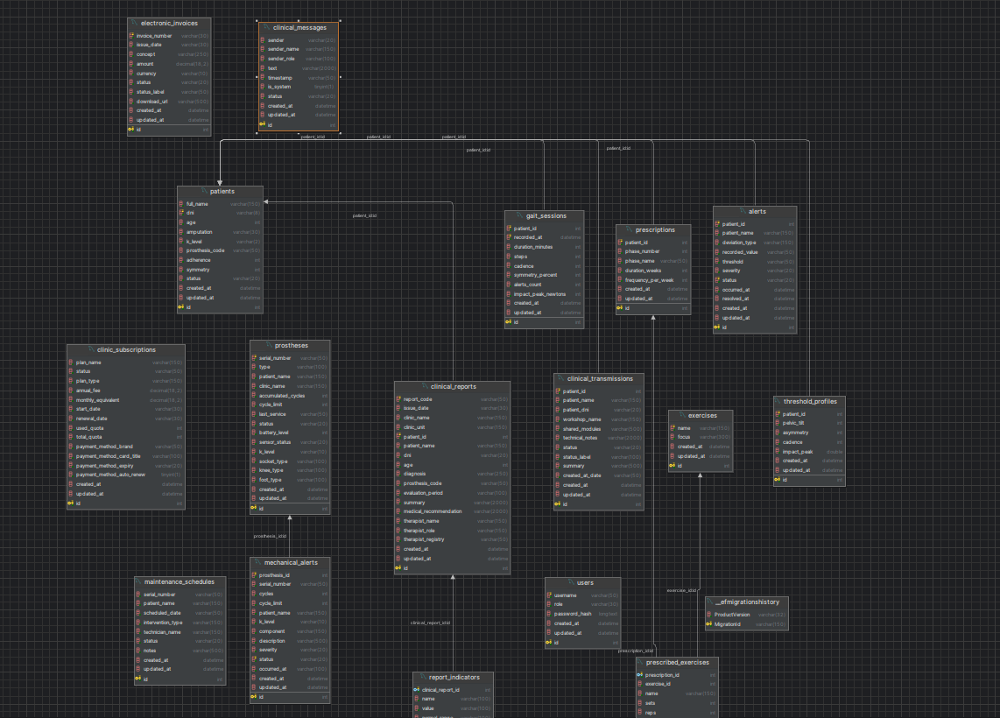

2. **Interfaz interactiva de Scalar / OpenAPI mostrando los 8 Bounded Contexts:**
   
   
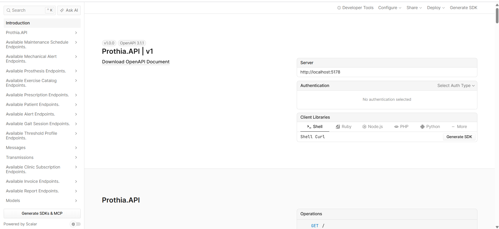

3. **Flujo de Autenticación JWT (IAM) e integración en la Web Application:**
   

#### 5.2.3.6. Services Documentation Evidence for Sprint Review

Durante el Sprint 3 se documentaron la totalidad de los endpoints RESTful correspondientes a las **21 Technical Stories** en ASP.NET Core (.NET 10) siguiendo la especificación **OpenAPI** y expuestos a través de la interfaz interactiva de **Scalar**. Se implementaron convenciones globales con URL base `/api/v1`, rutas en `kebab-case`, respuestas en formato JSON (`application/json; charset=utf-8`), estandarización de errores bajo **RFC 9457 (`ProblemDetails`)**, autenticación mediante **HTTP Bearer Token (`Authorization: Bearer <token>`)** y el **inglés como idioma por defecto**.

* **Repositorio de Web Services (Backend):** https://github.com/upc-pre-202620-1asi0730-8155-SeniorsIP/SeniorsInProcess-Prothia-Backend

* **URL de la Documentación Desplegada (Scalar / OpenAPI):**  https://prothia-backend.onrender.com/

* **Commits asociados a Documentación OpenAPI y ProblemDetails:** `d858fa9` (`Shared OpenAPI`), `99b86f3` (`Security Bearer`), `1bfd059` y `898833a` (`Analytics OpenAPI`), `4c11352` y `ac80eec` (`Billing OpenAPI & ProblemDetails`).

| Technical Story ID | Bounded Context / Acción | Verbo HTTP | Sintaxis de Llamada (Ruta) | Parámetros / Payload (Request) | Ejemplo y Explicación del Response | 
| ----- | ----- | ----- | ----- | ----- | ----- | 
| **TS-PAT-001** | **Patients** — Register a New Patient | `POST` | `/api/v1/patients` | Body JSON (`fullName`, `dni`, `age`, `amputation`, `kLevel`, `prosthesisCode` opcional) | **201 Created:** Cabecera `Location: /api/v1/patients/{id}` y `PatientResource`. Si el DNI está duplicado retorna **409 Conflict** / **400 Bad Request** con `ProblemDetails`. | 
| **TS-PAT-002** | **Patients** — Query All Registered Patients | `GET` | `/api/v1/patients` | Ninguno | **200 OK:** Arreglo JSON de objetos `PatientResource` con estado de adherencia, simetría y alertas (lectura *non-tracking*). | 
| **TS-PAT-003** | **Patients** — Query Patient by Identifier | `GET` | `/api/v1/patients/{id}` | Path param: `{id}` | **200 OK:** Objeto `PatientResource`. Si `{id}` no existe retorna **404 Not Found**. | 
| **TS-PRE-001** | **Prescriptions** — Query Exercise Catalog | `GET` | `/api/v1/exercises` | Ninguno | **200 OK:** Arreglo JSON de `ExerciseResource` incluyendo `id`, `name` y `focus`. | 
| **TS-PRE-002** | **Prescriptions** — Create Exercise Prescription | `POST` | `/api/v1/prescriptions` | Body JSON (`patientId`, `phaseNumber`, `phaseName`, `durationWeeks`, `frequencyPerWeek`, `exercises` array) | **201 Created:** Retorna `PrescriptionResource` tras validar existencia del paciente vía ACL. Si `patientId` no existe retorna **404 Not Found**. | 
| **TS-PRE-003** | **Prescriptions** — Get Prescription by Patient ID | `GET` | `/api/v1/prescriptions/patient/{patientId}` | Path param: `{patientId}` | **200 OK:** Retorna el `PrescriptionResource` detallado con el plan de rehabilitación activo del paciente. | 
| **TS-MON-001** | **Monitoring** — Record Telemetry Gait Session | `POST` | `/api/v1/gait-sessions` | Body JSON (`patientId`, `durationMinutes`, `steps`, `cadence`, `symmetryPercent`, `alertsCount`, `impactPeakNewtons`) | **201 Created:** Persiste las métricas telemétricas de la sesión de marcha y retorna `GaitSessionResource`. | 
| **TS-MON-002** | **Monitoring** — Query Clinical Postural Alerts | `GET` | `/api/v1/alerts` | Ninguno | **200 OK:** Arreglo JSON de `AlertResource` (pendientes y resueltas) ordenado por fecha de ocurrencia. | 
| **TS-MON-003** | **Monitoring** — Resolve Postural Alert | `PUT` | `/api/v1/alerts/{id}/resolve` | Path param: `{id}` | **200 OK:** Actualiza el estado de la alerta a `status = 'Resolved'` y registra la marca de tiempo `resolvedAt`. | 
| **TS-MON-004** | **Monitoring** — Calibrate Threshold Profile | `POST` / `PUT` | `/api/v1/threshold-profiles` | Body JSON (`patientId`, `pelvicTilt`, `asymmetry`, `cadence`, `impactPeak`) | **201 Created / 200 OK:** Crea o actualiza el perfil de umbrales biomecánicos basales del paciente. | 
| **TS-WRK-001** | **Workshop** — Register / Associate a Prosthesis | `POST` | `/api/v1/prostheses` | Body JSON (`serialNumber`, `type`, `patientName`, `clinicName`, `kLevel`, `socketType`) | **201 Created:** Registra la prótesis, la vincula al paciente y retorna `ProsthesisResource`. | 
| **TS-WRK-002** | **Workshop** — Schedule Preventive Maintenance | `POST` | `/api/v1/maintenance-schedules` | Body JSON (`serialNumber`, `patientName`, `scheduledDate`, `type`, `workshopName`, `technician`) | **201 Created:** Agenda la inspección preventiva en el calendario del taller y retorna `MaintenanceScheduleResource`. | 
| **TS-WRK-003** | **Workshop** — Mechanical Alert Dispatch & Resolution | `POST` / `PUT` | `/api/v1/mechanical-alerts` `/api/v1/mechanical-alerts/{id}/resolve` | Body JSON de creación o Path param `{id}` para resolución | **201 Created / 200 OK:** Registra una alerta de sobrecarga mecánica o actualiza su estado a resuelto. | 
| **TS-COM-001** | **Communication** — Transmit Clinical File to Workshop | `POST` | `/api/v1/clinical-transmissions` | Body JSON (`patientId`, `patientName`, `patientDni`, `workshopName`, `sharedModules`, `technicalNotes`) | **201 Created:** Retorna `ClinicalTransmissionResource` con `status: 'Transmitted'`. | 
| **TS-COM-002** | **Communication** — Exchange Coordination Messages | `GET` / `POST` | `/api/v1/clinical-messages` | Body JSON en POST (remitente, destinatario, contenido) | **200 OK / 201 Created:** Persiste y retorna los hilos de mensajes clínicos con marcas de tiempo y metadatos del remitente. | 
| **TS-ANA-001** | **Analytics** — Generate and Issue Clinical Report | `POST` | `/api/v1/reports` | Body JSON (`reportCode`, `patientId`, `indicators` array, `diagnosis`, `medicalRecommendation`) | **201 Created:** Valida al paciente vía ACL, persiste el informe biomecánico y retorna `ClinicalReportResource`. | 
| **TS-ANA-002** | **Analytics** — Query Reports by ID or Patient | `GET` | `/api/v1/reports` `/api/v1/reports/{id}` | Path param opcional: `{id}` | **200 OK:** Retorna el listado completo de informes emitidos o el `ClinicalReportResource` específico listo para vista o exportación CSV. | 
| **TS-BIL-001** | **Billing** — Manage Clinic Subscription | `GET` / `PUT` | `/api/v1/clinic-subscriptions` `/api/v1/clinic-subscriptions/{id}` | Path param `{id}` y Body JSON (`plan`, `usedQuota`, `totalQuota`, `fee`) | **200 OK:** Consulta o actualiza el nivel de suscripción institucional y la asignación de cupos retornando `ClinicSubscriptionResource`. | 
| **TS-BIL-002** | **Billing** — Query Electronic Invoices | `GET` | `/api/v1/invoices` | Ninguno | **200 OK:** Retorna un arreglo JSON de `ElectronicInvoiceResource` con el historial de comprobantes electrónicos. | 
| **TS-IAM-001** | **IAM** — User Sign-Up | `POST` | `/api/v1/authentication/sign-up` | Body JSON (`username`, `password`) | **201 Created (o 200 OK):** Crea la cuenta con hash `BCrypt` y retorna `UserResource`. Si el usuario ya existe retorna **409 Conflict**. | 
| **TS-IAM-002** | **IAM** — User Sign-In & Token Issuance | `POST` | `/api/v1/authentication/sign-in` | Body JSON (`username`, `password`) | **200 OK:** Retorna `AuthenticatedUserResource` con el token Bearer JWT firmado. Si las credenciales son inválidas retorna **401 Unauthorized** / **400 Bad Request**. | 

**Capturas de Interacción en Scalar / OpenAPI:**

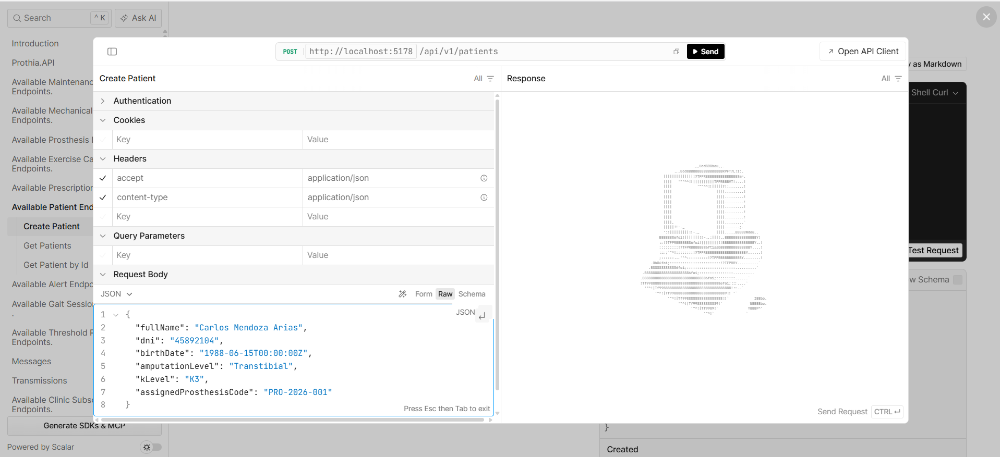

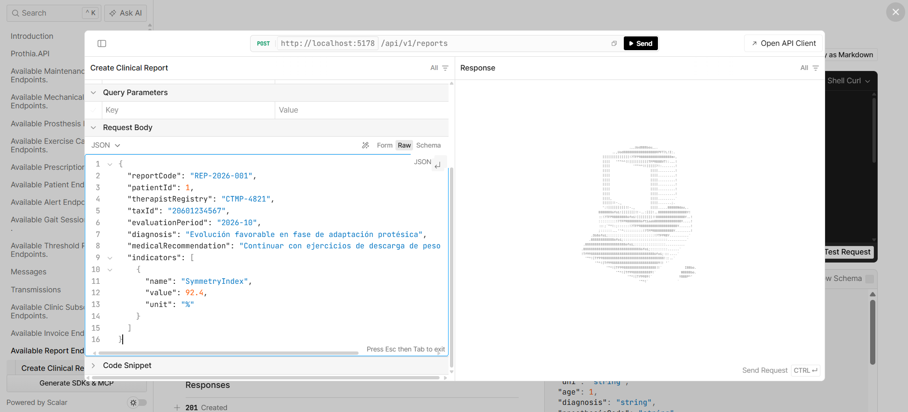

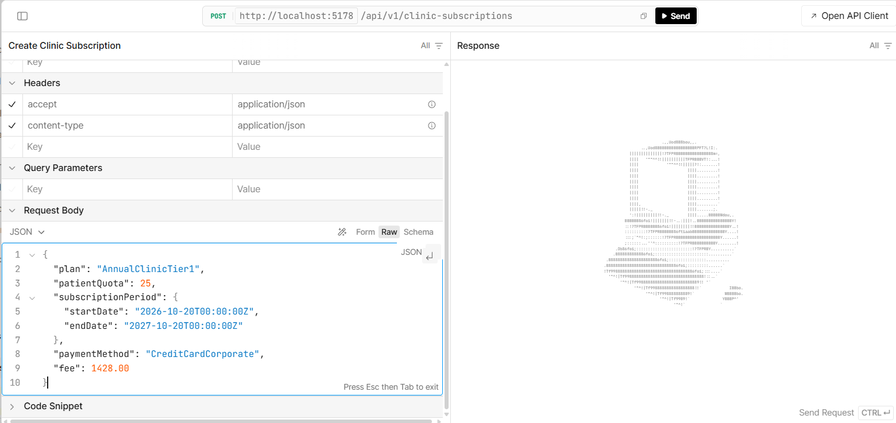

#### 5.2.3.7. Software Deployment Evidence for Sprint Review

En esta iteración se configuró la cadena de conexión hacia **MySQL** (`chore(config): configure MySQL default connection string and project settings` - commit `8cd1e3d`) y se prepararon los artefactos de despliegue para los tres productos de la solución (**Landing Page**, **Frontend Web Application** y **Backend RESTful Web Services**).

1. **Configuración de Base de Datos Relacional (MySQL Workbench & Cloud DBMS):**

   * Se configuró el esquema relacional en **MySQL** empleando Entity Framework Core y convenciones automáticas `snake_case` pluralizadas (`3ad7b85`).

2. **Despliegue del RESTful API (.NET 10 / Scalar):**

   * Se empaquetó el proyecto `Prothia.API` en su versión `0.1.7` (`6dbf9b2`) habilitando la interfaz de documentación **Scalar / OpenAPI**, el soporte de errores **RFC 9457 (`ProblemDetails`)** y las políticas CORS para permitir peticiones desde el dominio de Firebase Hosting.

3. **Actualización del Frontend y Landing Page:**

   * Se actualizaron las variables de entorno en `Prothia-Frontend` para apuntar a la ruta base `/api/v1` del servidor desplegado en lugar del mock local, y se preparó la estructura de incrustación de videos en `Prothia-LandingPage`.

* **Capturas del Proceso de Despliegue (Cloud Provider, MySQL Workbench y Firebase):**
  

#### 5.2.3.8. Team Collaboration Insights during Sprint

Durante el Sprint 3, el desarrollo colaborativo se ejecutó sobre el repositorio `SeniorsInProcess-Prothia-Backend` aplicando rigurosamente **GitFlow** (ramas `feature/project-configuration`, `feature/shared`, `feature/patients`, `feature/prescriptions`, `feature/monitoring`, `feature/analytics`, `feature/billing`, `feature/workshop`, `feature/communication` y `feature/IAM` fusionadas hacia `develop`), **Conventional Commits** y **Semantic Versioning** documentado desde la versión `0.1.0` hasta la `0.1.7` en el archivo `CHANGELOG.md`.

| Integrante | Usuario GitHub (Backend) | Technical Stories Implementadas | Ramas Trabajadas | Resumen de Aportes en el Sprint 3 | 
| ----- | ----- | ----- | ----- | ----- | 
| **Patricio Farias, Ana Camila** | `anc-f4` | `TS-PRE-001`, `TS-PRE-002`, `TS-PRE-003`, `TS-COM-001` | `feature/shared`, `feature/prescriptions`, `feature/communication` | Implementación completa del núcleo transversal **`Shared`** (`BaseRepository`, `UnitOfWork`, interceptores de auditoría, convenciones `snake_case` y `kebab-case`, patrón `Result`, `ProblemDetails`, mediador y configuración OpenAPI/Bearer); desarrollo integral de **`Prescriptions`** y endpoints de transmisión clínica en **`Communication`** (Release `0.1.3` y `0.1.5`). | 
| **Checa Burga, Oscar Diego** | `OscarCheca` | `TS-PAT-001`, `TS-PAT-002`, `TS-PAT-003`, `TS-MON-001`, `TS-MON-002`, `TS-MON-003`, `TS-MON-004` | `feature/project-configuration`, `feature/patients`, `feature/monitoring` | Inicialización de la solución `prothia.sln` y dependencias `.NET 10`; liderazgo en persistencia MySQL y documentación Scalar/OpenAPI; implementación completa de **`Patients`** (agregados, repositorio, fachada ACL, eventos y `PatientsController`) y **`Monitoring`** (sesiones de marcha, umbrales, resolución de alertas y controladores REST - Release `0.1.0` y `0.1.4`). | 
| **Dextre Flores, Leonardo Felix** | `leo-dex45` | `TS-WRK-001`, `TS-WRK-002`, `TS-WRK-003`, `TS-BIL-001`, `TS-BIL-002` | `feature/billing`, `feature/workshop` | Implementación integral de punta a punta de **`Billing`** (`ClinicSubscription`, `ElectronicInvoice`, objetos de valor, repositorios EF Core, ensambladores OpenAPI/`ProblemDetails` y controladores REST - Release `0.1.2`) y **`Workshop`** (`Prosthesis`, `MaintenanceSchedule`, `MechanicalAlert`, persistencia EF Core, resolución de alertas mecánicas y controladores REST - Release `0.1.6`). | 
| **Salcedo Correa, Carlos Mathhew** | `Matthewnhfe` | `TS-ANA-001`, `TS-ANA-002`, `TS-IAM-001`, `TS-IAM-002` | `feature/analytics`, `feature/IAM` | Liderazgo del desarrollo del API, configuración de conexión **MySQL** (`8cd1e3d`) y despliegue; implementación completa de **`Analytics`** (`ClinicalReport`, indicadores CSV, adaptador ACL `ExternalPatientService`, repositorio EF Core, metadatos OpenAPI y `ReportsController` - Release `0.1.1`) y del módulo **`IAM`** (agregado `User`, `BCrypt`, JWT, middleware, fachada ACL y endpoints `sign-up`/`sign-in` - Release `0.1.7`). | 
| **Barrenechea Bustamante, Rafael Andre** | `Rafael1231312331` | `TS-COM-001`, `TS-COM-002` | `feature/communication` | Modelado e implementación de los agregados `Message` y `UserNotification` con auditoría, enumeraciones de error, contratos de repositorio (`IMessageRepository`, `IUserNotificationRepository`), servicios `CommunicationNotificationCommandService` y `QueryService`, e infraestructura REST de mensajería clínica en **`Communication`**. | 

**Capturas de GitHub Insights / Contributors del Sprint 3:**

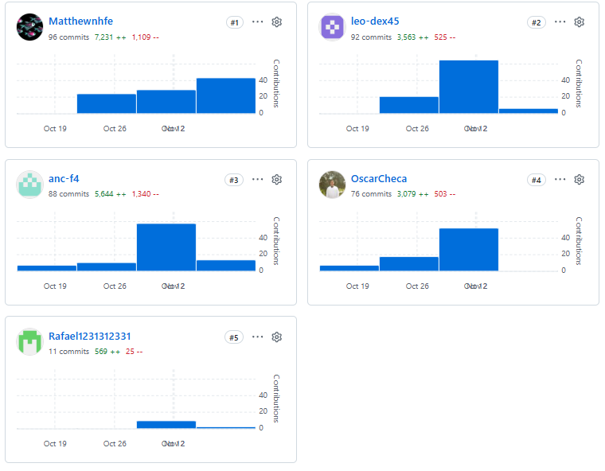

