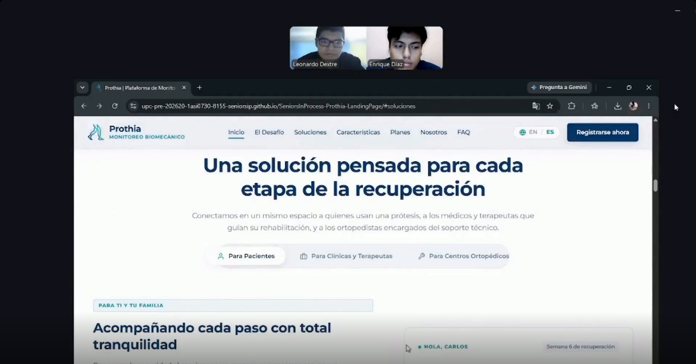
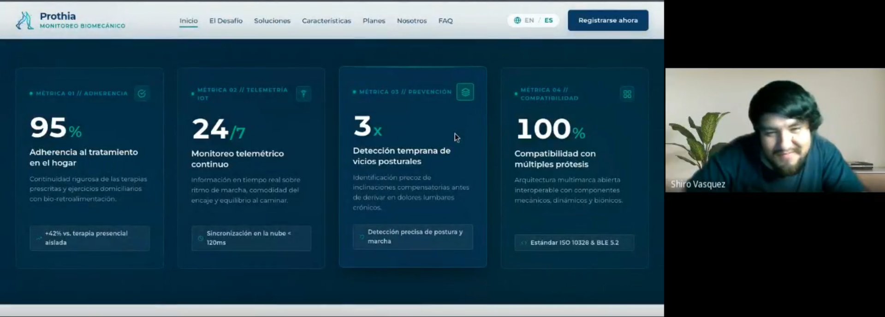
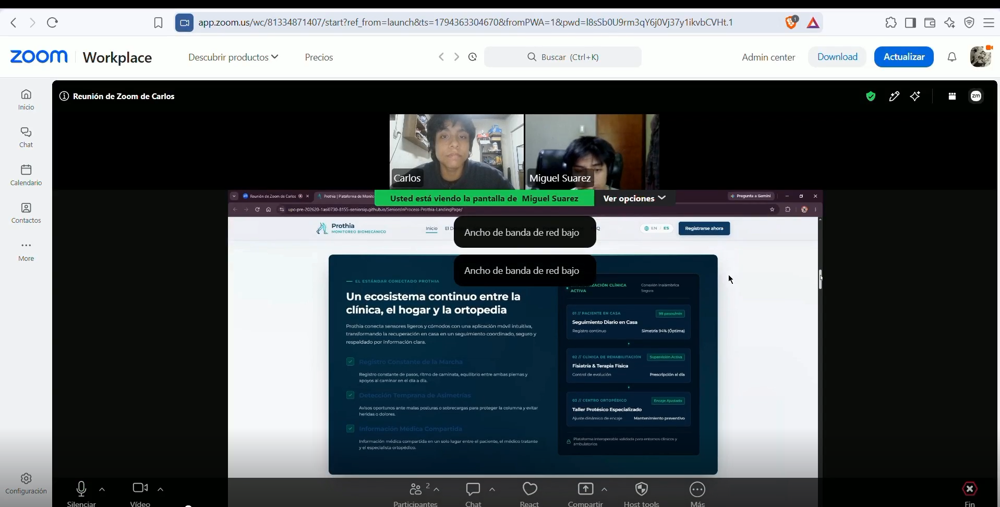
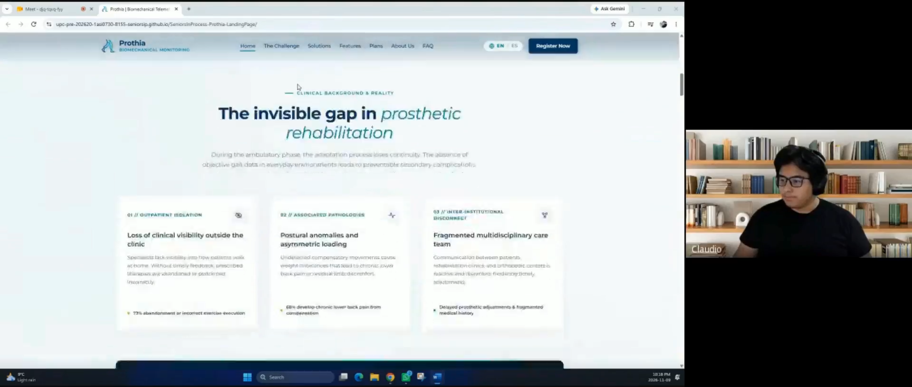
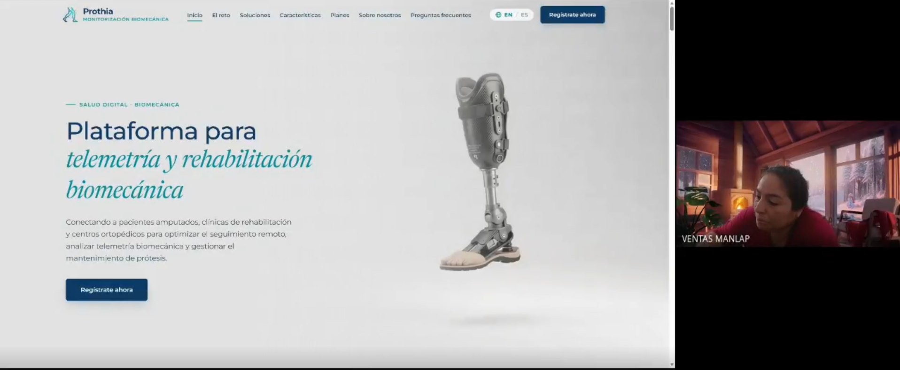
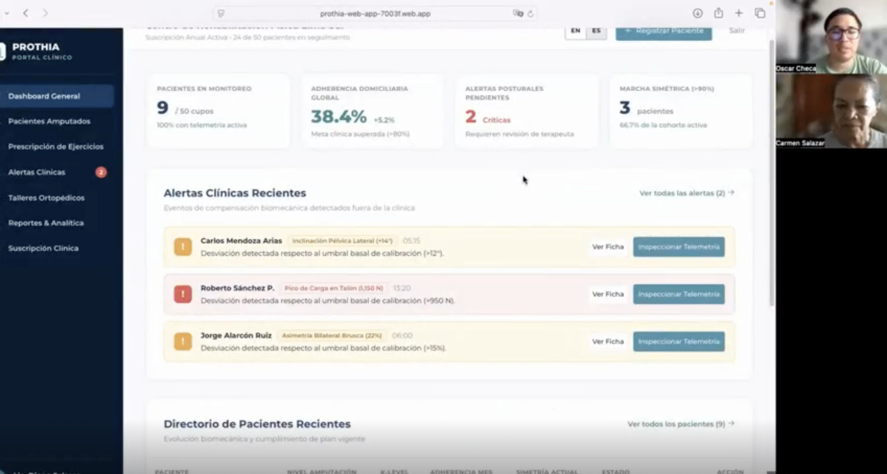
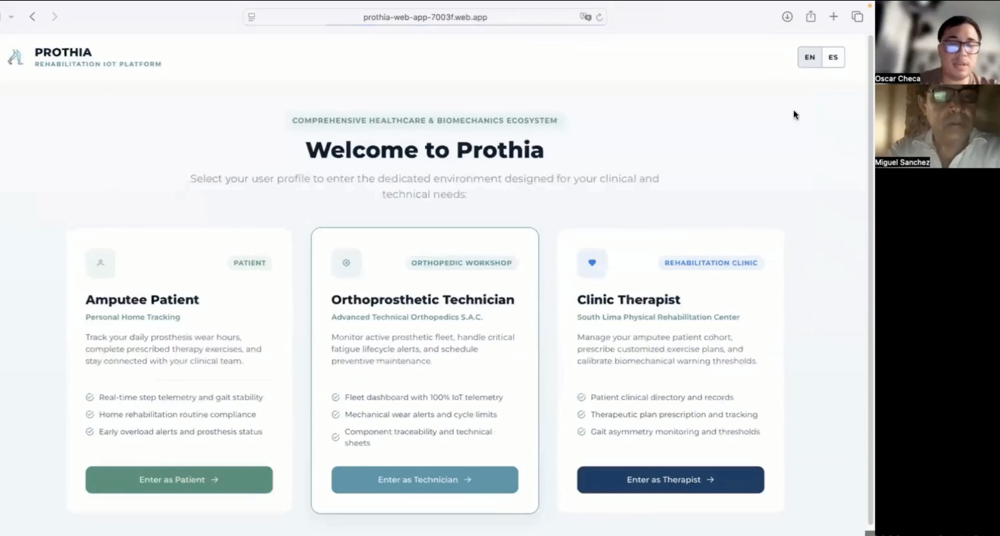
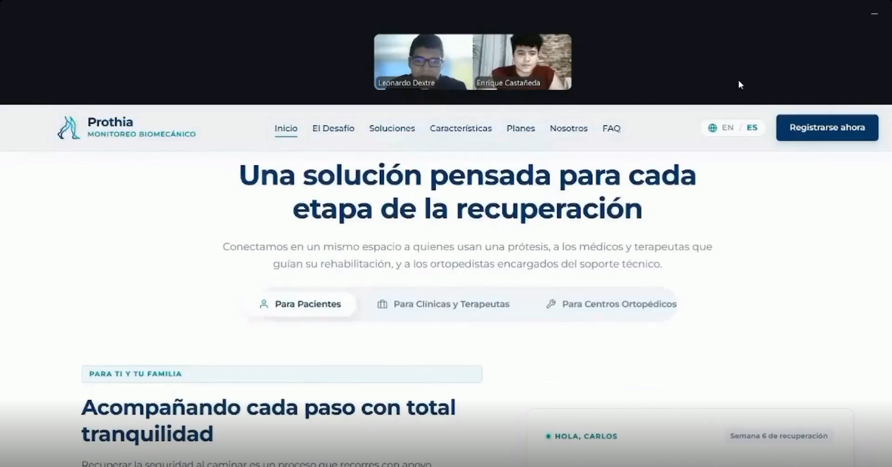
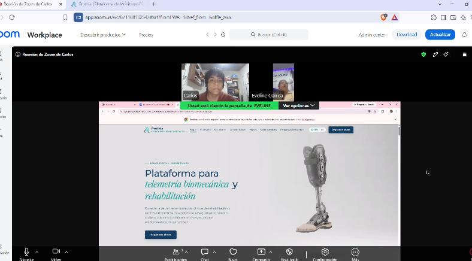

## 5.3. Validation Interviews.

En esta sección, el equipo registra y detalla la metodología y planificación de las entrevistas de validación orientadas a evaluar el grado de usabilidad, adopción y propuesta de valor de los artefactos desarrollados por SeniorsInProcess para la plataforma Prothia. Durante estas sesiones, usuarios representativos de los tres segmentos objetivo interactúan directamente con el Landing Page institucional y con los módulos correspondientes de la Web Application.   

### 5.3.1. Diseño de Entrevistas.

En esta sección el equipo establece por cada segmento objetivo los elementos a incluir en la sesión de validación, incluyendo el Landing Page y las aplicaciones. Aquí se especifica también cuáles serán los user flows de las aplicaciones, que formarán parte del proceso de validación.

**Segmento 1: Pacientes Amputados** 

* Elementos en Landing Page: Propuesta de valor inicial, sección "Para Pacientes", beneficios domiciliarios (monitoreo y biofeedback).

* Módulos en Web Application: Pantalla de "Welcome", panel principal "Mi Día" (indicadores de pasos y equilibrio), sección de rutinas y ejercicios, telemetría de marcha y chat con el fisioterapeuta.

* User Flows Evaluados: Ingreso mediante la tarjeta de perfil "Amputee Patient".Revisión de avance y marcado de rutina como terminada.Revisión y comprensión de gráficas de marcha y alertas.

* Envío de mensajes directos al terapeuta tratante.

**Segmento 2: Profesionales de Fisioterapia y Rehabilitación**

* Elementos en Landing Page: Sección "Para Clínicas", herramientas de prevención de posturas viciosas, comparador de planes y solicitud de prueba.

* Módulos en Web Application: Pantalla de "Welcome", panel principal de pacientes, vistas de alertas críticas (semaforización), ficha de perfil del paciente, módulo de registro de pacientes y editor de planes de ejercicios.

* User Flows Evaluados: Ingreso mediante la tarjeta de perfil "Clinic Therapist". Revisión general de pacientes y priorización basada en alertas. Simulación de registro de pacientes (nivel de amputación y nivel K). Asignación y dosificación de ejercicios mediante menús desplegables.

**Segmento 3: Técnicos Ortoprotesistas**

* Elementos en Landing Page: Sección "Para Ortopedias", propuesta de prevención de roturas, enfoque multimarca y planes de licenciamiento por taller.

* Módulos en Web Application: Pantalla de "Welcome", panel de control de flota activa ("Fleet Dashboard"), alertas de fatiga mecánica, calendario de citas técnicas y ficha técnica de prótesis.

* User Flows Evaluados: Ingreso mediante la tarjeta de perfil "Orthoprosthetic Technician". Revisión de horas acumuladas de dispositivos y capacidad de límite de licencias. Identificación de alertas críticas y agendamiento de revisión preventiva. Simulaciónde registrode intervenciónde mantenimiento y reseteo	de ciclos.

### 5.3.2. Registro	de Entrevistas.

**Segmento 1: Pacientes Amputados**

**Entrevista 1: Enrique Diaz**

Edad: 26 años

Distrito de Residencia: Lima, Perú

Timing de inicio y duración: 0:05 – Duración: 5:13

Enlace: https://shorturl.at/7dKUe

Resumen: Durante la evaluación del Landing Page, Enrique comprendió de inmediato el propósito de la solución gracias a la claridad del mensaje principal y las imágenes de apoyo, destacando que el video demostrativo le brinda confianza al visualizar cómo funcionará el monitoreo remoto con su fisioterapeuta. Respecto a las tareas asignadas en la Web Application, identificó sin dificultad su tarjeta de acceso mediante el ícono de usuario y el botón verde. En la vista "Mi Día", valoró positivamente la visualización de la distribución de peso entre su pierna sana y la prótesis, ya que su principal temor en casa es pisar mal y lesionarse el muñón. Logró marcar su próximo ejercicio como completado de manera intuitiva y comprendió rápidamente la alerta amarilla de "Desviación" en la gráfica de marcha al estar redactada sin tecnicismos médicos complejos. Asimismo, ubicó el panel de chat con su terapeuta (Lic. Diego Salazar) en la zona inferior, comparando su fluidez con WhatsApp. Como oportunidad de mejora, señaló una ligera desorientación inicial al alternar entre las pestañas de telemetría e historial (superada rápidamente gracias al menú superior fijo) y sugirió incorporar un modo oscuro nativo para evitar la fatiga visual nocturna. Calificó la facilidad de uso general con 4.5 / 5.

**Entrevista 2: Juan Ramirez**

Edad: 30 años

Distrito de Residencia: San Miguel, Lima, Perú

Timing de inicio y duración: 0:01 – Duración: 11:44

Enlace: https://tinyurl.com/5ytcjw7c

Resumen: Desde su perfil técnico como desarrollador, Juan captó rápidamente el funcionamiento de los sensores de telemetría para el envío de métricas de pasos al médico, percibiendo la interfaz del Landing Page como limpia, profesional y orientada al ámbito clínico. Resaltó la utilidad del monitoreo automatizado en casa, comentando que anteriormente debía grabarse con su teléfono móvil para detectar irregularidades en su marcha. Al ejecutar las tareas en la Web Application, elogió la división clara de roles en la pantalla de bienvenida y la retroalimentación visual inmediata en la vista "Mi Día", especialmente la barra de progreso hacia la meta de 5,000 pasos y su actualización instantánea al completar un ejercicio. En el análisis de marcha, las gráficas de barras le permitieron correlacionar días de menor velocidad con episodios de dolor lumbar. También destacó que el chat con su terapeuta se abra en un panel lateral sin sacarlo de su pantalla principal y valoró el contraste visual entre el verde y el fondo blanco. No experimentó pérdidas durante la navegación, calificó la experiencia con 5 / 5 y recomendó implementar notificaciones push en el dispositivo móvil cuando el especialista responda un mensaje.

**Entrevista 3: Miguel Suarez**

Edad: 25 años

Distrito de Residencia: Lima, Perú

Timing de inicio y duración: 0:05 – Duración: 5:17

Enlace: https://shorturl.at/H9yKC

Resumen: Miguel, usuario con amputación transfemoral, identificó en el Landing Page la conexión tripartita entre paciente, clínica y taller ortopédico, destacando que el sistema de alertas en casa le brinda tranquilidad frente a su miedo constante a sufrir caídas. En las tareas de la Web Application, ingresó sin inconvenientes a través de la tarjeta de paciente y resaltó que el indicador de cumplimiento en "Mi Día" lo motiva a mantener la disciplina con sus rutinas. Al completar un ejercicio, sugirió aumentar ligeramente el tamaño del botón de confirmación para facilitar la interacción táctil en pantallas móviles. En la sección de gráficas de marcha, interpretó de forma inmediata una alerta roja sobre su ritmo como un indicador de caminata lenta o insegura. Valoró mucho la mensajería integrada con el terapeuta para evitar que las consultas se pierdan en aplicaciones externas como WhatsApp, y señaló que, aunque el término "Cadencia" no le era familiar, la unidad complementaria ("pasos/min") hizo que el dato fuera totalmente comprensible. Indicó una leve dificultad inicial para ubicar el menú desplegable en la esquina de la vista móvil, otorgó una puntuación de 4 / 5 y propuso añadir videos cortos demostrativos antes de marcar cada ejercicio como completado.

**Segmento 2: Profesionales de Fisioterapia y Rehabilitación**

**Entrevista 4: Lic. Claudio Coveñas**

Edad: 30 años

Distrito de Residencia: Lima, Perú

Timing de inicio y duración: 0:02 – Duración: 5:53

Enlace: https://tinyurl.com/y75pj2ce

Resumen: Al revisar el Landing Page, el Lic. Claudio afirmó que la propuesta resuelve la "ceguera clínica" que sufren los terapeutas cuando el paciente continúa su rehabilitación fuera del consultorio. Valoró especialmente la funcionalidad de calibración de límites personalizados por paciente, la transparencia en los precios publicados y la visibilidad del botón para solicitar una demostración. Durante las tareas en la Web Application, identificó rápidamente el acceso para especialistas ("Clínica de Rehabilitación") y destacó la eficiencia del panel principal al priorizar "2 Alertas Críticas pendientes", evitando la revisión manual de toda la lista de pacientes. Al inspeccionar la alerta del paciente Carlos Mendoza, consideró muy ágil y preciso el detalle clínico ("+14° de Inclinación") para identificar compensaciones posturales. Asimismo, elogió que el formulario de registro solicite únicamente datos relevantes (nivel de amputación y Nivel K) sin sobrecarga administrativa, y que la asignación de rutinas mediante menús desplegables agilice el trabajo frente al registro en papel. Confirmó que la codificación por colores (amarillo y rojo) sigue estándares médicos intuitivos y que el menú lateral izquierdo mantiene una navegación ordenada. Calificó la herramienta con 5 / 5 y sugirió añadir un botón para exportar reportes de alertas específicas en PDF para adjuntarlos a la historia clínica física del hospital.

**Entrevista 5: Lic. Ana Mercedes**

Edad: 38 años

Distrito de Residencia: Lima, Perú

Timing de inicio y duración: 0:02 Duración: 4:05

Enlace: https://tinyurl.com/yy8ktzmd

Resumen: La Lic. Ana Mercedes destacó en el Landing Page el enfoque preventivo frente a las malas posturas y calificó la generación automática de reportes clínicos como un recurso de alto valor que ahorraría horas semanales de redacción. Consideró que el formulario de contacto es clásico, funcional y libre de campos innecesarios. En las tareas de la Web Application, ingresó de inmediato al perfil de terapeuta y resaltó la utilidad de las métricas porcentuales globales del panel para presentar indicadores de gestión a la gerencia de la clínica. Al atender la alerta de un paciente, valoró el acceso directo mediante el botón "Ver Perfil" para evaluar si la anomalía responde a un patrón recurrente o a un evento aislado. Confirmó la ligereza administrativa del registro de pacientes y, en la asignación de rutinas, sugirió complementar los controles deslizantes (sliders) de calibración de inclinación con un campo numérico para ingresar valores exactos. Señaló que la navegación por el menú izquierdo es predecible (aunque recomendó mejorar la representatividad de algunos íconos), calificó la rapidez operativa con 4.5 / 5 y propuso incluir una vista comparativa lado a lado de las gráficas de evolución semanal de un mismo paciente.

**Entrevista 6: Dra. Carmen Salazar**

Edad: 70 años

Distrito de Residencia: Lima, Perú

Timing de inicio y duración: 0:01 – Duración: 3:26

Enlace:https://tinyurl.com/4ev79kkj

Resumen: Desde una perspectiva directiva y médica, la Dra. Carmen Salazar valoró en el Landing Page el respaldo de datos objetivos para sustentar extensiones de tratamiento ante las aseguradoras, así como la claridad de los planes de precios para la planificación del presupuesto anual de su clínica. En las pruebas de la Web Application, destacó la legibilidad de la tipografía, la amplitud del diseño visual y la claridad con la que el panel principal muestra la distribución de pacientes en seguimiento sin saturar la pantalla. Consideró que la revisión de alertas es directa al problema y que el formulario estructurado de registro de pacientes previene errores de transcripción en residentes o terapeutas jóvenes, siendo mucho más seguro que las prescripciones manuales. Confirmó que la paleta de colores de alerta es sobria y autoexplicativa, y que el menú lateral permanente evita cualquier desorientación. Otorgó una calificación de 5 / 5 y solicitó incorporar un filtro de alertas por terapeuta tratante para facilitar la supervisión clínica de su personal.   

Segmento 3: Técnicos Ortoprotesistas

**Entrevista 7: Miguel Sanchez**

Edad: 57 años

Distrito de Residencia: Lima, Perú

Timing de inicio y duración: 0:01  – Duración: 2:45

Enlace: https://tinyurl.com/vfz8jnut

Resumen: Miguel valora enormemente la visibilidad de los ciclos de uso y la telemetría, considerando que transforma el enfoque del mantenimiento. Destaca la ventaja de que el sistema sea multimarca y que las licencias se cobren por taller. Encuentra las alertas de ciclos excedidos muy útiles para programar revisiones oportunas. Como sugerencia, indica que sería de gran ayuda incluir los días restantes de la garantía de fábrica en la ficha técnica de cada pieza.   

**Entrevista 8: Enrique Castañeda**

Edad: 28 años

Distrito de Residencia: Lince, Perú

Enlace: https://shorturl.at/er1pA

Resumen: Enrique Castañeda resaltó en el Landing Page el valor de contar con evidencia objetiva de uso para respaldar diagnósticos frente a fallas de válvulas o piezas por mal uso del paciente, considerando la independencia de marca y la transparencia de precios como ventajas competitivas clave para talleres independientes. Durante la interacción con la Web Application, se ubicó rápidamente mediante el ícono del engranaje y destacó la utilidad del indicador de mantenimientos programados semanales para organizar las herramientas del taller. En la gestión de alertas y citas, elogió la visibilidad del botón rojo de urgencia y la rapidez de carga del calendario, así como el ahorro de tiempo al consultar la ficha técnica digital en lugar de buscar archivadores físicos. Valoró especialmente que, al registrar el reemplazo de una pieza, el contador de horas se reinicie automáticamente a cero. Además, verificó que los botones poseen dimensiones adecuadas para ser operados cómodamente desde tablets en el área de montaje. Calificó la facilidad para programar mantenimientos con 4.5 / 5 y propuso añadir un campo en la ficha técnica para registrar variaciones de volumen del muñón del paciente, dado su impacto directo en el reajuste de encajes.

**Entrevista 9: Eveline Correa**

Edad: 44 años

Distrito de Residencia: La Victoria, Lima, Perú

Timing de inicio y duración: 0:05 – 8:48

Enlace: https://shorturl.at/7Kyft

Resumen: Eveline Correa destacó en el Landing Page que el monitoreo objetivo elimina la incertidumbre sobre el tiempo real de uso que reportan los pacientes, valorando enormemente que la solución sea agnóstica a la marca de la prótesis (a diferencia de softwares propietarios limitados a componentes de gama alta) y que el modelo de cobro sea por taller y no por paciente. En las tareas de la Web Application, aprobó la iconografía técnica de ingreso y resaltó la utilidad de la barra de control de dispositivos conectados frente al límite de su plan en el panel principal. Al revisar las alertas de mantenimiento, valoró la precisión del diagnóstico ("Riesgo de pérdida de fluido") y la rapidez con la que la ficha técnica despliega la información cuando atiende llamadas telefónicas de pacientes. Encontró directo y claro el formulario de registro de cambio de piezas, y enfatizó que las alertas rojas permiten prevenir fallas mecánicas graves en la vía pública. Confirmó que la interfaz aprovecha bien el ancho de pantalla sin saturación visual, calificó la experiencia con 5 / 5 y sugirió habilitar una sección para cargar fotografías del ensamblaje inicial de la prótesis con el fin de realizar comparaciones visuales en los mantenimientos anuales.

### 5.3.3. Evaluaciones según heurísticas.

**UX Heuristics & Principles Evaluation**
*Usability – Inclusive Design – Information Architecture*

* **CARRERA:** Ingeniería de Software
* **CURSO:** Desarrollo de Aplicaciones Web
* **NRC:** 8155
* **PROFESORES:** Todos
* **AUDITOR:** SeniorsInProcess
* **CLIENTE(S):** Enrique Diaz, Juan Ramirez, Miguel Suarez, Lic. Claudio, Lic. Ana Mercedes, Dra. Carmen Salazar, Miguel Sanchez, Enrique Castañeda y Eveline Correa (participantes de las sesiones de evaluación).

**SITE o APP A EVALUAR:** Plataforma de Monitoreo Protésico (Landing Page y aplicación web).

**TAREAS A EVALUAR:**
El alcance de esta evaluación incluye la revisión de la usabilidad de las siguientes tareas:
1. Explorar el Landing Page y entender la propuesta de valor.
2. Ingresar al panel principal a través de la autenticación de usuario.
3. Revisar el estado diario de rutinas, gráficas de marcha y telemetría (Pacientes).
4. Usar la mensajería integrada (Pacientes y Terapeutas).
5. Revisar y gestionar alertas críticas de compensación postural (Terapeutas).
6. Calibrar límites de inclinación y asignar rutinas a pacientes (Terapeutas).
7. Monitorear los ciclos de uso y la flota activa de componentes (Técnicos).
8. Registrar mantenimientos y cambios de piezas en la ficha técnica digital (Técnicos).

No están incluidas en esta versión de la evaluación las siguientes tareas:
1. La configuración inicial y vinculación Bluetooth de los sensores físicos.
2. El portal de pagos y facturación para clínicas y talleres.
3. La gestión de roles administrativos (altas y bajas de personal).
4. Registro de un nuevo usuario.

---

**ESCALA DE SEVERIDAD:**

| Nivel | Descripción |
| :---: | :--- |
| **1** | Problema superficial: puede ser fácilmente superado por el usuario o se presenta con muy poca frecuencia. No necesita corregirse salvo que exista disponibilidad de tiempo. |
| **2** | Problema menor: puede ocurrir con más frecuencia o ser algo más difícil de superar para el usuario. Se le debería asignar una prioridad baja para resolverlo en el siguiente release. |
| **3** | Problema mayor: ocurre frecuentemente o los usuarios no son capaces de resolverlo. Es importante corregirlo y se le debe asignar una prioridad alta. |
| **4** | Problema muy grave: un error de gran impacto que impide al usuario continuar con el uso de la herramienta. Es imperativo corregirlo antes del lanzamiento. |

---

**TABLA RESUMEN:**

| # | Problema | Escala de severidad | Heurística / Principio violada(o) |
| :-: | :--- | :-: | :--- |
| **1** | Los botones para confirmar ejercicios son muy pequeños en la versión móvil | 3 | Inclusive Design: Interacción Táctil y Motora |
| **2** | La interfaz blanca genera fatiga visual en la noche para los pacientes | 2 | Inclusive Design: Legibilidad y Contraste Visual |
| **3** | Los sliders de calibración clínica no permiten ingresar valores numéricos exactos | 2 | Usability: Prevención de errores |
| **4** | No existe una vista comparativa temporal de las gráficas de marcha | 2 | Information Architecture: Is it useful? |
| **5** | Falta un filtro por terapeuta tratante en el panel general de alertas | 2 | Information Architecture: Is it findable? |
| **6** | Ausencia de un campo para registrar variaciones del volumen del muñón | 2 | Information Architecture: Is it useful? |
| **7** | El paciente no recibe notificaciones de nuevos mensajes del terapeuta | 2 | Usability: Visibilidad del estado del sistema |
| **8** | Confusión al alternar entre pestañas de Telemetría e Historial en móviles | 1 | Information Architecture: Sistema de Navegación |

---

**DESCRIPCIÓN DE PROBLEMAS:**

**PROBLEMA #1: Los botones para confirmar ejercicios son muy pequeños en la versión móvil**
* **Severidad:** 3
* **Heurística violada:** Inclusive Design – Interacción Táctil y Motora
* **Problema:** Durante la sesión con Miguel Suarez (segmento de pacientes) se observó que le costaba acertar al botón de "completado" desde la pantalla de su celular. Considerando que los pacientes pueden tener compromisos motores, esto dificulta el flujo principal.
* **Recomendación:** Incrementar el área interactiva de los botones principales a un mínimo de 48x48 píxeles en la versión móvil.

**PROBLEMA #2: La interfaz blanca genera fatiga visual en la noche para los pacientes**
* **Severidad:** 2
* **Heurística violada:** Inclusive Design – Legibilidad y Contraste Visual
* **Problema:** Durante la sesión con Enrique Diaz, comentó que al revisar sus estadísticas de pasos o enviar mensajes en la noche, el fondo blanco de la aplicación le producía fatiga visual.
* **Recomendación:** Implementar un modo oscuro (Dark Mode) que respete las pautas de accesibilidad para contrastes de color.

**PROBLEMA #3: Los sliders de calibración clínica no permiten ingresar valores numéricos exactos**
* **Severidad:** 2
* **Heurística violada:** Usabilidad – Prevención de errores
* **Problema:** La Lic. Ana Mercedes (segmento de terapeutas) indicó que ajustar la inclinación de alerta usando únicamente controles deslizables (sliders) es impreciso y puede llevar a configurar un ángulo incorrecto por error de pulso.
* **Recomendación:** Agregar un campo de texto numérico junto al control deslizante para que el terapeuta pueda escribir el valor exacto (ej. 14°).

**PROBLEMA #4: No existe una vista comparativa temporal de las gráficas de marcha**
* **Severidad:** 2
* **Heurística violada:** Arquitectura de información – Is it useful?
* **Problema:** La Lic. Ana Mercedes señaló que, para evaluar el progreso del paciente, necesita comparar cómo caminaba en la semana 1 frente a la semana 4, pero actualmente debe abrir las gráficas por separado.
* **Recomendación:** Diseñar una vista de comparación "Lado a Lado" que permita visualizar las gráficas de dos semanas distintas en la misma pantalla.

**PROBLEMA #5: Falta un filtro por terapeuta tratante en el panel general de alertas**
* **Severidad:** 2
* **Heurística violada:** Arquitectura de información – Is it findable?
* **Problema:** Durante la sesión con la Dra. Carmen Salazar, indicó que como directora médica necesita auditar el trabajo de su personal, pero el panel muestra todas las alertas mezcladas sin forma de filtrarlas por el terapeuta a cargo.
* **Recomendación:** Agregar un filtro en el Dashboard que permita segmentar la lista de alertas por el especialista asignado al paciente.

**PROBLEMA #6: Ausencia de un campo para registrar variaciones del volumen del muñón**
* **Severidad:** 2
* **Heurística violada:** Arquitectura de información – Is it useful?
* **Problema:** Enrique Castañeda (segmento de técnicos) comentó que al realizar mantenimientos es vital dejar constancia de si el paciente ha subido o bajado de peso (volumen del muñón), ya que esto afecta la garantía y el ajuste, pero no encontró dónde anotarlo.
* **Recomendación:** Incluir un campo de texto para observaciones clínicas estandarizadas dentro del formulario de registro de mantenimiento.

**PROBLEMA #7: El paciente no recibe notificaciones de nuevos mensajes del terapeuta**
* **Severidad:** 2
* **Heurística violada:** Usabilidad – Visibilidad del estado del sistema
* **Problema:** Juan Ramirez (segmento de pacientes) mencionó que podría perderse de indicaciones importantes si su terapeuta le escribe, ya que no tiene forma de enterarse a menos que abra activamente la aplicación.
* **Recomendación:** Enviar una notificación push al dispositivo móvil del paciente cuando reciba un mensaje nuevo en el chat.

**PROBLEMA #8: Confusión al alternar entre pestañas de Telemetría e Historial en móviles**
* **Severidad:** 1
* **Heurística violada:** Arquitectura de información – Sistema de Navegación
* **Problema:** Enrique Diaz experimentó una leve confusión al inicio para cambiar de la vista de sus datos en tiempo real al historial pasado, ya que el menú desplegable estaba poco visible en la versión móvil.
* **Recomendación:** Optimizar la barra de navegación inferior en celulares (bottom tab bar), usando íconos más descriptivos e indicando claramente la pestaña activa.

---

**Aspectos positivos observados**
Los nueve participantes calificaron las herramientas como intuitivas y de alto valor para su día a día. Los pacientes (Enrique, Juan, Miguel) valoraron el lenguaje sencillo sin tecnicismos y la motivación que les genera ver su progreso diario de pasos. Los terapeutas (Claudio, Ana Mercedes, Carmen) destacaron el uso estandarizado de los colores de alerta (amarillo y rojo) que facilita identificar rápidamente los casos críticos. Por su parte, los técnicos ortoprotesistas (Miguel, Enrique, Jose) resaltaron la automatización de la ficha técnica y señalaron que los indicadores de desgaste por "ciclos de vida" se ajustan perfectamente a la realidad mecánica de sus talleres, brindándoles gran confianza en la plataforma.

## 5.4. Video About-the-Product.