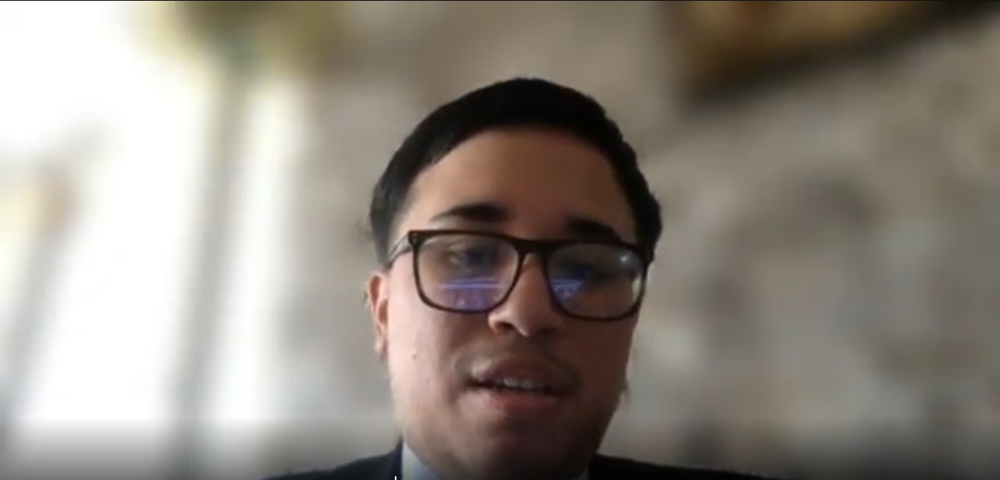

### Recomendaciones

1. Continuar la implementación de Prothia priorizando las funcionalidades que aparecieron con mayor frecuencia e importancia durante el needfinding, especialmente el seguimiento de planes de rehabilitación, visualización de datos biomecánicos, generación de alertas y gestión del mantenimiento preventivo de las prótesis.

2. Implementar en los siguientes sprints la primera versión funcional de la Web Application manteniendo el acceso diferenciado por roles definido en los requisitos y en la arquitectura, de manera que pacientes, profesionales clínicos y técnicos ortopédicos accedan únicamente a la información y funciones correspondientes a sus responsabilidades.

3. Desarrollar progresivamente el RESTful API y la persistencia de datos respetando los Bounded Contexts, componentes, clases y esquemas definidos durante el diseño técnico, evitando introducir dependencias innecesarias entre responsabilidades de dominio.

4. Realizar pruebas de usabilidad con usuarios representativos de los tres segmentos antes de considerar definitivas las interfaces desarrolladas en Figma. Estas pruebas deben permitir comprobar especialmente la facilidad para interpretar dashboards, consultar progreso, identificar alertas y acceder a información relacionada con mantenimiento.

5. Durante las siguientes entregas, ejecutar las entrevistas de validación y evaluaciones heurísticas necesarias para contrastar las Hypothesis Statements y los criterios de éxito definidos durante Lean UX. Los resultados deberán utilizarse para corregir assumptions que no coincidan con el comportamiento observado de los usuarios.

6. Validar progresivamente la forma en que se obtendrán y procesarán los datos biomecánicos, comenzando con datos controlados o simulados cuando sea necesario y posteriormente comprobando la integración con sensores compatibles, debido a que la disponibilidad y precisión de esta información representa una parte esencial de la propuesta de valor de Prothia.

7. Mantener durante el desarrollo las prácticas de control de versiones establecidas para el proyecto, utilizando ramas de trabajo, mensajes de Conventional Commits y versiones identificables para facilitar la revisión de la participación del equipo y la trazabilidad entre requisitos, implementación y entregas.

8. Utilizar la Landing Page desplegada como primer canal para presentar la propuesta de valor y captar interés de clínicas y centros ortopédicos, pero evitar utilizar su publicación como evidencia de validación del producto completo, debido a que las principales funciones de Prothia todavía requieren implementación y evaluación con usuarios reales.

9. Actualizar las conclusiones en cada entrega incorporando únicamente nueva evidencia obtenida durante el desarrollo y la validación. De esta manera, las conclusiones actuales de AV1 podrán contrastarse posteriormente con los resultados de la Web Application, Web Services, entrevistas de validación y versión final del producto.
### Video About-the-Team

En esta sección se presenta el video **About-the-Team** desarrollado por el equipo **SeniorsInProcess**, el cual sintetiza nuestro proceso de trabajo colaborativo a lo largo de los Sprints para la creación de la plataforma **Prothia**.

Durante el ciclo de vida del proyecto, el equipo aplicó el marco de trabajo ágil Scrum, gestionando la planificación y el seguimiento de tareas mediante tableros en **Trello** y manteniendo una comunicación sincrónica constante a través de **Discord** y **Microsoft Teams**. Desde las etapas iniciales de investigación (*Needfinding* y *Lean UX*) y el modelado del dominio mediante *EventStorming* en **Miro**, hasta el diseño de interfaces en **Figma**, la definición de la arquitectura distribuida bajo el **Modelo C4** en **Structurizr** y la implementación del código fuente en **GitHub** (aplicando *GitFlow*, *Conventional Commits* y *Semantic Versioning*), cada integrante asumió un liderazgo técnico distribuido. Esta organización permitió construir y desplegar satisfactoriamente nuestra Landing Page, la aplicación web en **Vue 3 / PrimeVue** y los servicios backend RESTful en **ASP.NET Core (C#)**, cumpliendo con los criterios de liderazgo conjunto, inclusión y efectividad establecidos en el **ABET Student Outcome 5**.

El video incluye una retrospectiva general narrada con evidencias de nuestras sesiones reales de coordinación, seguida por los testimonios individuales ante cámara de cada uno de los cinco integrantes del equipo, quienes detallan sus aportes técnicos, los retos superados y las competencias de ingeniería de software desarrolladas.

#### Pauta de Secuencias de Contenido (Timing)

| Sección del Video | Tiempo de Inicio (`hh:mm:ss`) | Duración Aproximada | Descripción del Contenido |
| :--- | :---: | :---: | :--- |
| **1. Introducción y Presentación de la Startup** | `00:00:00` | 01:00 | Presentación de la startup *SeniorsInProcess*, misión del proyecto *Prothia* y estructura del equipo. |
| **2. Proceso de Investigación y Diseño (Lean UX, DDD & UX/UI)** | `00:01:00` | 02:00 | Retrospectiva de las sesiones de *Needfinding*, *EventStorming* en Miro, arquitectura C4 y prototipado en Figma. |
| **3. Proceso de Implementación, GitFlow y Despliegue por Sprints** | `00:03:00` | 02:00 | Evidencia de sesiones de trabajo en Discord/Teams, gestión de Sprints en Trello, flujo colaborativo en GitHub e integración continua. |
| **4. Testimonio: Ana Camila Patricio Farias** | `00:05:00` | 01:00 | Aportes en Requisitos, configuración base de Vue 3, módulos *Prescription* y *Communication*, y logro del ABET SO5. |
| **5. Testimonio: Oscar Diego Checa Burga** | `00:06:00` | 01:00 | Aportes en Lean UX, infraestructura transversal *Shared*, módulos *Patients* y *Monitoring*, y logro del ABET SO5. |
| **6. Testimonio: Leonardo Felix Dextre Flores** | `00:07:00` | 01:00 | Aportes en EventStorming, arquitectura de diseño, módulos *Workshop* y *Billing*, y logro del ABET SO5. |
| **7. Testimonio: Carlos Matthew Salcedo Correa** | `00:08:00` | 01:00 | Aportes en Landing Page, módulos *Patient-Portal* y *Analytics*, y logro del ABET SO5. |
| **8. Testimonio: Rafael Andre Barrenechea Bustamante** | `00:09:00` | 01:00 | Aportes en SCM, diagramación C4/UML, módulos *IAM* y *Option*, cierre y logro del ABET SO5. |

#### Evidencia y Enlaces de Publicación

* **Duración total del video:** `00:10:00` (Ajustar según edición final)
* **Nombre de archivo reglamentario:** `upc-pre-202620-1asi0730-8155-SeniorsInProcess-about-the-team-sprint-3.mp4`
* **Enlace en Microsoft Stream:** 
* **Enlace en YouTube (Incrustado en el Landing Page):** [Ver Video About-the-Team en YouTube](COLOCAR_URL_YOUTUBE_AQUI)

